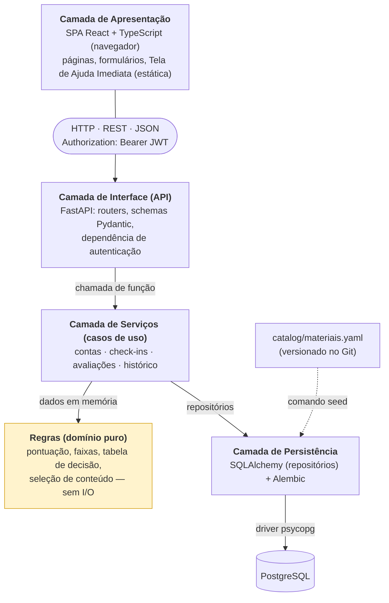
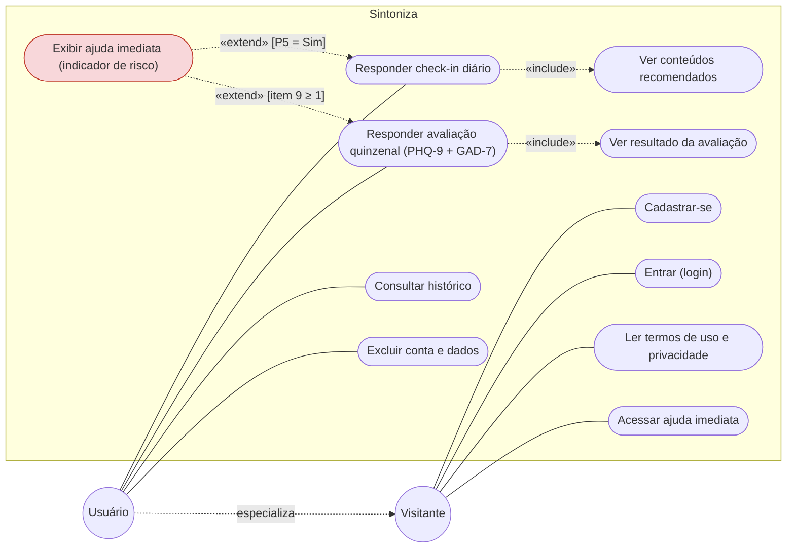
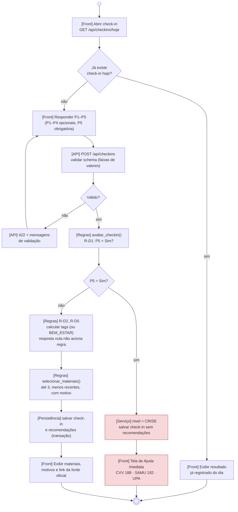
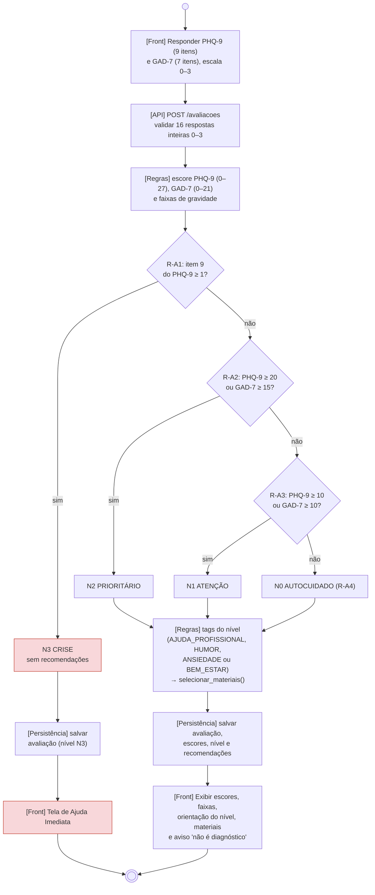
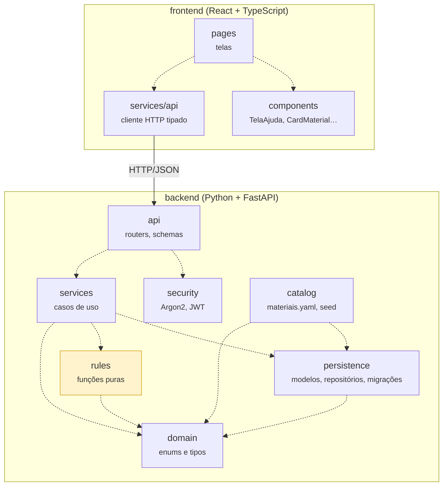
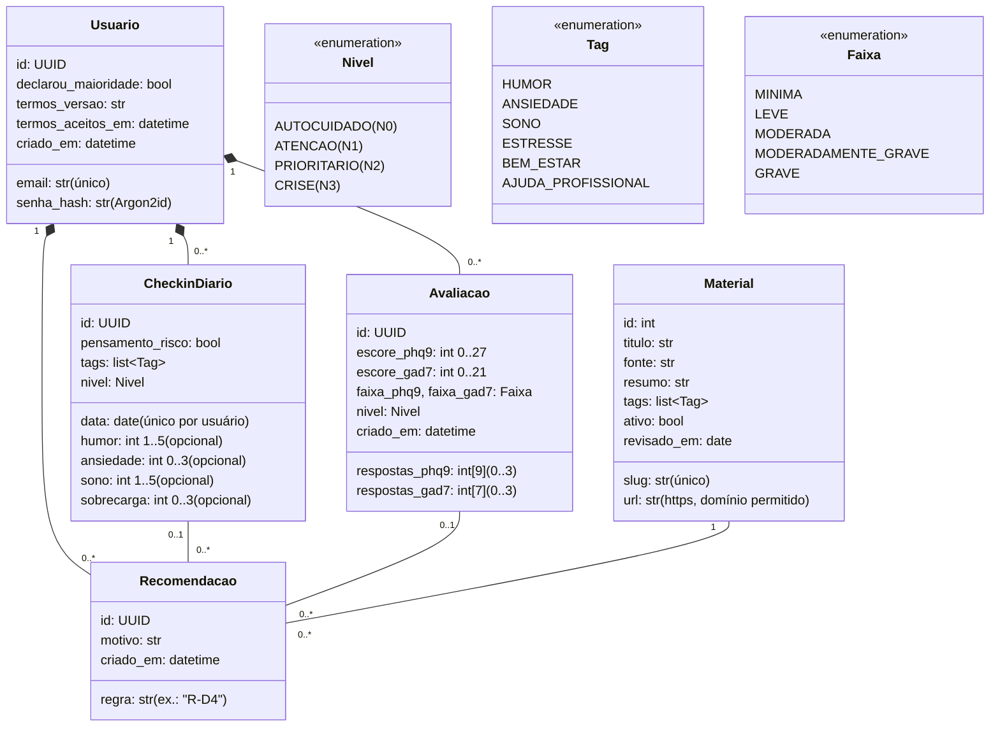
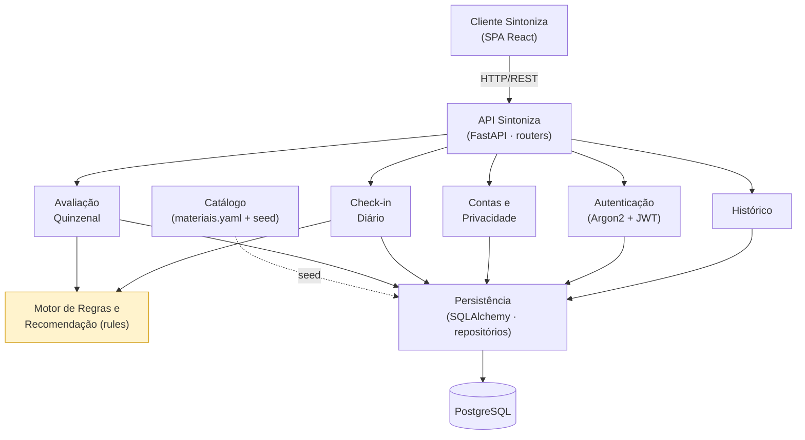
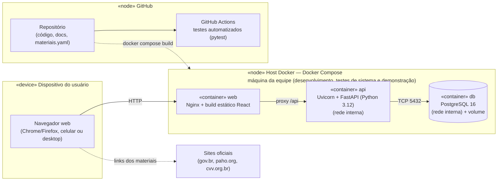

# Documento de Arquitetura

**Versão 2.2 – 29/10/2026**

!!! info "Versão vigente"
    Esta página reproduz a versão 2.2, que substitui as anteriores. O que mudou em cada versão está no [Histórico de versões](historico-versoes.md). Este documento está alinhado à [Visão do Produto e do Projeto v2.2](visao-produto-projeto.md).

## Integrantes do grupo

| Matrícula | Nome | Função (responsabilidade) | Pontos de participação |
| :--: | :-- | :-- | :--: |
| 251026239 | Martin Quadros de Melo | Product Owner | 15 |
| 251012322 | Luiz Felipe Mendes Cordeiro Gomes | Desenvolvedor backend | 14 |
| 231026803 | Carlos Eduardo Pereira Alexandre | Desenvolvedor backend | 14 |
| 251010927 | Júlio Barros de Oliveira | Desenvolvedor frontend | 14 |
| 251040022 | Danilo Menezes Gomez | Desenvolvedor frontend | 14 |
| 251035784 | Vinícius Evangelista Borges Pinto | UX/UI, conteúdo e documentação | 14 |
| 251035274 | Hugo Sousa Rosa | Infraestrutura e qualidade | 15 |
| | | **Total** | **100** |

## Histórico de revisões

| Data | Versão | Descrição | Autor(es) |
| :--: | :--: | :-- | :-- |
| 05/10/2026 | 1.0 | Elaboração inicial do Documento de Arquitetura do Sintoniza, alinhada à Visão do Produto e do Projeto. | Grupo Lamport |
| 07/10/2026 | 1.1 | Revisão conforme feedback: critérios de indicador crítico, fluxo de segurança, cliente web em React, dependências dos pacotes, modelo de classes, visão de implantação e rastreabilidade. | Grupo Lamport |
| 15/10/2026 | 2.0 | Alinhamento à Visão v2.0: remoção dos perfis Administrador e Curador e do componente de administração; módulo de regras como funções puras com contrato documentado; catálogo versionado em arquivo com carga por seed; avaliação quinzenal PHQ-9/GAD-7; dois diagramas de atividades (check-in e avaliação); contrato da API; restrições de segurança verificáveis por testes; Docker Compose como implantação obrigatória. | Grupo Lamport |
| 18/10/2026 | 2.1 | Alinhamento à Visão v2.1: remoção das metas de desempenho, capacidade e cobertura de código, da publicação em nuvem, do verificador automático de links, da auditoria de dependências e da avaliação de utilidade dos materiais; restrições de segurança limitadas ao que é verificado pelos testes TS-01 a TS-05; características de qualidade descritas sem metas numéricas. | Grupo Lamport |
| 29/10/2026 | 2.2 | Alinhamento à Visão v2.2: P1 a P4 do check-in opcionais (nulas quando sem resposta) na Figura 3, na Figura 6 e no contrato de `avaliar_checkin`; retirada do convite para avaliação (R07, R-D7), da função `deve_convidar_avaliacao` e do campo `convite`; regra de nomes das respostas do check-in na API (`p1` a `p5` na entrada e na saída); correção do prefixo `/api` nas rotas da Figura 3. | Grupo Lamport |

---

## 1 Introdução

### 1.1 Propósito

Este documento descreve a arquitetura do Sintoniza, sistema desenvolvido pelo grupo Lamport na disciplina de Métodos de Desenvolvimento de Software (MDS) em 2026, a fim de fornecer uma visão abrangente do sistema para desenvolvedores, testadores e demais interessados. Ele registra as decisões arquiteturais, as tecnologias, as responsabilidades e interfaces de cada elemento, as restrições e o ambiente de implantação. Como na Visão do Produto e do Projeto, **tudo o que está descrito aqui é compromisso de implementação**; o que não será feito está explicitamente marcado como fora do escopo.

### 1.2 Escopo

O detalhamento do escopo encontra-se na [Visão do Produto e do Projeto](visao-produto-projeto.md), versão 2.2 (GRUPO LAMPORT, 2026), seção 4. Em linhas gerais, o MVP compreende: cadastro, autenticação, termos de uso e exclusão de conta; check-in diário com cinco perguntas e recomendação de até três materiais oficiais com explicação; avaliação quinzenal com os instrumentos PHQ-9 e GAD-7 e orientação por nível; Tela de Ajuda Imediata acionada por indicador de risco ou por botão; histórico; e catálogo curado de links oficiais mantido no repositório.

As partes da Visão usadas nas decisões deste documento são citadas explicitamente: a pilha tecnológica (Visão, seção 1.4), as regras de negócio do fluxo principal (Visão, seção 4.5), os requisitos Must (Visão, seção 4.4), as métricas do GQM (Visão, seção 5) e os riscos (Visão, seção 2.5). Ficam fora da arquitetura do MVP: aplicativo móvel nativo, notificações, painel administrativo, inteligência artificial, integração com APIs externas e publicação em nuvem.

## 2 Representação arquitetural

### 2.1 Definições

O sistema seguirá o estilo arquitetural **em camadas** (*layered architecture*), implementado como um **monólito modular** no backend e um **cliente web de página única** (SPA) no frontend, que se comunicam por uma API REST. O backend é uma única unidade de implantação dividida em módulos coesos; a lógica de decisão fica isolada em um módulo de **regras puras**, sem acesso a banco ou rede.

### 2.2 Justificativa

A escolha decorre do que está registrado na Visão do Produto e do Projeto (GRUPO LAMPORT, 2026):

1. **pilha tecnológica** (Visão, seção 1.4): cliente React, API em FastAPI e PostgreSQL se encaixam naturalmente nas camadas de apresentação, interface, serviços e persistência;
2. **regras de negócio explícitas e testáveis** (Visão, seção 4.5 e objetivo secundário 3): o encaminhamento depende de tabelas de decisão com valores-limite. Isolá-las em um módulo de funções puras permite testar cada linha com testes unitários rápidos, sem banco (Visão, métrica M1);
3. **segurança e privacidade** (Visão, requisito R14 e risco R4): autenticação, autorização e isolamento entre usuários ficam concentrados no backend, num único ponto de entrada, em conformidade com a LGPD (BRASIL, 2018);
4. **equipe e prazo** (Visão, seções 2.2 e 2.3): sete estudantes, quatro sprints restantes e pouca experiência com React. Um único código-base de backend e um único banco reduzem a complexidade operacional.

Foram descartados, para o MVP: **microsserviços**, pelo custo de orquestração, comunicação entre serviços e observabilidade, desproporcional ao tamanho da equipe; **aplicativo móvel nativo**, porque um cliente web acessado pelo navegador exige um único código; **integração com APIs externas de conteúdo**, porque as APIs públicas da OMS e do Ministério da Saúde oferecem indicadores estatísticos, e não materiais educativos; e **mecanismos de recomendação por aprendizado de máquina**, por não serem explicáveis nem testáveis no nível exigido.

### 2.3 Detalhamento

A Figura 1 apresenta a arquitetura lógica. O cliente acessa exclusivamente a API, por HTTP e com token JWT. A API valida as entradas, autentica o usuário e delega cada caso de uso à camada de serviços. Os serviços obtêm os dados necessários da persistência, chamam as funções do módulo de regras com esses dados já em memória e gravam o resultado. O PostgreSQL só é acessado pela camada de persistência. O catálogo de materiais é um arquivo versionado no Git, carregado no banco por um comando de *seed*.

**Figura 1 – Arquitetura em camadas do Sintoniza**

O Quadro 3 instancia cada elemento da figura: por que existe, qual sua responsabilidade e quais são as regras de uso de sua interface.

**Quadro 3 – Elementos da arquitetura, responsabilidades e regras de uso das interfaces**

| Elemento | Responsabilidade (por que existe) | Interface e regras de uso |
| :-- | :-- | :-- |
| Apresentação (SPA React) | Telas, navegação, formulários e acessibilidade. Contém a Tela de Ajuda Imediata como conteúdo estático, para funcionar mesmo sem a API. Não contém regras de negócio. | Entrada: ações do usuário. Saída: requisições HTTP/JSON com cabeçalho `Authorization: Bearer <token>`. Nunca acessa o banco. Exibe os textos de orientação recebidos da API. |
| Interface (API FastAPI) | Ponto único de entrada: rotas, validação de esquemas (Pydantic) e autenticação JWT. | Entrada: JSON validado contra esquema; requisição inválida → 422. Saída: JSON e códigos HTTP. Contrato descrito em OpenAPI, gerado automaticamente pelo FastAPI. |
| Serviços (casos de uso) | Orquestram cada caso de uso: cadastro, check-in, avaliação, histórico, exclusão. Garantem que toda consulta seja filtrada pelo usuário autenticado. | Entrada: dados validados e identificador do usuário. Saída: objetos de resultado. Usam regras e persistência; executam a gravação em uma transação. |
| Regras (domínio puro) | Pontuação do PHQ-9 e do GAD-7, faixas, tabela de decisão, regras do check-in e seleção de conteúdo. É o elemento que torna o encaminhamento verificável. | Entrada: valores primitivos e listas em memória. Saída: resultados imutáveis. Sem I/O, sem data/hora do sistema e sem aleatoriedade: mesma entrada, mesma saída (contrato no Quadro 5). |
| Persistência | Modelos SQLAlchemy, repositórios e migrações Alembic. | Entrada: operações dos serviços. Saída: entidades. Único elemento que conhece o PostgreSQL. |
| PostgreSQL | Armazena usuários, check-ins, avaliações, materiais e recomendações. | Acessado somente pela API. |
| Catálogo (`materiais.yaml` + seed) | Fonte versionada dos materiais oficiais, revisada por pull request. | Entrada: arquivo YAML validado (TU-07). Saída: carga na tabela Material; material marcado como inativo deixa de ser recomendado. |

Os conectores são: entre cliente e API, HTTP com JSON (REST); entre API e serviços, e entre serviços e regras, chamadas de função em memória; entre serviços e persistência, chamadas a repositórios; entre persistência e PostgreSQL, conexão pelo driver psycopg.

### 2.4 Metas e restrições arquiteturais

As metas e restrições a seguir decorrem dos requisitos e dos riscos da Visão. Cada uma tem uma forma de verificação:

1. **Regras determinísticas, puras e parametrizadas.** O módulo `rules` não acessa banco, rede, relógio nem gerador aleatório; recebe tudo por parâmetro. Os limites (por exemplo, 10, 15 e 20) ficam em constantes de configuração, e alterá-los exige pull request, atualização de testes e aprovação do PO. *Justificativa:* permitir testar todas as linhas das tabelas (Visão, métrica M1) e evitar encaminhamento errado (risco R3). *Verificação:* testes TU-01 a TU-07;
2. **Rastreabilidade de cada recomendação.** Toda recomendação é gravada com o código da regra e o motivo exibido. *Justificativa:* explicar a sugestão ao usuário. *Verificação:* TI-03 e TI-06;
3. **Ajuda Imediata independente do backend.** A Tela de Ajuda é estática no frontend e acessível sem login. *Justificativa:* risco R1. *Verificação:* TSI-02 e TSI-04;
4. **Interfaces.** API REST com JSON e rotas sob `/api`. Recursos de outro usuário respondem 404, e não 403, para não revelar sua existência. *Justificativa:* contrato único entre frontend e backend, que evoluem em paralelo. *Verificação:* TS-03;
5. **Segurança.** Senhas com Argon2id; JWT assinado com validade de 60 min e segredo lido de variável de ambiente; toda rota privada protegida por dependência de autenticação; consultas sempre filtradas pelo usuário do token. *Justificativa:* dados de saúde são dados pessoais sensíveis (BRASIL, 2018, art. 5º, II). *Verificação:* TS-01 a TS-05;
6. **Padrão de codificação.** Backend em Python seguindo a PEP 8 (VAN ROSSUM; WARSAW; COGHLAN, 2001), verificada pelo Ruff; frontend em TypeScript verificado pelo ESLint. Nomes de pacotes e módulos em inglês (`api`, `services`, `rules`, `persistence`); entidades e campos do domínio em português sem acento (`Usuario`, `CheckinDiario`, `escore_phq9`), por serem termos do negócio; textos da interface em português. *Justificativa:* código uniforme reduz atrito nas revisões.

Não foram definidas metas de desempenho, capacidade, disponibilidade ou compatibilidade com navegadores e tamanhos de tela: o sistema será usado apenas em testes e demonstrações da disciplina, e essas metas exigiriam testes que não fazem parte do escopo (Visão, seção 4.1).

### 2.5 Visões

As visões a seguir comunicam o escopo funcional (visão de uso), as camadas e módulos (visão de organização lógica) e a composição do sistema (visão estrutural). A visão de implantação está na seção 2.6.

#### 2.5.1 Visão de uso

O ator principal é o Usuário, que especializa o Visitante (Figura 2). O Visitante pode cadastrar-se, entrar, ler os termos e acessar a Ajuda Imediata. O Usuário, além disso, responde o check-in diário e a avaliação quinzenal, vê conteúdos e resultados, consulta o histórico e exclui a conta. O caso "Exibir ajuda imediata" estende o check-in e a avaliação quando há indicador de risco. Não há atores administrativos: o catálogo é mantido pela equipe no repositório.

**Figura 2 – Diagrama de casos de uso do Sintoniza**

As funcionalidades mais complexas são o check-in diário e a avaliação quinzenal, detalhadas nos diagramas de atividades das Figuras 3 e 4. Os prefixos entre colchetes indicam o elemento da arquitetura que executa cada atividade.

**Figura 3 – Diagrama de atividades do check-in diário**

**Figura 4 – Diagrama de atividades da avaliação quinzenal**

A arquitetura foi influenciada principalmente pelos requisitos Must de registro do check-in (R05), recomendação explicada (R06), avaliação e resultado (R08, R09), Ajuda Imediata (R10, R11) e proteção de dados (R14). A necessidade de testar as regras isoladamente levou ao módulo de regras puro; a necessidade de impedir acesso cruzado entre usuários levou a concentrar a autorização na API e nos serviços; e a necessidade de oferecer ajuda mesmo em caso de falha levou à Tela de Ajuda estática no cliente.

A experiência da equipe também orientou a escolha, como evidência complementar. O Mapa de Competências da disciplina foi respondido por dois dos sete integrantes (escala de 1 a 5), razão pela qual não foi a base exclusiva da decisão. Nas respostas, Python aparece como a tecnologia de maior familiaridade, seguida de Git/GitHub e desenvolvimento backend; React, SQL, Docker e soluções móveis ainda demandam amadurecimento. Por isso: o backend em FastAPI aproveita a competência mais forte; o monólito modular reduz a curva de aprendizado; o acesso ao banco fica isolado em um único módulo; e o frontend usa React com telas simples, sem bibliotecas de componentes complexas (Visão, risco R7).

#### 2.5.2 Visão de organização lógica

**Quadro 4 – Módulos da organização lógica**

| Módulo | Razão lógica | Comunicação / interface |
| :-- | :-- | :-- |
| `frontend/pages` | Uma tela por caso de uso (login, cadastro, check-in, avaliação, resultado, histórico, termos, ajuda). | Usa `components` e `services/api`. |
| `frontend/components` | Elementos reutilizáveis: BotaoAjuda, TelaAjuda, CardMaterial, PerguntaEscala. | Recebe dados por props; TelaAjuda não depende da API. |
| `frontend/services/api` | Cliente HTTP tipado; injeta o token e trata 401 (volta ao login). | HTTP/JSON com o módulo `api` do backend. |
| `backend/api` | Rotas FastAPI, esquemas Pydantic e dependência de autenticação. | Recebe HTTP; chama `services` e `security`. |
| `backend/security` | Hash e verificação de senha (Argon2id); emissão e validação de JWT. | Funções chamadas pela `api`. |
| `backend/services` | Casos de uso; filtro por usuário em todas as consultas; transações. | Chama `rules` (funções puras) e `persistence` (repositórios). |
| `backend/rules` | Pontuação, faixas, decisão, regras do check-in e seleção de conteúdo. | Funções puras (Quadro 5); depende só de `domain`. |
| `backend/domain` | Enumerações e tipos do negócio: Nivel, Tag, Faixa e objetos de resultado. | Importado pelos demais módulos; não importa nenhum. |
| `backend/persistence` | Modelos SQLAlchemy, repositórios e migrações Alembic. | Chamado por `services` e `catalog`; único a acessar o PostgreSQL. |
| `backend/catalog` | `materiais.yaml`, validação e comando seed. | Usa `persistence` para a carga. |

As dependências de código seguem uma única direção (`pages` → `services/api` → `api` → `services` → `rules`/`persistence` → `domain`), como mostra a Figura 5. O módulo `rules` não depende de `persistence` nem de `api`, o que garante que pode ser testado sem banco e sem servidor. O módulo `domain` não depende de nenhum outro.

**Figura 5 – Diagrama de pacotes da organização lógica**

O Quadro 5 define o contrato das funções do módulo de regras. É por meio dessas funções que **o formulário é ligado ao conteúdo**: os serviços passam as respostas e o histórico; as funções devolvem nível, tags e materiais com o motivo de cada um.

**Quadro 5 – Contrato das funções do módulo de regras**

| Função | Entrada | Saída | Regras (Visão, seção 4.5) |
| :-- | :-- | :-- | :-- |
| `pontuar(respostas, n_itens)` | lista de inteiros 0–3; 9 itens (PHQ-9) ou 7 (GAD-7) | inteiro (soma); `ValueError` se inválida | — |
| `faixa_phq9(escore)` / `faixa_gad7(escore)` | inteiro 0–27 / 0–21 | Faixa | Quadro de faixas |
| `decidir_avaliacao(phq9, gad7)` | listas de respostas do PHQ-9 e do GAD-7 | ResultadoAvaliacao: escores, faixas, nível, tags | R-A1 a R-A4 |
| `avaliar_checkin(p1, p2, p3, p4, p5)` | p1 a p4: inteiros nas faixas do check-in ou nulo (sem resposta); p5: booleano | ResultadoCheckin: nível, tags, regras acionadas | R-D1 a R-D6 |
| `selecionar_materiais(tags, catalogo, ultimas_exibicoes, limite)` | tags; materiais ativos; data da última exibição de cada material ao usuário; limite (3 ou 2) | lista de Sugestao: material_id, regra, motivo | R-S1 a R-S6 |

O Quadro 6 apresenta o contrato da API. Todas as rotas, exceto as marcadas como públicas, exigem token, e o teste TS-01 verifica isso automaticamente para todas as rotas existentes. Nas rotas de check-in, as respostas às perguntas usam os identificadores `p1` a `p5` tanto na entrada quanto na saída; a camada de serviços converte esses identificadores nos campos do domínio (Figura 6).

**Quadro 6 – Contrato da API REST**

| Método e rota | Acesso | Entrada | Saída (sucesso / erros) | Req. |
| :-- | :-- | :-- | :-- | :-- |
| `POST /api/auth/cadastro` | Público | email, senha, aceite_termos, maior_de_idade | 201 / 409 e-mail em uso; 422 inválido | R01 |
| `POST /api/auth/login` | Público | email, senha | 200 token / 401 genérico | R02 |
| `GET /api/me` | Usuário | — | 200 id, email, criado_em | R02 |
| `DELETE /api/me` | Usuário | — | 204 (apaga tudo) | R04 |
| `GET /api/checkins/hoje` | Usuário | — | 200 check-in do dia (p1 a p5, nível, tags) ou 404 | R05 |
| `POST /api/checkins` | Usuário | p1, p2, p3, p4 (inteiro ou nulo), p5 (booleano, obrigatório) | 201 nível, tags, recomendações / 409 já existe; 422 | R05, R06, R10 |
| `GET /api/checkins` | Usuário | limite (≤ 30) | 200 lista do próprio usuário (data, p1 a p5, tags) | R12 |
| `GET /api/checkins/{id}` | Usuário (dono) | — | 200 / 404 se não for do usuário | R12 |
| `POST /api/avaliacoes` | Usuário | phq9[9], gad7[7] | 201 escores, faixas, nível, orientação, recomendações / 422 | R08, R09, R10 |
| `GET /api/avaliacoes` e `GET /api/avaliacoes/{id}` | Usuário (dono) | — | 200 / 404 se não for do usuário | R12 |

#### 2.5.3 Visão estrutural

A estrutura do domínio está na Figura 6. Um Usuario possui, por composição, seus check-ins, avaliações e recomendações: ao excluir a conta, todos são removidos (`ON DELETE CASCADE`), atendendo ao requisito R04. Cada Recomendacao liga um Material a um CheckinDiario ou a uma Avaliacao e guarda a regra e o motivo. Material não pertence a usuário: é carregado do catálogo e, quando retirado, é apenas marcado como inativo, para preservar o histórico. O nível CRISE é registrado no próprio check-in ou avaliação, sem entidade separada e sem recomendações associadas.

**Figura 6 – Diagrama de classes conceitual do Sintoniza**

No banco de dados, três restrições reforçam as regras independentemente do código: unicidade de (`usuario_id`, `data`) em CheckinDiario, que garante um check-in por dia (a data é calculada no fuso `America/Sao_Paulo`); unicidade de `email` e de `slug`; e chaves estrangeiras com exclusão em cascata a partir de Usuario.

Na visão de componentes (Figura 7), o cliente consome a API, que distribui as requisições aos componentes de autenticação, contas, check-in, avaliação e histórico. Check-in e avaliação usam o motor de regras e recomendação. Todo acesso persistente passa pelo componente de persistência. O backend não acessa os sites oficiais: os links dos materiais são abertos pelo navegador do usuário.

**Figura 7 – Diagrama de componentes do Sintoniza**

**Quadro 7 – Componentes do sistema**

| Componente | Responsabilidade | Conecta-se a |
| :-- | :-- | :-- |
| Cliente Sintoniza (SPA React) | Interface do usuário; Tela de Ajuda estática. | API (HTTP/REST). |
| API Sintoniza (FastAPI) | Rotas, validação e autenticação. | Cliente; componentes de negócio. |
| Autenticação | Argon2id e JWT. | API; Persistência. |
| Contas e Privacidade | Cadastro, aceite de termos, maioridade e exclusão de conta. | API; Persistência. |
| Check-in Diário | Registro do check-in e montagem da resposta. | API; Motor de Regras; Persistência. |
| Avaliação Quinzenal | Registro da avaliação e montagem do resultado. | API; Motor de Regras; Persistência. |
| Motor de Regras e Recomendação | Funções puras do Quadro 5. | Chamado por Check-in e Avaliação. |
| Histórico | Consultas do próprio usuário. | API; Persistência. |
| Persistência | Repositórios, transações e migrações. | Componentes de negócio; PostgreSQL; Catálogo. |
| Catálogo | `materiais.yaml`, validação e seed. | Persistência. |

### 2.6 Visão de Implantação

Para desenvolvimento, testes de sistema e demonstração, o software é executado com **Docker Compose** em máquina da equipe, em três contêineres (Figura 8): **web**, com Nginx servindo o build estático do React e encaminhando `/api` para a API; **api**, com Uvicorn executando o FastAPI em Python 3.12; e **db**, com PostgreSQL 16 e volume persistente. Configurações sensíveis (segredo do JWT e senha do banco) são lidas de variáveis de ambiente em arquivo `.env`, que não é versionado.

**Figura 8 – Diagrama de implantação do Sintoniza**

**Infraestrutura.** A escolha de contêineres padroniza o ambiente entre as máquinas da equipe, que possuem sistemas operacionais diferentes, e permite subir os três serviços juntos para a demonstração. A publicação em nuvem não faz parte do escopo do MVP (Visão, seção 4.1).

**Banco de dados.** O PostgreSQL foi escolhido por ser relacional, com consistência transacional e restrições declarativas (UNIQUE e FOREIGN KEY), adequado a dados estruturados como usuários, check-ins, avaliações e recomendações, e por ser gratuito e amplamente documentado. O esquema é versionado por migrações Alembic.

**Integração contínua.** O GitHub Actions executa os testes automatizados (pytest, com um PostgreSQL de teste) a cada pull request; se algum teste falhar, o merge é bloqueado.

### 2.7 Restrições adicionais

**Restrições de negócio.** O Sintoniza é acessível pela internet, mas dados pessoais, check-ins, avaliações e histórico exigem login. O uso é restrito a adultos (declaração de maioridade obrigatória). No contexto da disciplina, o sistema será usado apenas por usuários de teste (integrantes, colegas e avaliadores), com respostas fictícias. O sistema não monitora respostas em tempo real nem contata terceiros.

**Capacidade e desempenho.** Não há requisito de capacidade nem de desempenho: o sistema é usado apenas em testes e demonstrações da disciplina, com poucos usuários simultâneos.

**Características de qualidade relevantes**, cada uma ligada a uma decisão já descrita neste documento:

1. **Confiabilidade do encaminhamento:** regras em funções puras, com ao menos um teste automatizado por linha das tabelas de regras (Visão, métricas M1 e M2);
2. **Segurança e privacidade:** autenticação obrigatória, isolamento entre usuários e hash de senhas, verificados pelos casos TS-01 a TS-05 (Visão, métrica M3), e exclusão total da conta (TI-07);
3. **Usabilidade:** perguntas fechadas, poucas telas e linguagem simples. É acompanhada qualitativamente pelo PO nas revisões de sprint, sem meta numérica;
4. **Manutenibilidade:** módulos com dependências em uma única direção, regras isoladas e padrão de código verificado pelo Ruff e pelo ESLint;
5. **Portabilidade:** execução em contêineres Docker; acesso por navegador web.

**Segurança e perfis.** A autorização segue o princípio do menor privilégio (Quadro 8). Como dados de saúde são dados pessoais sensíveis (BRASIL, 2018, art. 5º, II, e art. 11), o tratamento se baseia em consentimento específico e destacado no cadastro, com finalidade informada nos termos, e o titular pode eliminar seus dados a qualquer momento (art. 18, VI), o que é implementado pela exclusão física da conta.

**Quadro 8 – Perfis de acesso e permissões**

| Perfil | Permissões | Restrições |
| :-- | :-- | :-- |
| Visitante | Cadastrar-se, entrar, ler os termos e acessar a Ajuda Imediata. | Nenhum acesso a dados de usuários. |
| Usuário | Tudo do Visitante, mais: check-in, avaliação, resultados, histórico e excluir a própria conta. | Acessa somente os próprios registros (verificado por TS-03); não altera o catálogo. |
| Equipe mantenedora (fora do sistema) | Alterar o catálogo por pull request revisado pelo PO. | Não é um perfil da aplicação. |

### 2.8 Rastreabilidade com a Visão do Produto e do Projeto

**Quadro 9 – Rastreabilidade entre a Visão do Produto e do Projeto e a arquitetura**

| Requisito da Visão | Decisão arquitetural | Evidência neste documento | Testes |
| :-- | :-- | :-- | :-- |
| R01–R03 Conta e termos | API com Argon2id e JWT; componente Contas e Privacidade. | Quadro 3; Quadro 6; seção 2.4 | TI-01, TI-02, TS-02, TS-05 |
| R04 Exclusão de conta | Composição com `ON DELETE CASCADE` a partir de Usuario. | Figura 6; seção 2.5.3 | TI-07, TSI-05 |
| R05–R06 Check-in e conteúdos | Serviço de check-in + funções `avaliar_checkin` e `selecionar_materiais`. | Figura 3; Quadro 5 | TU-05, TU-06, TI-03, TI-04 |
| R08–R09 Avaliação e resultado | Serviço de avaliação + funções `pontuar`, `faixa_*` e `decidir_avaliacao`. | Figura 4; Quadro 5 | TU-01 a TU-04, TI-06 |
| R10–R11 Ajuda Imediata | Tela estática no cliente; nível CRISE suprime recomendações. | Seção 2.4; Figura 1 | TI-05, TSI-02, TSI-04 |
| R12 Histórico | Consultas filtradas pelo usuário do token. | Quadro 6 | TS-03, TSI-01 |
| R13 Catálogo | Arquivo versionado + comando seed. | Figura 7; Quadro 4 | TU-07 |
| R14 Proteção de dados | Ponto único de entrada, autenticação obrigatória, filtro por usuário, hash de senhas. | Seções 2.4 e 2.7; Quadro 8 | TS-01 a TS-05 |

## 3 Bibliografia

BRASIL. Lei nº 13.709, de 14 de agosto de 2018. Lei Geral de Proteção de Dados Pessoais (LGPD). **Diário Oficial da União**: seção 1, Brasília, DF, 15 ago. 2018.

GRUPO LAMPORT. **Visão do Produto e do Projeto – Sintoniza**: aplicação web de apoio à saúde mental. Versão 2.2. Brasília, DF: Universidade de Brasília, 2026.

SCHWABER, K.; SUTHERLAND, J. **The Scrum Guide**: the definitive guide to Scrum: the rules of the game. [S. l.]: Scrum.org, 2020.

VAN ROSSUM, G.; WARSAW, B.; COGHLAN, A. **PEP 8**: style guide for Python code. [S. l.]: Python Software Foundation, 2001. Disponível em: <https://peps.python.org/pep-0008/>. Acesso em: 15 out. 2026.
