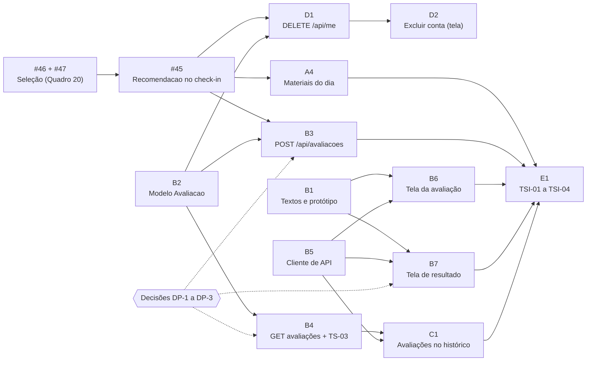

# Sprint 5: Pendências da Sprint 4, avaliação e histórico

**12/11 a 25/11/2026** · Base: [Visão v2.5](../visao-produto-projeto.md) e [Arquitetura v2.4](../arquitetura.md) · Código analisado: `main` no commit `886e00b` (PR #44).

Esta página registra a revisão da Sprint 4 pelo PO, o estado do produto requisito a requisito, as pendências e o backlog proposto para a Sprint 5. O backlog é a base para criar as issues; cada issue deve citar a seção ou o quadro dos documentos de que vem. O que não está nos documentos entra como decisão pendente do PO (seção 4), e não diretamente na issue.

## 1 Revisão da Sprint 4

A conferência do QA está em [Métricas da Sprint 4](../metricas/sprint-4.md). Pelos critérios de aceite, o PO aceita 12 dos 14 itens comprometidos; o Quadro 8 registra 80% (12 de 14 = 85,7%, arredondado para baixo).

| Situação | Issues | Motivo |
| :-- | :-- | :-- |
| Aceitos | #2, #3, #4, #7, #8, #10, #11, #18, #19, #20, #21, #22 | Critérios de aceite atendidos. Na #19, a conferência dos 7 materiais pelo PO passa à Sprint 5. |
| **Rejeitados** | #5, #17 | #5: `POST /api/checkins` não gera nem grava recomendações (TI-03 não atendido, [DEF-01](../metricas/defeitos.md#def-01), #45). #17: seleção de conteúdo diverge do Quadro 20 e TU-06 parcial ([DEF-02](../metricas/defeitos.md#def-02) e [DEF-03](../metricas/defeitos.md#def-03), #46 e #47). |
| Adiantados | #6, #9 | Histórico de check-ins (R12), previsto para a Sprint 5 e entregue na Sprint 4. |

**Replanejamento (Visão v2.5, seção 2.6, critério 1):** o R06 (recomendações do check-in) é Must e não foi entregue; passa à Sprint 5, antes da avaliação, que reutiliza a seleção de conteúdo e a entidade Recomendacao. Não há item Should para retirar; a capacidade vem do histórico de check-ins já entregue.

**Decisão do PO sobre o DEF-02 (Visão v2.5):** vale o Quadro 20. O código e os testes de `selecionar_materiais` se ajustam a R-S2, R-S5 e R-S6 como estão escritas.

### Lições da Sprint 4 (proposta para a retrospectiva)

Os pontos abaixo saem dos dados da conferência do QA e devem ser confirmados ou ajustados pela equipe na retrospectiva.

1. **Duas issues foram fechadas sem cumprir o critério de aceite** (#5 e #17). Proposta: fechar a issue só pelo PR que atende todos os critérios, com o PO marcando a lista de aceite antes do merge (Definição de Pronto, seção 3).
2. **Uma dependência entre issues não foi respeitada:** a #5 foi fechada antes de existir o modelo `Material` (#19). Proposta: registrar "Depende de" em cada issue e não iniciar a integração antes da dependência estar na `main`.
3. **Testes que passam sem verificar o resultado esperado do roteiro** (TI-03 confere só nível e tags). Proposta: cada teste do roteiro cita o ID do caso e confere todos os itens da coluna "Resultado esperado" do Quadro 26.
4. **28% das execuções da CI em PR falharam**, todas corrigidas antes do merge. A CI cumpriu sua função; rodar `pytest` e `npm test` localmente antes do push reduz o retrabalho.

## 2 Estado do produto por requisito

Posição na `main` (`886e00b`). "Regras" indica as funções puras do Quadro 5 da Arquitetura.

| Req. | Nome | Backend | Frontend | Testes do roteiro | Situação |
| :--: | :-- | :-- | :-- | :-- | :--: |
| R01 | Cadastrar usuário | `POST /api/auth/cadastro`, Consentimento | Cadastro com termos e 18+ | TI-01, TS-05 aprovados | Pronto |
| R02 | Autenticar usuário | Login, logout, limite de tentativas | Login e sair | TI-02, TS-02 aprovados | Pronto |
| R03 | Termos de uso | `GET /api/terms` | Página de privacidade | — | Pronto |
| R04 | Excluir conta e dados | **Falta** `DELETE /api/me`; cascata já existe em consentimentos e check-ins | **Falta** | TI-07, TSI-05 não executados | A fazer |
| R05 | Responder check-in | `POST /api/checkins`, `GET /api/checkins/hoje` | Tela do check-in | TI-04 aprovado | Pronto |
| R06 | Receber conteúdos do dia | Regras prontas (`avaliar_checkin`); **falta** Recomendacao, integração de `selecionar_materiais` e ajuste ao Quadro 20 | **Falta** exibir materiais e motivo (hoje volta ao início) | TU-05 aprovado; TU-06 parcial; TI-03 não atendido | A fazer (pendência S4) |
| R08 | Responder avaliação | Regras prontas (`pontuar`); **falta** Avaliacao e `POST /api/avaliacoes` | **Falta** | TU-01 aprovado; TI-06 não executado | A fazer |
| R09 | Ver resultado e orientação | Regras prontas (`faixa_*`, `decidir_avaliacao`) | **Falta** | TU-02 a TU-04 aprovados; TSI-03 não executado | A fazer |
| R10 | Ajuda Imediata por risco | Check-in: nível CRISE gravado; avaliação: **falta** | Check-in com P5 = Sim abre a Tela de Ajuda; avaliação: **falta** | TU-04, TU-05 aprovados; TI-05 parcial | Parcial |
| R11 | Botão "Preciso de ajuda agora" | — | Em todas as páginas | TSI-04 não executado | Pronto (falta o TSI) |
| R12 | Consultar histórico | Check-ins prontos; **falta** `GET /api/avaliacoes` e `GET /api/avaliacoes/{id}` | Check-ins prontos; **falta** avaliações | TS-03 parcial; TSI-01 não executado | Parcial |
| R13 | Catálogo curado | `materiais.yaml` com 7 materiais e seed | — | TU-07 aprovado | Pronto (falta conferência do PO) |
| R14 | Proteção de dados | TS-01, TS-02, TS-04, TS-05 na CI | — | TS-03 parcial (avaliações) | Parcial |

## 3 Pendências

### 3.1 Defeitos abertos (vindos da Sprint 4)

| Issue | Defeito | Severidade | O que falta |
| :--: | :-- | :--: | :-- |
| #45 | DEF-01: check-in sem recomendações | Alta | Recomendacao (modelo, migração, repositório), integração ao serviço, resposta de `POST /api/checkins` e TI-03/TI-05 completos. |
| #46 | DEF-02: seleção diverge do Quadro 20 | Média | Ajustar `selecionar_materiais` a R-S2, R-S5 e R-S6 (decisão do PO de 12/11). |
| #47 | DEF-03: TU-06 incompleto | Média | Testes de inativos, regra e motivo por item e teto de 2 para N2, seguindo o Quadro 20. |

### 3.2 Tarefas do PO

1. Conferir os 7 materiais do catálogo (fonte oficial, link abre, tag adequada) e atualizar o Quadro 21 em nova versão da Visão.
2. Revisar e decidir o PR #25 (protótipo do check-in e do histórico, aberto na `docs` desde a Sprint 4).
3. Registrar a retrospectiva da Sprint 4 (seção 1).
4. Decidir os pontos DP-1 a DP-3 da seção 4 antes das issues que dependem deles.
5. Criar as issues da seção 5 e o quadro da Sprint 5 no GitHub Projects.

### 3.3 Casos do roteiro a fechar na Sprint 5 (Quadro 26)

| Caso | Situação atual | O que é preciso |
| :-- | :-- | :-- |
| TU-06 | Parcial | #46 e #47 |
| TI-03, TI-05 | Não atendido / parcial | #45 |
| TI-06 | Não executado | Avaliação ponta a ponta com os perfis A a E (Quadro 19) |
| TI-07 | Não executado | `DELETE /api/me` |
| TS-03 | Parcial | Parte de avaliações (`GET /api/avaliacoes/{id}`) |
| TSI-01 a TSI-04 | Não executado | Ciclo 1 do roteiro de sistema, no fim da sprint |

## 4 Decisões pendentes do PO

Pontos que os documentos não definem e que afetam issues da Sprint 5. Cada decisão tomada gera nova versão da Visão ou da Arquitetura antes de virar código.

| # | Ponto em aberto | Onde aparece | Bloqueia |
| :--: | :-- | :-- | :-- |
| DP-1 | **Texto do motivo das recomendações da avaliação.** O Quadro 16 define o motivo de cada regra do check-in (R-D2 a R-D6), mas o Quadro 18 não define motivo para as tags geradas por R-A2 a R-A4, e a R-S5 exige um motivo por recomendação. | Visão, Quadros 18 e 20 (R-S5) | `POST /api/avaliacoes` (recomendações) e tela de resultado |
| DP-2 | **O check-in do dia mostra os materiais ao ser reaberto?** A Figura 3 diz "exibir resultado já registrado do dia", mas o Quadro 6 define a saída de `GET /api/checkins/hoje` só com p1 a p5, nível e tags. | Arquitetura, Figura 3 e Quadro 6 | Ajuste de `GET /api/checkins/hoje` e tela do check-in |
| DP-3 | **Saída de `GET /api/avaliacoes/{id}`.** O Quadro 6 indica apenas "200". Sugestão a decidir: os mesmos campos da resposta de `POST /api/avaliacoes`. | Arquitetura, Quadro 6 | `GET /api/avaliacoes/{id}` e tela de resultado a partir do histórico |

## 5 Backlog proposto da Sprint 5

Responsáveis sugeridos conforme os papéis do Quadro 7 da Visão. Os blocos A e B1, B2 e B5 começam na primeira semana; as telas e o roteiro de sistema ficam para a segunda. As issues já existentes (#45, #46 e #47) são reutilizadas.

### Bloco A – Pendências da Sprint 4 (prioridade máxima)

| ID | Issue | Resp. | Depende de | Requisitos e testes | Base nos documentos |
| :--: | :-- | :--: | :--: | :-- | :-- |
| #46 + #47 | [Backend] Seleção de conteúdo conforme o Quadro 20 e TU-06 completo | Luiz Felipe | — | R06, R09; TU-06; M1 = 100% | Visão, Quadro 20; Arquitetura, Quadro 5; DEF-02, DEF-03 |
| #45 | [Backend] Recomendacao e recomendações no `POST /api/checkins` | Luiz Felipe | #46 | R06, R10; TI-03, TI-05 | Visão, R06 e seção 4.5.3; Arquitetura, Figuras 3 e 6, Quadro 6; DEF-01 |
| A4 | [Frontend] Materiais do dia com motivo após o check-in | Júlio | contrato da #45 (pode usar mock) | R06; prepara TSI-01 | Visão, R06 (título, fonte, resumo, link e motivo) e R-S5 ("Por que estou vendo isto?") |

### Bloco B – Avaliação quinzenal (R08, R09, R10)

| ID | Issue | Resp. | Depende de | Requisitos e testes | Base nos documentos |
| :--: | :-- | :--: | :--: | :-- | :-- |
| B1 | [Conteúdo/UX] Textos oficiais do PHQ-9 e do GAD-7 em português do Brasil e protótipo das telas de avaliação e resultado | Vinícius | — | R08, R09 | Visão, seção 4.5.2 (PHQ SCREENERS, 2026) e Quadro 18 |
| B2 | [Backend] Modelo de dados e migração da Avaliacao | Carlos Eduardo | — | R08, R04 (cascata) | Arquitetura, Figura 6 e seção 2.5.3 |
| B3 | [Backend] `POST /api/avaliacoes`: escores, faixas, nível, orientação e recomendações | Luiz Felipe | #45, B2, DP-1 | R08, R09, R10; TI-06 (perfis A a E) | Visão, Quadros 17 a 20; Arquitetura, Figura 4 e Quadro 6 |
| B4 | [Backend] `GET /api/avaliacoes` e `GET /api/avaliacoes/{id}` e parte de avaliações do TS-03 | Carlos Eduardo | B2, DP-3 | R12, R14; TS-03 | Visão, R12; Arquitetura, Quadro 6 |
| B5 | [Frontend] Cliente de API e tipos para avaliações | Danilo | contrato do Quadro 6 | R08, R09, R12 | Arquitetura, Quadro 6 |
| B6 | [Frontend] Tela da avaliação quinzenal | Júlio | B1, B5 | R08, R10; prepara TSI-03 | Visão, seção 4.5.2 (16 itens 0–3, aviso das duas semanas, item 9 ≥ 1 abre a Tela de Ajuda) |
| B7 | [Frontend] Tela de resultado da avaliação | Júlio | B1, B5, DP-1 | R09; prepara TSI-03 | Visão, R09 e Quadro 18 (escores, faixas, orientação, materiais, aviso "não é diagnóstico") |

### Bloco C – Histórico (R12)

| ID | Issue | Resp. | Depende de | Requisitos e testes | Base nos documentos |
| :--: | :-- | :--: | :--: | :-- | :-- |
| C1 | [Frontend] Avaliações no histórico | Danilo | B4, B5 | R12; prepara TSI-01 | Visão, R12 (data, escores, faixas e nível de todas as avaliações) |

### Bloco D – Exclusão de conta (R04)

| ID | Issue | Resp. | Depende de | Requisitos e testes | Base nos documentos |
| :--: | :-- | :--: | :--: | :-- | :-- |
| D1 | [Backend] `DELETE /api/me`: exclusão física da conta e dos dados | Carlos Eduardo | #45, B2 (para o TI-07 cobrir todas as tabelas) | R04, R14; TI-07; TS-02 com exclusão real | Visão, R04; Arquitetura, Quadro 6 e seção 2.5.3 |
| D2 | [Frontend] Excluir conta com confirmação | Danilo | D1 | R04; prepara TSI-05 (Sprint 6) | Visão, R04 |

### Bloco E – Qualidade e gestão

| ID | Issue | Resp. | Depende de | Requisitos e testes | Base nos documentos |
| :--: | :-- | :--: | :--: | :-- | :-- |
| E1 | [QA] Acompanhamento da Sprint 5 e ciclo 1 do roteiro de sistema | Hugo | todas as anteriores (TSI no fim) | M1 a M5; TSI-01 a TSI-04; Quadro 26 | Visão, seções 5 e 6; [Métricas](../metricas/index.md) |
| E2 | [PO] Revisão da Sprint 4, planejamento e decisões da Sprint 5 | Martin | — | — | Visão, seções 2.3 e 2.6; esta página |

### Ordem de execução

## 6 Metas da sprint

| Métrica | Meta da Sprint 5 | Sprint 4 |
| :-- | :--: | :--: |
| M1. Cobertura das tabelas de regras | 100% (16 de 16) | 81,25% |
| M2. Aprovação dos testes automatizados | 100% na `main` | 100% |
| M3. Testes de segurança aprovados | 100% (TS-03 completo) | 80% |
| M4. Conclusão da sprint | ≥ 80% pelos critérios de aceite | 85,7% |
| M5. Defeitos abertos | 0 críticos; #45, #46 e #47 fechadas | 0 críticos; 3 abertos |

## 7 Riscos acompanhados na sprint

| Risco (Visão, Quadro 10) | Por que importa nesta sprint | Ação |
| :-- | :-- | :-- |
| R6. Atraso em itens Must | Sprint com a pendência do R06 e sem item Should para retirar. | Bloco A primeiro; acompanhamento semanal das dependências da seção 5. |
| R3. Erro nas regras | A seleção de conteúdo muda (DEF-02) e passa a ser usada pela avaliação. | TU-06 seguindo o Quadro 20; M1 = 100% antes das telas. |
| R1 e R2. Crise real; resultado lido como diagnóstico | A avaliação introduz o item 9 do PHQ-9 e a exibição de escores. | Item 9 ≥ 1 abre a Tela de Ajuda sem materiais (TI-06, perfil D); aviso "não é diagnóstico" no resultado (TSI-03). |
| R7. Pouca experiência com React | Quatro telas novas ou alteradas no frontend. | Telas simples conforme o protótipo (B1); backend apoia se necessário. |
