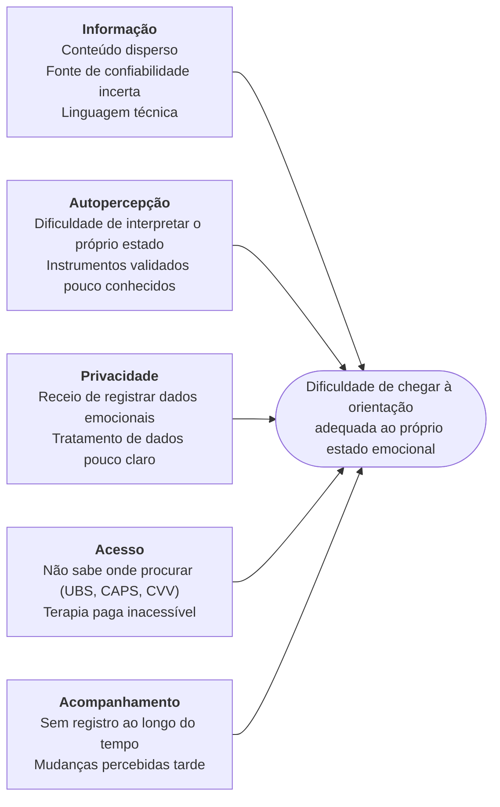
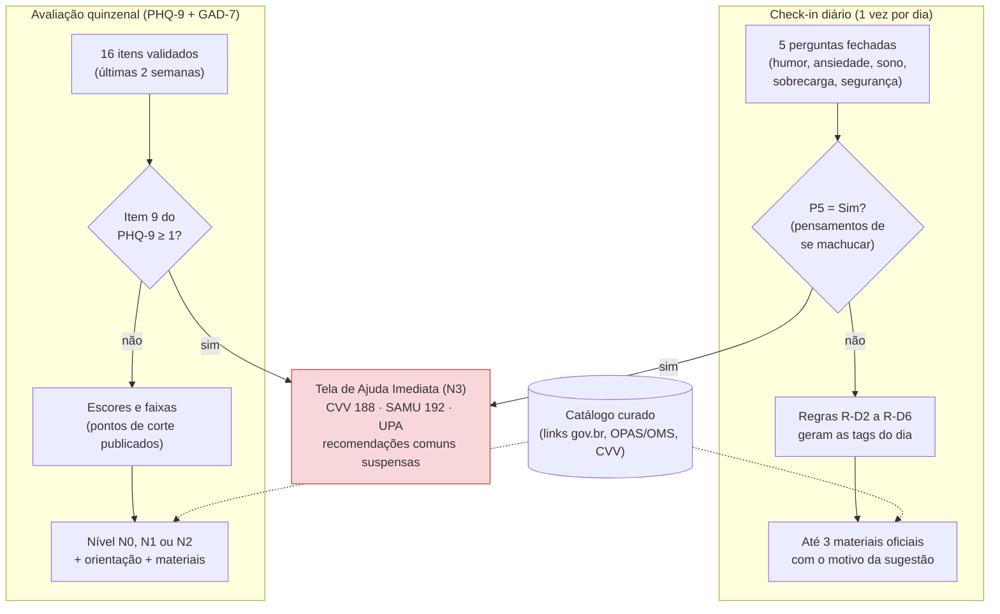
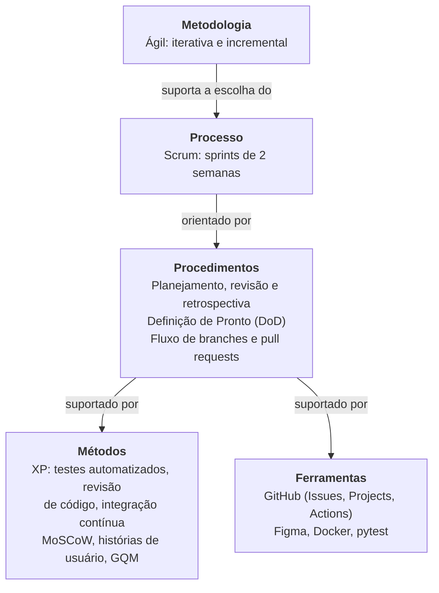
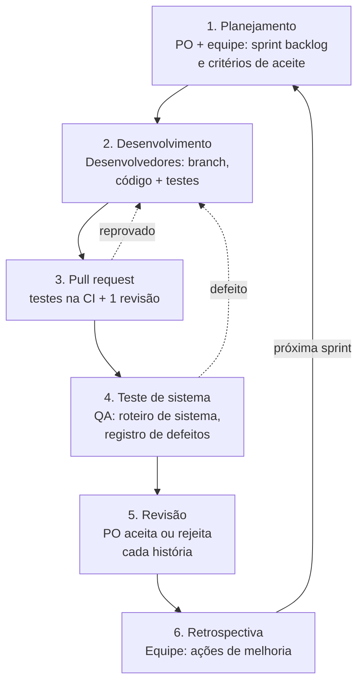

# Visão do Produto e do Projeto

**Versão 2.1 – 18/10/2026** · Aplicação web de apoio à saúde mental: check-in diário, rastreio com instrumentos validados e encaminhamento a conteúdos e serviços oficiais.

!!! info "Versão vigente"
    Esta página reproduz a versão 2.1, que substitui as anteriores. O que mudou em cada versão está no [Histórico de versões](historico-versoes.md).

## Integrantes do grupo

| Matrícula | Nome | Função (responsabilidade) | Pontos de participação |
| :--: | :-- | :-- | :--: |
| 251026239 | Martin Quadros de Melo | Product Owner | 15 |
| 251012322 | Luiz Felipe Mendes Cordeiro Gomes | Desenvolvedor backend | 14 |
| 231026803 | Carlos Eduardo Pereira Alexandre | Desenvolvedor backend | 14 |
| 251010927 | Júlio Barros de Oliveira | Desenvolvedor frontend | 14 |
| 251040022 | Danilo Menezes Gomez | Desenvolvedor frontend | 14 |
| 251035784 | Vinícius Evangelista Borges Pinto | UX/UI, conteúdo e documentação | 14 |
| 251035274 | Hugo Sousa Rosa | Infraestrutura e qualidade | 15 |
| | | **Total** | **100** |

## Histórico de revisões

| Data | Versão | Descrição | Autor |
| :--: | :--: | :-- | :-- |
| 30/09/2026 | 1.0 | Atualização do nome do produto para Sintoniza e definição das responsabilidades iniciais da equipe. | Equipe do projeto |
| 15/10/2026 | 2.0 | Reformulação após o feedback da apresentação: fluxo principal especificado (check-in diário, avaliação quinzenal com PHQ-9 e GAD-7, tabela de decisão, regras de seleção e catálogo curado de fontes oficiais); redução de escopo (remoção dos perfis Administrador e Curador, de lembretes e de IA); estratégia e roteiro de testes detalhados, incluindo testes de vazamento de dados; GQM revisado; replanejamento das sprints 3 a 6. | Grupo Lamport |
| 18/10/2026 | 2.1 | Revisão de escopo para manter apenas compromissos essenciais: remoção dos requisitos não funcionais de interface responsiva, execução com Docker Compose, publicação em nuvem e verificação automática de links; remoção das metas de usabilidade, desempenho, capacidade e cobertura de código e dos testes associados; remoção dos itens Should e Could não essenciais; testes de segurança concentrados em cinco casos; requisitos e roteiro de testes renumerados. | Grupo Lamport |

---

Este documento registra a visão do produto Sintoniza e o planejamento do projeto. A equipe adotou uma regra explícita na sua elaboração: **tudo o que está escrito aqui é compromisso de entrega**. Por isso, o documento descreve apenas o que é necessário ao fluxo principal do produto; o que não será feito está listado como fora do escopo (seção 4.1), e cada funcionalidade tem regras e casos de teste descritos de forma verificável.

## 1 Visão geral do produto

### 1.1 Problema

**Contexto.** Quem busca apoio em saúde mental no Brasil encontra, de um lado, muita informação dispersa na internet, de confiabilidade difícil de avaliar; de outro, uma rede pública estruturada — Unidades Básicas de Saúde (UBS) como porta de entrada, Centros de Atenção Psicossocial (CAPS) na Rede de Atenção Psicossocial (RAPS) e o Centro de Valorização da Vida (CVV, telefone 188) — que muitas pessoas não sabem quando nem como procurar (BRASIL, 2026a; 2026b). Também existem instrumentos curtos e validados para rastrear sintomas de depressão e ansiedade, como o PHQ-9 e o GAD-7, usados inclusive na Pesquisa Nacional de Saúde 2019 (MELO et al., 2023), mas eles são pouco conhecidos fora dos serviços de saúde. O público inicial do produto são adultos, com foco em estudantes universitários, contexto em que a equipe está inserida.

**Problema encontrado.** A dificuldade de transformar a percepção cotidiana do próprio estado emocional em uma orientação adequada e confiável: saber se basta uma prática de autocuidado, se é recomendável procurar um serviço de saúde ou se é preciso ajuda imediata. A questão que orienta o projeto é: *"Como ajudar adultos a acompanhar o próprio estado emocional e a chegar, de forma rápida e segura, a conteúdos oficiais ou a serviços de saúde adequados ao momento?"*

**Quadro 3 – Síntese das causas do problema e resposta do produto**

| Dimensão | Causa observada | Resposta do Sintoniza |
| :-- | :-- | :-- |
| Informação | Conteúdo disperso, linguagem técnica e confiabilidade incerta das fontes. | Catálogo curado apenas com links de fontes oficiais (Ministério da Saúde, OPAS/OMS, CVV), com resumo em linguagem simples. |
| Autopercepção | Dificuldade de interpretar o próprio estado; instrumentos validados pouco conhecidos. | Check-in diário curto e avaliação quinzenal com PHQ-9 e GAD-7, com explicação das faixas e aviso de que não é diagnóstico. |
| Acesso | Não sabe onde procurar ajuda; terapia paga é inacessível para muitos. | Orientação por nível (autocuidado, UBS, atendimento prioritário, ajuda imediata) com canais públicos e gratuitos. |
| Acompanhamento | Ausência de registro ao longo do tempo; mudanças percebidas tarde. | Histórico de check-ins e avaliações; convite para a avaliação após dias seguidos de dificuldade. |
| Privacidade | Receio de registrar dados emocionais; tratamento de dados pouco claro. | Coleta mínima, termo de uso claro, isolamento entre usuários e exclusão total da conta. |

**Figura 1 – Diagrama de Ishikawa das causas do problema**

As cinco causas convergem para o efeito central. Informação e acesso explicam por que a pessoa não chega ao recurso certo; autopercepção e acompanhamento explicam por que ela não sabe qual recurso precisa; privacidade explica por que ela evita registrar o que sente. Por isso o produto combina registro simples, rastreio validado, encaminhamento por regras explícitas e proteção de dados — e não apenas uma lista de conteúdos.

**Solução proposta.** O Sintoniza é uma aplicação web, acessada pelo navegador, com dois formulários e um mecanismo de encaminhamento por regras, mostrados na Figura 2:

1. **Check-in diário:** cinco perguntas fechadas sobre humor, ansiedade, sono, sobrecarga e uma pergunta de segurança. As quatro primeiras são perguntas próprias da equipe, não clínicas, e servem **apenas para escolher conteúdos de autocuidado**. A quinta identifica risco e, se respondida "Sim", leva direto à Tela de Ajuda Imediata;
2. **Avaliação quinzenal:** os instrumentos PHQ-9 (depressão) e GAD-7 (ansiedade), validados no Brasil (SANTOS et al., 2013; MORENO et al., 2016) e de uso livre. Eles perguntam sobre as **últimas duas semanas** e, por isso, não são aplicados diariamente. A pontuação, com os pontos de corte publicados (KROENKE; SPITZER; WILLIAMS, 2001; SPITZER et al., 2006), define o nível de orientação: N0 autocuidado, N1 procurar a UBS, N2 procurar atendimento nos próximos dias ou N3 ajuda imediata;
3. **Encaminhamento a conteúdo:** as respostas geram *tags* (HUMOR, ANSIEDADE, SONO, ESTRESSE, BEM_ESTAR, AJUDA_PROFISSIONAL) e cada material do catálogo possui tags. O sistema seleciona até três materiais compatíveis e mostra o motivo de cada sugestão. As regras completas estão na seção 4.5.

**Figura 2 – Fluxo principal do Sintoniza: do formulário ao conteúdo ou à ajuda imediata**

Duas decisões tornam o fluxo verificável. Primeiro, o vínculo entre formulário e material não depende de interpretação livre: é uma tabela de regras com valores-limite definidos, implementada como funções puras e coberta por testes automatizados (seção 6). Segundo, não há API externa no fluxo: as APIs públicas da OMS e do Ministério da Saúde disponibilizam indicadores estatísticos, não materiais educativos. Os materiais são, portanto, **links para páginas oficiais**, cadastrados em um arquivo versionado no repositório.

**O que o Sintoniza não faz**, e que, por isso, não será cobrado como entrega: não realiza diagnóstico; não substitui psicólogo, psiquiatra ou serviço de urgência; não acompanha respostas em tempo real nem avisa terceiros ou serviços de emergência; não usa inteligência artificial; não cria pontos de corte próprios para os instrumentos clínicos.

### 1.2 Declaração de Posição do Produto

**Qual é o produto?** Uma aplicação web gratuita de apoio à saúde mental que combina registro diário, rastreio periódico validado e encaminhamento explicável a conteúdos oficiais ou a serviços públicos de saúde.

**O que o diferencia?** O Quadro 4 compara alternativas existentes. Plataformas como Vittude e Zenklub focam na contratação de sessões de terapia pagas; diários de humor como o Daylio registram o estado emocional sem encaminhar a recursos; o app Saúde da Apple aplica PHQ-9 e GAD-7 e indica recursos locais, mas está restrito ao ecossistema da Apple (APPLE, 2026). O Sintoniza funciona em qualquer navegador, é gratuito, encaminha especificamente para a rede pública brasileira (UBS, CAPS, CVV, SAMU) e mostra a regra que gerou cada sugestão.

**Quadro 4 – Comparação com alternativas existentes**

| Alternativa | O que oferece | Limitação para o problema |
| :-- | :-- | :-- |
| Vittude, Zenklub | Agendamento de terapia on-line. | Serviço pago; não ajuda a decidir se e quando procurar ajuda. |
| Daylio e diários de humor | Registro diário de humor e atividades. | Sem rastreio validado e sem encaminhamento a recursos. |
| App Saúde (Apple) | PHQ-9 e GAD-7 com nível de risco e recursos locais. | Disponível apenas em dispositivos Apple; sem check-in diário integrado a conteúdo. |
| Busca na internet | Grande volume de conteúdo. | Confiabilidade incerta; não considera o estado do usuário. |

**Quem são os usuários-alvo?** Adultos (18 anos ou mais) que querem acompanhar o próprio bem-estar emocional; no contexto da disciplina, estudantes universitários. São pessoas que usam o celular diariamente, têm pouco tempo e, muitas vezes, não sabem que podem procurar a UBS por questões de saúde mental. **Por que usariam o produto?** Porque recebem uma orientação clara e de fonte confiável, sem custo e sem precisar saber de antemão o que procurar.

**Quadro 5 – Declaração de posição do produto**

| Item | Descrição |
| :-- | :-- |
| **Para:** | Adultos, com foco inicial em estudantes universitários, que desejam acompanhar seu bem-estar emocional. |
| **Necessidade:** | Saber, a partir de como se sentem, se basta autocuidado, se devem procurar um serviço de saúde ou se precisam de ajuda imediata. |
| **O Sintoniza:** | É uma aplicação web de apoio à saúde mental. |
| **Que:** | Transforma respostas de um check-in diário e de uma avaliação quinzenal validada em conteúdos oficiais e orientações de encaminhamento, explicando o motivo de cada sugestão. |
| **Ao contrário de:** | Buscas genéricas na internet ou aplicativos de terapia paga, que exigem saber previamente o que procurar ou ter recursos para pagar; sem o produto, a pessoa tende a adiar a busca de ajuda ou a se basear em fontes pouco confiáveis. |
| **Nosso produto:** | Usa instrumentos validados e regras públicas e testadas, encaminha para a rede pública brasileira e oferece Ajuda Imediata acessível em um clique, inclusive sem login. |

### 1.3 Objetivos do Produto

**Objetivo principal:** entregar, até 09/12/2026, um MVP web que permita ao usuário registrar diariamente como está, responder periodicamente instrumentos validados de rastreio e receber, por regras explícitas e testadas, conteúdos de fontes oficiais ou orientação para procurar atendimento, incluindo ajuda imediata em situações de risco.

Os objetivos secundários detalham o principal e cada um está ligado a requisitos do backlog (seção 4.4) e a métricas (seção 5):

1. recomendar materiais oficiais a partir do check-in diário, por regras explícitas e com o motivo de cada sugestão — requisitos R05 e R06;
2. aplicar PHQ-9 e GAD-7 com pontuação e pontos de corte publicados, sem pontos de corte criados pela equipe — R08 e R09;
3. garantir que todas as linhas das tabelas de regras tenham ao menos um teste automatizado — R06, R09 e R10;
4. manter um catálogo com pelo menos um material de fonte oficial para cada tag — R13;
5. exibir a Ajuda Imediata sempre que houver indicador de risco e a partir de qualquer tela — R10 e R11;
6. tratar os dados conforme a LGPD (BRASIL, 2018): consentimento, isolamento entre usuários e exclusão total — R03, R04 e R14;
7. oferecer histórico simples dos registros do próprio usuário — R12.

### 1.4 Tecnologias a Serem Utilizadas

A escolha prioriza o que a equipe já conhece (Python) e ferramentas gratuitas com documentação ampla; o [Documento de Arquitetura](arquitetura.md) detalha como cada uma é aplicada.

**Quadro 6 – Tecnologias adotadas**

| Área | Tecnologia | Uso no projeto |
| :-- | :-- | :-- |
| Frontend | React 18, TypeScript, Vite, React Router | Aplicação web de página única (SPA). Não haverá app móvel nativo. |
| Backend | Python 3.12, FastAPI, Pydantic v2 | API REST, validação de entrada, autenticação e regras. |
| Persistência | PostgreSQL 16, SQLAlchemy 2, Alembic | Banco relacional, mapeamento objeto-relacional e migrações. |
| Segurança | argon2-cffi (Argon2id), PyJWT | Hash de senhas e tokens de acesso com validade de 60 min. |
| Testes | pytest, httpx | Testes unitários e de integração do backend. |
| Qualidade | Ruff; ESLint | Padrão de código do backend e do frontend. |
| Infraestrutura | Docker, Docker Compose, GitHub Actions | Execução local dos serviços; execução dos testes a cada pull request. |
| Gestão | GitHub (Issues, Projects), Figma | Backlog, quadro Kanban e protótipos. |

## 2 Visão geral do projeto

### 2.1 Ciclo de vida do projeto de desenvolvimento de software

**Figura 3 – Instanciação da metodologia, processo, procedimentos, métodos e ferramentas do projeto**

1. **Metodologia — ágil, iterativa e incremental.** O produto lida com um tema sensível, e as regras e os textos de orientação precisam ser validados com frequência pelo Product Owner e pelo professor. Entregas a cada duas semanas permitem corrigir o rumo cedo, como ocorreu após a apresentação que motivou esta versão;
2. **Processo — Scrum com sprints de duas semanas.** Com sete integrantes e prazo até 09/12/2026, o Scrum dá cadência fixa de planejamento, revisão e retrospectiva e torna o progresso visível para o cliente;
3. **Procedimentos.** Planejamento, revisão e retrospectiva em cada sprint; Definição de Pronto única (seção 3); fluxo de branches e pull requests com revisão obrigatória;
4. **Métodos — práticas do XP e técnicas de engenharia de requisitos.** Testes automatizados escritos junto com o código, com prioridade para o módulo de regras, cujo comportamento já está todo especificado em tabelas; revisão de código; integração contínua; priorização MoSCoW; histórias de usuário; GQM para métricas;
5. **Ferramentas.** GitHub (Issues, Projects e Actions), Figma, Docker e pytest.

A combinação é adequada porque o maior risco técnico do produto é encaminhar o usuário de forma errada. Ao especificar as regras antes (seção 4.5), implementá-las primeiro (Sprint 3) e protegê-las com testes que rodam a cada pull request, a equipe reduz esse risco antes de construir as telas.

### 2.2 Organização do Projeto

As atribuições foram divididas sem hierarquia entre os integrantes. Todos participam do planejamento e das revisões, e todo desenvolvedor escreve os testes do próprio código.

**Quadro 7 – Papéis e responsabilidades**

| Papel | Atribuições | Responsável | Participantes |
| :-- | :-- | :-- | :-- |
| Product Owner (PO) | Priorizar o backlog; validar a tabela de decisão, os textos de orientação e o catálogo; aceitar ou rejeitar histórias na revisão. | Martin | Equipe e cliente |
| Desenvolvedor backend (BE) | Implementar API, módulo de regras, persistência e testes unitários, de integração e de segurança. | Luiz Felipe, Carlos Eduardo | Equipe técnica |
| Desenvolvedor frontend (FE) | Implementar telas, Tela de Ajuda Imediata e integração com a API. | Júlio, Danilo | Equipe técnica |
| UX/UI, conteúdo e documentação (UX) | Protótipos no Figma, textos da interface, curadoria do catálogo com o PO, documentação. | Vinícius | Equipe e PO |
| Infraestrutura e qualidade (QA) | Docker Compose, CI, execução do roteiro de testes de sistema, registro de defeitos e coleta das métricas. | Hugo | Equipe técnica |
| Cliente | Avaliar entregas e dar feedback nas apresentações. | Professor e monitores | Equipe |

### 2.3 Planejamento das Fases e/ou Iterações do Projeto

A partir da Sprint 3 o plano foi refeito para colocar primeiro o que é mais arriscado (regras e catálogo) e deixar o único item Should para depois dos Must. O percentual de conclusão é atualizado ao fim de cada sprint, em intervalos de 10%.

**Quadro 8 – Planejamento das sprints**

| Sprint | Produto (entrega) | Início | Fim | Entregáveis | Resp. | % concl. |
| :--: | :-- | :--: | :--: | :-- | :--: | :--: |
| 1 | Definição do produto | 15/09/2026 | 30/09/2026 | Visão do Produto e do Projeto v1.0; backlog inicial; protótipo de baixa fidelidade. | Todos | 100% |
| 2 | Base do MVP | 01/10/2026 | 14/10/2026 | Documento de Arquitetura v1.1; estrutura dos repositórios; cadastro e login (R01, R02). | BE, FE, QA | [atualizar] |
| 3 | Regras e catálogo | 15/10/2026 | 28/10/2026 | Visão e Arquitetura v2.1; módulo de regras com TU-01 a TU-07; catálogo inicial (R13); termos (R03); Tela de Ajuda e botão (R10 no frontend, R11); CI executando os testes; pendências da Sprint 2. | Todos | 0% |
| 4 | Check-in diário | 29/10/2026 | 11/11/2026 | Check-in completo com conteúdos (R05, R06, R10); TI-03 a TI-05; TS-01 a TS-05. | BE, FE, QA | 0% |
| 5 | Avaliação e histórico | 12/11/2026 | 25/11/2026 | Avaliação quinzenal e resultado (R08, R09); histórico (R12); exclusão de conta (R04); convite (R07, Should); TU-08, TI-06, TI-07; roteiro de sistema, ciclo 1. | BE, FE, QA | 0% |
| 6 | Qualidade e entrega | 26/11/2026 | 09/12/2026 | Correções; ciclo final do roteiro de sistema; atualização dos documentos; demonstração. | Todos | 0% |

Legenda dos responsáveis: PO = Martin Quadros de Melo; BE = Luiz Felipe Mendes Cordeiro Gomes e Carlos Eduardo Pereira Alexandre; FE = Júlio Barros de Oliveira e Danilo Menezes Gomez; UX = Vinícius Evangelista Borges Pinto; QA = Hugo Sousa Rosa. O percentual da Sprint 2 será registrado na revisão dessa sprint.

### 2.4 Matriz de Comunicação

Todos os registros ficam no repositório do GitHub, que é a fonte oficial auditada pelos monitores.

**Quadro 9 – Matriz de comunicação**

| Descrição | Área / envolvidos | Periodicidade | Produtos gerados |
| :-- | :-- | :-- | :-- |
| Acompanhamento das atividades e impedimentos | Equipe | Semanal | Quadro Kanban atualizado; impedimentos registrados nas issues. |
| Planejamento da sprint | Equipe e PO | Início de cada sprint | Sprint backlog no GitHub Projects. |
| Revisão e retrospectiva | Equipe e PO | Fim de cada sprint | Registro das histórias aceitas e rejeitadas e do resultado do roteiro de testes; ações de melhoria. |
| Acompanhamento de riscos, defeitos e métricas | Equipe e QA | A cada sprint (na retrospectiva) | Quadro de riscos atualizado; issues de defeito; métricas GQM. |
| Comunicação da situação do projeto | Equipe, professor e monitores | Conforme calendário da disciplina | Apresentações; documentos versionados no GitHub e no Aprender3. |

### 2.5 Gerenciamento de Riscos

Os riscos são revisados em toda retrospectiva. A exposição combina probabilidade e impacto. Para cada risco há um plano de mitigação, que busca evitar que ele ocorra, e um plano de contingência, aplicado se ele ocorrer.

**Quadro 10 – Gerenciamento de riscos**

| Risco | Exposição | Mitigação | Contingência | Resp. |
| :-- | :--: | :-- | :-- | :--: |
| R1. Usuário em crise real utiliza o app | Alta | Pergunta de segurança diária e item 9 do PHQ-9 acionam a Tela de Ajuda; botão de ajuda acessível sem login; termos informam que não há monitoramento. | Tela de Ajuda já exibida; revisar textos com base nas orientações do CVV e do Ministério da Saúde. | PO, FE |
| R2. Resultado interpretado como diagnóstico | Alta | Aviso "não é diagnóstico" em todo resultado; apenas pontos de corte publicados; textos revisados pelo PO. | Ocultar escores numéricos e manter só a orientação do nível. | PO, UX |
| R3. Erro nas regras gera encaminhamento errado | Alta | Um teste por linha das tabelas de regras, com valores-limite; revisão de código em todo pull request. | Correção imediata; até a correção, exibir só orientação genérica e Ajuda Imediata. | BE, QA |
| R4. Vazamento de dados sensíveis | Média | Testes TS-01 a TS-05 na CI; coleta mínima; uso apenas com usuários de teste. | Trocar a chave de assinatura (invalida todos os tokens), corrigir e registrar o incidente. | BE, QA |
| R5. Links do catálogo quebram ou o conteúdo muda | Média | Somente fontes oficiais; link conferido na inclusão do material; data de revisão por material. | Marcar o material como inativo e substituí-lo na mesma sprint. | UX |
| R6. Atraso em itens Must | Alta | Escopo enxuto; regras na Sprint 3; item Should só após os Must. | Replanejar: retirar primeiro o item Should. | PO |
| R7. Pouca experiência da equipe com React | Alta | Telas simples, sem biblioteca de componentes complexa; apoio entre integrantes quando necessário. | Desenvolvedores backend apoiam o frontend; simplificar telas. | FE |
| R8. Indisponibilidade de integrante | Média | Issues pequenas; todo PR revisado por outra pessoa; conhecimento compartilhado. | Redistribuir tarefas no acompanhamento seguinte. | Equipe |
| R9. Uso por menores de idade | Baixa | Declaração de maioridade obrigatória no cadastro; uso restrito a usuários de teste. | Excluir a conta. | PO |

### 2.6 Critérios de Replanejamento

O replanejamento é acionado quando ocorre qualquer um dos critérios abaixo. Em todos os casos, o PO e a equipe revisam backlog, cronograma, riscos e Definição de Pronto, e a alteração gera nova versão deste documento:

1. um item Must não concluído ao fim da sprint planejada (risco R6) — o item passa à sprint seguinte e o item Should sai do escopo para abrir espaço;
2. um risco de exposição alta se concretiza (R1, R2, R3 ou R4) — as correções passam à frente de qualquer outra tarefa;
3. conclusão abaixo de 80% dos itens comprometidos em duas sprints seguidas (métrica M4) — a capacidade planejada é reduzida;
4. mudança de requisito pedida pelo cliente ou pelo PO após a revisão da sprint.

## 3 Processo de desenvolvimento de software

O processo segue o Scrum (SCHWABER; SUTHERLAND, 2020) com práticas do XP, conforme justificado na seção 2.1. A Figura 4 mostra o fluxo de trabalho de cada item do backlog dentro de uma sprint.

**Figura 4 – Fluxo de trabalho dentro de cada sprint**

1. **Planejamento** (PO e equipe): seleção dos itens priorizados, quebra em issues pequenas e definição dos critérios de aceite;
2. **Desenvolvimento** (desenvolvedores): uma branch por issue; testes automatizados escritos junto com o código;
3. **Pull request** (desenvolvedores e QA): o merge na branch `main` exige que os testes automatizados passem na CI e a revisão de outro integrante;
4. **Teste de sistema** (QA): execução do roteiro de sistema sobre a branch `main`, no ambiente de demonstração; defeitos viram issues com o rótulo `bug`;
5. **Revisão** (PO e equipe): o PO aceita ou rejeita cada história segundo seus critérios de aceite;
6. **Retrospectiva** (equipe): ações de melhoria registradas para a sprint seguinte.

**Definição de Pronto.** Um item só é considerado concluído quando: o código foi revisado por outro integrante; os testes automatizados do item passam na CI; os critérios de aceite foram validados pelo PO; e não há defeito crítico aberto relacionado ao item.

## 4 Declaração de escopo do projeto

### 4.1 Backlog do produto

O backlog foi revisado nas versões 2.0 e 2.1 a partir do feedback da apresentação. As classes de prioridade significam, para este projeto:

- **Must:** necessário para que o fluxo principal funcione com segurança. É compromisso de entrega;
- **Should:** agrega valor e será entregue se todos os Must da sprint estiverem prontos. É declaradamente condicional. Há um único item Should (R07);
- **Could:** não há itens Could nesta versão; ideias sem compromisso de entrega não são registradas no backlog.

**Quadro 11 – Técnicas de elicitação**

| Técnica | Como foi ou será usada | Resultado |
| :-- | :-- | :-- |
| Brainstorming da equipe | Sessões da equipe. | Ideia inicial do produto e cortes de escopo da versão 2.0. |
| Pesquisa documental | Leitura de materiais do Ministério da Saúde, da OPAS/OMS e dos artigos de validação do PHQ-9 e do GAD-7. | Instrumentos, pontos de corte, canais de ajuda e fontes do catálogo. |
| Análise de soluções similares | Comparação com Vittude, Zenklub, Daylio e app Saúde da Apple. | Diferenciais e funcionalidades fora do escopo. |
| Feedback do cliente | Questionamentos do professor na apresentação. | Especificação do fluxo principal e da estratégia de testes. |

!!! warning "Fora do escopo do MVP"
    Não entregue nesta disciplina: aplicativo móvel nativo; notificações ou lembretes; perfis administrativos e painel de curadoria; inteligência artificial; chat ou atendimento por profissionais; contato com terceiros ou com serviços de emergência; localização da UBS ou do CAPS mais próximos; integração com APIs externas; exportação de dados; uso por menores de 18 anos; publicação em nuvem; testes de desempenho, de carga ou de usabilidade com participantes; garantia de compatibilidade com navegadores ou tamanhos de tela específicos.

### 4.2 Perfis

O sistema possui apenas dois perfis de acesso. Os perfis Administrador e Curador da versão 1.0 foram removidos: o catálogo passa a ser mantido pela equipe por meio de pull requests no repositório, o que elimina um painel administrativo inteiro e as regras de permissão associadas.

**Quadro 12 – Perfis de acesso**

| # | Nome do perfil | Características do perfil | Permissões de acesso |
| :--: | :-- | :-- | :-- |
| P01 | Visitante | Pessoa não autenticada. | Páginas públicas: início, cadastro, login, termos de uso e privacidade, e Ajuda Imediata. |
| P02 | Usuário | Adulto cadastrado e autenticado. | Tudo do Visitante, mais: check-in diário, avaliação quinzenal, resultados, histórico e excluir a própria conta. Acessa apenas os próprios dados. |

A equipe mantenedora não é um perfil do sistema: altera o catálogo por pull request revisado pelo PO. Para os dois perfis a elicitação é a mesma (Quadro 11).

### 4.3 Cenários

**Quadro 13 – Cenários funcionais**

| Cenário | Nome do cenário | Sprints |
| :--: | :-- | :--: |
| C01 | Conta e privacidade (cadastro, login, termos, exclusão) | 2, 3, 5 |
| C02 | Check-in diário e conteúdos do dia | 3, 4, 5 |
| C03 | Avaliação quinzenal e resultado | 3, 5 |
| C04 | Ajuda Imediata | 3, 4 |
| C05 | Histórico | 5 |
| C06 | Catálogo de conteúdos oficiais | 3 |
| C07 | Segurança dos dados | 4, 5 |

### 4.4 Tabela de Backlog do produto

Regras R-D, R-A e R-S na seção 4.5; testes na seção 6.2. F = funcional; NF = não funcional.

**Quadro 14 – Backlog do produto**

| Cenário / req. | Sprint | Nome do requisito | Tipo | Prioridade | Descrição sucinta e critério de aceite | História de usuário |
| :-- | :--: | :-- | :--: | :--: | :-- | :-- |
| C01/R01 | 2 | Cadastrar usuário | F | Must | E-mail único, senha com 8 ou mais caracteres, aceite dos termos e declaração de maioridade obrigatórios; senha guardada com Argon2id. Testes: TI-01, TS-05. | Como visitante, quero criar uma conta para registrar como estou. |
| C01/R02 | 2 | Autenticar usuário | F | Must | Login retorna token válido por 60 min; mensagem de erro genérica; sair descarta o token. Testes: TI-02, TS-02. | Como usuário, quero entrar e sair da minha conta com segurança. |
| C01/R03 | 3 | Termos de uso e privacidade | F | Must | Página pública informa dados coletados, finalidade, que não há diagnóstico nem monitoramento e como excluir a conta. | Como visitante, quero saber como meus dados serão usados antes de me cadastrar. |
| C01/R04 | 5 | Excluir conta e dados | F | Must | Após confirmação, remove usuário, check-ins, avaliações e recomendações (exclusão física). Testes: TI-07, TSI-05. | Como usuário, quero apagar todos os meus dados. |
| C02/R05 | 4 | Responder check-in diário | F | Must | Perguntas P1 a P5 (Quadro 15); P5 obrigatória; um check-in por dia. Testes: TI-03, TI-04. | Como usuário, quero registrar como estou hoje. |
| C02/R06 | 4 | Receber conteúdos do dia | F | Must | Aplica R-D2 a R-D6 e R-S1 a R-S5; exibe até 3 materiais com título, fonte, resumo, link e motivo. Testes: TU-05, TU-06, TI-03. | Como usuário, quero receber materiais oficiais ligados ao que respondi e entender por quê. |
| C02/R07 | 5 | Convite para avaliação | F | Should | Aplica R-D7. Teste: TU-08. | Como usuário, quero ser convidado a fazer a avaliação quando tiver dias difíceis seguidos. |
| C03/R08 | 5 | Responder avaliação quinzenal | F | Must | PHQ-9 e GAD-7 com texto oficial em português do Brasil; 16 respostas obrigatórias, de 0 a 3. Testes: TU-01, TI-06. | Como usuário, quero responder um questionário validado sobre as últimas duas semanas. |
| C03/R09 | 5 | Ver resultado e orientação | F | Must | Exibe escores, faixas (Quadro 17), nível (R-A1 a R-A4), orientação e materiais, com aviso de que não é diagnóstico. Testes: TU-02 a TU-04, TI-06, TSI-03. | Como usuário, quero entender meu resultado e saber o que fazer. |
| C04/R10 | 3–4 | Ajuda Imediata por indicador de risco | F | Must | R-D1 ou R-A1 exibem a Tela de Ajuda (seção 4.5.5) e nenhuma recomendação. Testes: TU-04, TU-05, TI-05, TSI-02. | Como usuário em sofrimento intenso, quero ver imediatamente onde conseguir ajuda humana. |
| C04/R11 | 3 | Botão "Preciso de ajuda agora" | F | Must | Visível em todas as páginas, inclusive sem login; abre a Tela de Ajuda. Teste: TSI-04. | Como qualquer pessoa, quero achar ajuda sem precisar entrar na conta. |
| C05/R12 | 5 | Consultar histórico | F | Must | Lista os últimos 30 check-ins (data, humor, tags) e todas as avaliações (data, escores, faixas, nível) do próprio usuário. Testes: TS-03, TSI-01. | Como usuário, quero rever meus registros para perceber padrões. |
| C06/R13 | 3 | Catálogo curado | F | Must | Arquivo `materiais.yaml` com pelo menos 1 material ativo por tag, apenas de domínios permitidos, carregado no banco por comando seed. Teste: TU-07. | Como usuário, quero que os conteúdos venham de fontes oficiais. |
| C07/R14 | 4–5 | Proteção de dados | NF | Must | Casos TS-01 a TS-05 aprovados na CI. | Como usuário, quero que minhas informações emocionais fiquem protegidas. |

### 4.5 Especificação do fluxo principal: do formulário ao conteúdo

Esta seção responde objetivamente a *como o formulário leva o usuário ao conteúdo certo*. Tudo o que está aqui é implementado no módulo de regras do backend, como funções sem acesso a banco ou rede, e cada linha das tabelas tem ao menos um caso de teste automatizado (seção 6.2).

#### 4.5.1 Check-in diário

P1 a P4 são perguntas próprias, **não validadas** e **não usadas para classificar a saúde do usuário**: servem apenas para escolher conteúdos de autocuidado. P5 adapta para o dia o item 9 do PHQ-9 e tem a função exclusiva de detectar risco; a literatura indica que perguntar sobre ideação suicida não aumenta essa ideação (DAZZI et al., 2014).

**Quadro 15 – Perguntas do check-in diário**

| ID | Pergunta | Opções (valor gravado) | Regra |
| :--: | :-- | :-- | :--: |
| P1 | Como você avalia seu humor hoje? | 1 Muito ruim · 2 Ruim · 3 Regular · 4 Bom · 5 Muito bom | R-D2 |
| P2 | Hoje, o quanto você se sentiu nervoso(a), ansioso(a) ou preocupado(a)? | 0 Nada · 1 Um pouco · 2 Bastante · 3 Extremamente | R-D3 |
| P3 | Como foi seu sono na última noite? | 1 Muito ruim · 2 Ruim · 3 Regular · 4 Bom · 5 Muito bom | R-D4 |
| P4 | Hoje, o quanto você se sentiu sobrecarregado(a) com estudos, trabalho ou outras demandas? | 0 Nada · 1 Um pouco · 2 Bastante · 3 Extremamente | R-D5 |
| P5 | Hoje você teve pensamentos de se machucar ou de que seria melhor estar morto(a)? | Não · Sim (resposta obrigatória) | R-D1 |

As regras do Quadro 16 são avaliadas em ordem. O check-in sem risco recebe sempre o nível N0 (autocuidado): o check-in diário nunca produz N1 ou N2, porque suas perguntas não são instrumento de rastreio.

**Quadro 16 – Regras do check-in diário**

| Regra | Condição | Efeito | Motivo exibido ao usuário |
| :--: | :-- | :-- | :-- |
| R-D1 | P5 = Sim | Nível CRISE: exibe a Tela de Ajuda Imediata; nenhuma recomendação é gerada. Tem precedência sobre todas as demais regras. | — |
| R-D2 | P1 ≤ 2 | Adiciona a tag HUMOR. | "Você indicou humor ruim ou muito ruim hoje." |
| R-D3 | P2 ≥ 2 | Adiciona a tag ANSIEDADE. | "Você indicou ter se sentido bastante ou extremamente ansioso(a) hoje." |
| R-D4 | P3 ≤ 2 | Adiciona a tag SONO. | "Você indicou que dormiu mal na última noite." |
| R-D5 | P4 ≥ 2 | Adiciona a tag ESTRESSE. | "Você indicou ter se sentido bastante ou extremamente sobrecarregado(a)." |
| R-D6 | Nenhuma das regras R-D2 a R-D5 acionada | Adiciona a tag BEM_ESTAR. | "Você não indicou dificuldades marcantes hoje." |
| R-D7 | Os 3 últimos check-ins registrados (incluindo o atual) têm a tag HUMOR ou ANSIEDADE | Inclui na resposta um convite para responder a avaliação quinzenal (requisito Should R07). | "Notamos dificuldades em dias seguidos. Que tal responder a avaliação?" |

#### 4.5.2 Avaliação quinzenal (PHQ-9 e GAD-7)

A avaliação usa o PHQ-9 (9 itens) e o GAD-7 (7 itens), ambos com a pergunta "Nas últimas 2 semanas, com que frequência você foi incomodado(a) por…" e a escala 0 = nenhuma vez, 1 = vários dias, 2 = mais da metade dos dias, 3 = quase todos os dias. Os textos utilizados serão os das versões oficiais em português do Brasil disponibilizadas pelos autores, cuja reprodução não exige permissão (PHQ SCREENERS, 2026). A avaliação pode ser respondida a qualquer momento; a tela da avaliação informa que o recomendado é respondê-la a cada duas semanas, período a que os instrumentos se referem. O sistema não envia lembretes; o convite após dias seguidos de dificuldade (R-D7) é o único item Should. O escore é a soma dos itens (PHQ-9: 0 a 27; GAD-7: 0 a 21).

**Quadro 17 – Faixas de gravidade do PHQ-9 e do GAD-7**

| Instrumento | Escore | Faixa de gravidade |
| :-- | :--: | :-- |
| PHQ-9 (depressão) | 0–4 | Mínima |
| PHQ-9 (depressão) | 5–9 | Leve |
| PHQ-9 (depressão) | 10–14 | Moderada |
| PHQ-9 (depressão) | 15–19 | Moderadamente grave |
| PHQ-9 (depressão) | 20–27 | Grave |
| GAD-7 (ansiedade) | 0–4 | Mínima |
| GAD-7 (ansiedade) | 5–9 | Leve |
| GAD-7 (ansiedade) | 10–14 | Moderada |
| GAD-7 (ansiedade) | 15–21 | Grave |

*Fonte: Kroenke, Spitzer e Williams (2001); Spitzer et al. (2006).*

O nível de orientação é definido pela tabela de decisão do Quadro 18, avaliada de cima para baixo: a primeira regra verdadeira define o nível.

**Quadro 18 – Tabela de decisão da avaliação quinzenal**

| Regra | Condição | Nível | O que o usuário vê | Tags usadas para o conteúdo |
| :--: | :-- | :-- | :-- | :-- |
| R-A1 | Item 9 do PHQ-9 ≥ 1 (qualquer pontuação total) | N3 – CRISE | Tela de Ajuda Imediata. Nenhum material é exibido. | — |
| R-A2 | PHQ-9 ≥ 20 ou GAD-7 ≥ 15 | N2 – PRIORITÁRIO | "Suas respostas indicam sintomas intensos. Recomendamos procurar atendimento em saúde nos próximos dias, na sua UBS de referência ou em um CAPS. Se piorar, use a Ajuda Imediata." | AJUDA_PROFISSIONAL (até 2 materiais) |
| R-A3 | PHQ-9 ≥ 10 ou GAD-7 ≥ 10 | N1 – ATENÇÃO | "Recomendamos conversar com um profissional de saúde. No SUS, a porta de entrada é a Unidade Básica de Saúde (UBS)." | AJUDA_PROFISSIONAL + HUMOR (se PHQ-9 ≥ 10) + ANSIEDADE (se GAD-7 ≥ 10) |
| R-A4 | Nenhuma das anteriores | N0 – AUTOCUIDADO | "Continue acompanhando como você está. Seguem materiais de autocuidado." | HUMOR (se PHQ-9 5–9) + ANSIEDADE (se GAD-7 5–9); BEM_ESTAR se ambos ≤ 4 |

**Justificativa dos limites.** O ponto de corte 10 é o usual para ambos os instrumentos (KROENKE; SPITZER; WILLIAMS, 2001; SPITZER et al., 2006) e foi o adotado na análise da Pesquisa Nacional de Saúde 2019 (MELO et al., 2023). O estudo brasileiro de Santos et al. (2013) encontrou desempenho semelhante com o corte 9; a equipe mantém os valores internacionais porque coincidem com as faixas publicadas e **não cria limites próprios**. O item 9 do PHQ-9 é tratado isoladamente, com qualquer resposta diferente de "nenhuma vez", porque indica pensamentos de morte ou de autoagressão. Os limites ficam em constantes de configuração do módulo de regras; alterá-los exige pull request, atualização dos testes e aprovação do PO.

O Quadro 19 define perfis de respostas usados como dados de teste nos níveis de integração (TI-06) e de sistema (TSI-03).

**Quadro 19 – Perfis de respostas de referência para testes**

| Perfil | PHQ-9 (itens 1–9) | GAD-7 (itens 1–7) | Escores PHQ / GAD | Faixas | Nível esperado | Tags esperadas |
| :--: | :-- | :-- | :--: | :-- | :-- | :-- |
| A | 0,0,0,0,0,0,0,0,0 | 0,0,0,0,0,0,0 | 0 / 0 | Mínima / Mínima | N0 (R-A4) | BEM_ESTAR |
| B | 2,2,1,1,1,1,1,1,0 | 1,1,1,1,1,0,0 | 10 / 5 | Moderada / Leve | N1 (R-A3) | AJUDA_PROFISSIONAL, HUMOR |
| C | 3,3,2,2,2,2,2,2,0 | 3,3,2,2,2,2,1 | 18 / 15 | Mod. grave / Grave | N2 (R-A2) | AJUDA_PROFISSIONAL |
| D | 0,0,0,0,0,0,0,0,1 | 0,0,0,0,0,0,0 | 1 / 0 | Mínima / Mínima | N3 (R-A1) | — (Tela de Ajuda) |
| E | 1,1,1,1,1,0,0,0,0 | 1,1,1,1,1,1,0 | 5 / 6 | Leve / Leve | N0 (R-A4) | ANSIEDADE, HUMOR |

#### 4.5.3 Seleção de conteúdo

Depois de calculadas as tags, a escolha dos materiais segue as regras do Quadro 20. Não há aleatoriedade nem aprendizado de máquina: as mesmas respostas, com o mesmo histórico, produzem sempre a mesma sugestão, o que torna o comportamento testável.

**Quadro 20 – Regras de seleção de conteúdo**

| Regra | Descrição |
| :--: | :-- |
| R-S1 | Para cada tag gerada, na ordem de prioridade AJUDA_PROFISSIONAL → ANSIEDADE → HUMOR → ESTRESSE → SONO → BEM_ESTAR, buscar os materiais **ativos** do catálogo que possuem a tag. |
| R-S2 | Entre os candidatos de uma tag, escolher o material recomendado **há mais tempo** a esse usuário (material nunca recomendado vem primeiro). Empate: menor identificador. |
| R-S3 | Um mesmo material não aparece duas vezes na mesma resposta. |
| R-S4 | No máximo **3 materiais** por check-in ou avaliação (2 para N2). Tags excedentes são descartadas pela ordem de prioridade. |
| R-S5 | Cada recomendação é salva com o código da regra que a gerou (ex.: R-D4) e o texto do motivo, exibido ao usuário em "Por que estou vendo isto?". |
| R-S6 | Se nenhuma tag tiver material disponível, exibe-se apenas a orientação do nível. A situação é evitada pelo teste de integridade do catálogo (TU-07), que exige ao menos 1 material ativo por tag. |

#### 4.5.4 Catálogo de conteúdos oficiais

Os materiais ficam no arquivo `catalog/materiais.yaml` do repositório. Cada material possui: slug (identificador único), título, URL, fonte, resumo escrito pela equipe em até duas frases, lista de tags, indicador de ativo e data da última revisão. O Sintoniza **não copia** o conteúdo das fontes: exibe título, fonte e resumo e abre a página oficial em nova aba. As regras do catálogo são:

1. somente domínios permitidos: `gov.br` e seus subdomínios, `paho.org`, `who.int` e `cvv.org.br`. A regra é verificada pelo teste TU-07;
2. pelo menos 1 material ativo para cada uma das 6 tags;
3. inclusão ou alteração apenas por pull request revisado pelo PO, conferindo se a fonte é oficial, se o link abre e se a tag é adequada;
4. o comando seed carrega o arquivo no banco; para retirar um material, ele é marcado como inativo no arquivo, o que preserva o histórico de recomendações.

O Quadro 21 mostra os materiais já identificados para o catálogo inicial. Para completar o mínimo de 1 material por tag, falta incluir um material com a tag SONO, previsto para a Sprint 3 sob as mesmas regras.

**Quadro 21 – Amostra do catálogo inicial**

| Slug | Título | Fonte | URL | Tags |
| :-- | :-- | :-- | :-- | :-- |
| saude-mental-ms | Saúde Mental – Saúde de A a Z | Ministério da Saúde | <https://www.gov.br/saude/pt-br/assuntos/saude-de-a-a-z/s/saude-mental> | AJUDA_PROFISSIONAL, BEM_ESTAR |
| sus-saude-mental-ms | SUS e a Saúde Mental | Ministério da Saúde | <https://www.gov.br/saude/pt-br/assuntos/saude-de-a-a-z/s/saude-mental/sus-e-a-saude-mental> | AJUDA_PROFISSIONAL |
| raps-ms | Rede de Atenção Psicossocial (RAPS) | Ministério da Saúde | <https://www.gov.br/saude/pt-br/composicao/saes/desmad/raps> | AJUDA_PROFISSIONAL |
| depressao-ms | Depressão – Saúde de A a Z | Ministério da Saúde | <https://www.gov.br/saude/pt-br/assuntos/saude-de-a-a-z/d/depressao> | HUMOR |
| suicidio-prevencao-ms | Suicídio (Prevenção) – sinais de alerta e onde pedir ajuda | Ministério da Saúde | <https://www.gov.br/saude/pt-br/assuntos/saude-de-a-a-z/s/suicidio-prevencao> | AJUDA_PROFISSIONAL |
| faca-o-que-importa-opas | Faça o que importa em tempos de estresse: guia ilustrado (versão para o Brasil) | OPAS/OMS | <https://www.paho.org/pt/documentos/faca-que-importa-em-tempos-estresse-guia-ilustrado-versao-adaptada-para-brasil> | ESTRESSE, ANSIEDADE |

#### 4.5.5 Tela de Ajuda Imediata

A Tela de Ajuda Imediata é exibida quando a regra R-D1 ou a R-A1 é acionada e também pelo botão "Preciso de ajuda agora", presente em todas as páginas. O conteúdo é fixo no frontend, para funcionar mesmo que a API esteja indisponível, e contém:

1. **CVV – Centro de Valorização da Vida:** ligue **188**, gratuito, 24 horas por dia, com link `tel:188`, e atendimento por chat no site cvv.org.br (CVV, 2026);
2. **SAMU:** ligue **192**, com link `tel:192`;
3. em perigo imediato, procure a UPA ou o pronto-socorro mais próximo;
4. orientação para procurar alguém de confiança e não ficar sozinho(a);
5. aviso: "O Sintoniza não acompanha suas respostas em tempo real e não avisa ninguém. Se você precisa de ajuda agora, use os contatos acima."

Quando a tela é aberta por indicador de risco, o check-in ou a avaliação é salvo com o nível CRISE e nenhuma recomendação comum é gerada.

## 5 Métricas e medições

### 5.1 GQM de medições

O GQM (*Goal, Question, Metric*) avalia ao mesmo tempo a qualidade do produto e o andamento do projeto.

**Quadro 22 – Objetivos de medição (GQM)**

| Elemento | Objetivo G1 – produto | Objetivo G2 – processo |
| :-- | :-- | :-- |
| Analisar | o MVP do Sintoniza | o processo de desenvolvimento do grupo |
| Com o propósito de | avaliar | monitorar |
| Com respeito a | corretude do encaminhamento e proteção de dados | cumprimento do planejado e controle de defeitos |
| Do ponto de vista | da equipe e do PO | da equipe e do professor |
| No contexto | do projeto da disciplina MDS 2026, sprints 3 a 6 | do projeto da disciplina MDS 2026, sprints 3 a 6 |

Todas as métricas são coletadas por ferramenta ou por procedimento definido; o QA consolida os valores na revisão de cada sprint e os registra no repositório.

**Quadro 23 – Questões e métricas do GQM**

| Questão | Métrica | Cálculo / unidade | Coleta (como, quando, quem) | Valor esperado | Análise |
| :-- | :-- | :-- | :-- | :--: | :-- |
| G1-Q1. As regras encaminham corretamente? | M1. Cobertura das tabelas de regras por testes | linhas de R-D, R-A e R-S com ≥ 1 teste ÷ total de linhas × 100 (%) | Conferência da matriz regra × teste na revisão de cada sprint (QA) | 100% | < 100%: criar o teste que falta antes de novas funcionalidades. |
| | M2. Aprovação dos testes automatizados | testes TU e TI aprovados ÷ executados × 100 (%) | CI, a cada pull request | 100% na main | Falha bloqueia o merge. |
| G1-Q2. Os dados estão protegidos contra vazamento? | M3. Testes de segurança aprovados | casos TS-01 a TS-05 aprovados ÷ 5 × 100 (%) | CI, a cada pull request | 100% | Falha é defeito crítico (risco R4). |
| G2-Q3. A equipe cumpre o planejado? | M4. Conclusão da sprint | itens concluídos ÷ comprometidos × 100 (%) | GitHub Projects, fim de cada sprint (QA) | ≥ 80% (referência) | Duas sprints abaixo: replanejar (seção 2.6). |
| G2-Q4. A qualidade está sob controle? | M5. Defeitos abertos por severidade | nº de issues `bug` abertas, por severidade | GitHub Issues, a cada sprint (QA) | 0 críticos na entrega final | Críticos têm prioridade sobre novas funcionalidades. |

## 6 Testes de software

### 6.1 Estratégia de testes

**1. Níveis de teste.**

**Quadro 24 – Níveis de teste**

| Nível | O que cobre | Ferramenta e forma | Responsável | Quando |
| :-- | :-- | :-- | :-- | :-- |
| Unitário | Regras (pontuação, faixas, tabela de decisão, regras do check-in, seleção, convite) e integridade do catálogo. | pytest. Automático. | Desenvolvedor do item | A cada pull request |
| Integração | API + regras + banco PostgreSQL de teste: cadastro, login, check-in, avaliação, exclusão e segurança. | pytest + cliente httpx do FastAPI; PostgreSQL de teste. Automático. | Desenvolvedores backend | A cada pull request |
| Sistema | Jornadas completas pela interface, no navegador. | Roteiro manual com evidências (capturas de tela). | QA | Fim das sprints 5 e 6 |
| Aceitação | Critérios de aceite de cada história. | Demonstração na revisão da sprint. | PO | Fim de cada sprint |

**2. Tipos de teste.** Funcionais: regras, API e jornadas pela interface. Não funcionais: apenas segurança contra vazamento de dados (TS-01 a TS-05), por ser o único requisito não funcional do MVP (R14). Testes de desempenho, de carga, de usabilidade com participantes e de compatibilidade entre navegadores não fazem parte do escopo, porque o produto não assume metas nessas características.

**Como se verifica que o formulário leva ao conteúdo certo.** O oráculo dos testes são as tabelas da seção 4.5. Cada linha das tabelas de regras vira ao menos um caso parametrizado no pytest (TU-04, TU-05, TU-06), sempre com os dois lados de cada limite (por exemplo, P1 = 2 aciona HUMOR e P1 = 3 não aciona). No nível de integração, TI-03 e TI-06 enviam respostas conhecidas pela API e conferem no banco quais materiais e quais regras foram gravados. No nível de sistema, TSI-01 e TSI-03 repetem a verificação pela interface. Assim, uma mudança que altere o encaminhamento quebra pelo menos um teste antes de chegar à `main`.

**Como se testa vazamento de dados da API.** Os cinco casos TS-01 a TS-05, todos automatizados no pytest, verificam que: nenhuma rota privada responde sem token (o teste percorre todas as rotas da aplicação, então uma rota nova sem proteção é detectada); tokens inválidos são rejeitados; um usuário não acessa dados de outro, recebendo 404 para não revelar que o registro existe; nenhuma resposta da API contém senha ou hash; e a senha é guardada com Argon2id, nunca em texto. O teste TI-07 completa o conjunto, confirmando que a exclusão da conta remove todos os dados do usuário.

**3. Ambientes de teste.**

**Quadro 25 – Ambientes de teste**

| Ambiente | Branch | Descrição | Testes executados |
| :-- | :-- | :-- | :-- |
| Local | Branch da issue | Máquina do desenvolvedor. | Unitários e de integração do item |
| Integração contínua | Pull request para `main` | GitHub Actions com PostgreSQL de teste executando o pytest. Merge bloqueado se algum teste falhar. | Todos os automatizados (TU, TI, TS) |
| Demonstração | `main` | Sistema completo executado com Docker Compose em máquina da equipe, com catálogo real e usuários fictícios. | Sistema (TSI) |

**4. Formas de análise.** O resultado previsto de cada caso está no roteiro (seção 6.2). Testes automatizados são analisados pela CI: qualquer falha bloqueia o merge. Testes manuais são executados pelo QA, que registra o resultado obtido e a evidência. Quando o obtido difere do previsto, abre-se uma issue com o rótulo `bug` e a severidade (crítica, alta, média ou baixa); após o reparo, o caso é executado novamente e o número de ciclos é atualizado. Os totais alimentam as métricas M2, M3 e M5.

**5. Resultados obtidos.** Nesta versão os casos ainda não foram executados (status "Não executado"). A cada revisão de sprint, o QA atualiza no roteiro o resultado obtido, o status, a evidência (link da execução na CI ou captura de tela), os reparos feitos e a quantidade de ciclos, gerando nova versão deste documento.

### 6.2 Roteiro de teste

"Req." indica os requisitos cobertos e "Sprint", quando o caso passa a ser executado. Os casos automatizados continuam rodando em todas as sprints seguintes. Colunas de acompanhamento: Status, Evidência, Reparos e Ciclos (atualmente "Não executado", —, —, 0 para todos os casos).

**Quadro 26 – Roteiro de testes**

| ID | Caso de teste e objetivo | Nível / tipo | Req. | Pré-condições e entradas | Resultado esperado (critério de aceite) | Sprint | Status |
| :-- | :-- | :-- | :-- | :-- | :-- | :--: | :-- |
| TU-01 | Pontuação do PHQ-9 e do GAD-7: verificar a soma dos itens e a rejeição de entradas inválidas. | Unitário / Funcional | R08, R09 | Respostas: todas 0; todas 3; PHQ-9 misto [0,1,2,3,0,1,2,3,1]; inválidas: tamanho diferente de 9 (ou 7), valor 4 ou −1. | Escores 0; 27 (PHQ-9) e 21 (GAD-7); 13 no misto. Entradas inválidas lançam `ValueError`. | S3 | Não executado |
| TU-02 | Faixas do PHQ-9 nos valores-limite. | Unitário / Funcional | R09 | Escores 0, 4, 5, 9, 10, 14, 15, 19, 20, 27. | Mínima, Mínima, Leve, Leve, Moderada, Moderada, Mod. grave, Mod. grave, Grave, Grave. | S3 | Não executado |
| TU-03 | Faixas do GAD-7 nos valores-limite. | Unitário / Funcional | R09 | Escores 0, 4, 5, 9, 10, 14, 15, 21. | Mínima, Mínima, Leve, Leve, Moderada, Moderada, Grave, Grave. | S3 | Não executado |
| TU-04 | Tabela de decisão da avaliação: um caso por regra, incluindo precedência. | Unitário / Funcional | R09, R10 | (item 9 = 1, PHQ-9 = 3, GAD-7 = 0); (PHQ-9 = 20, GAD-7 = 0); (5, 15); (10, 0); (0, 10); (19, 14); (9, 9); (4, 4). | N3; N2; N2; N1 [AJUDA, HUMOR]; N1 [AJUDA, ANSIEDADE]; N1 [AJUDA, ANSIEDADE, HUMOR]; N0 [ANSIEDADE, HUMOR]; N0 [BEM_ESTAR]. R-A1 prevalece sobre as demais. | S3 | Não executado |
| TU-05 | Regras do check-in diário nos limites. | Unitário / Funcional | R06, R10 | P5 = Sim com P1–P4 favoráveis; P1 = 2 e 3; P2 = 1 e 2; P3 = 2 e 3; P4 = 1 e 2; todas favoráveis. | CRISE sem tags; HUMOR só com P1 = 2; ANSIEDADE só com P2 = 2; SONO só com P3 = 2; ESTRESSE só com P4 = 2; BEM_ESTAR quando nenhuma. | S3 | Não executado |
| TU-06 | Seleção de conteúdo (R-S1 a R-S5). | Unitário / Funcional | R06, R09 | Catálogo de teste fixo (2 materiais por tag, 1 inativo) e histórico de exibições do usuário. | Ordem de prioridade respeitada; material menos recente escolhido; sem repetição; máximo 3; nenhum inativo; cada item com regra e motivo. | S3 | Não executado |
| TU-07 | Integridade do catálogo real (`materiais.yaml`). | Unitário / Funcional | R13 | Arquivo `materiais.yaml` do repositório. | Esquema válido; slugs únicos; URLs https; domínio na lista permitida; ≥ 1 material ativo por tag. | S3 | Não executado |
| TU-08 | Convite para avaliação (R-D7). | Unitário / Funcional | R07 | Sequências de tags dos últimos check-ins: 3 seguidos com HUMOR/ANSIEDADE; sequência interrompida por BEM_ESTAR. | Convite apenas no primeiro caso. | S5 | Não executado |
| TI-01 | Cadastro de usuário. | Integração / Funcional | R01 | Banco de teste vazio. | Dados válidos → 201; e-mail repetido → 409; sem aceite dos termos ou sem declaração 18+ → 422; senha < 8 caracteres → 422. | S2 | Não executado |
| TI-02 | Login. | Integração / Funcional | R02 | Usuário cadastrado. | Credenciais corretas → 200 com token; senha errada e e-mail inexistente → 401 com a mesma mensagem. | S2 | Não executado |
| TI-03 | Check-in gera e persiste recomendações corretas. | Integração / Funcional | R05, R06 | Usuário autenticado; catálogo de teste; P1 = 4, P2 = 3, P3 = 1, P4 = 0, P5 = Não. | 201; check-in salvo com tags [ANSIEDADE, SONO]; 2 recomendações persistidas com materiais dessas tags e regras R-D3 e R-D4. | S4 | Não executado |
| TI-04 | Check-in duplicado no mesmo dia. | Integração / Funcional | R05 | Usuário já fez check-in hoje. | 409; nenhum registro novo. | S4 | Não executado |
| TI-05 | Check-in com indicador de risco. | Integração / Funcional | R10 | P5 = Sim. | 201; nível CRISE; lista de recomendações vazia; nenhuma linha nova em Recomendacao. | S4 | Não executado |
| TI-06 | Avaliação ponta a ponta. | Integração / Funcional | R08, R09 | Perfis de respostas A a E (Quadro 19). | Escores, faixas, nível e tags iguais aos do Quadro 19; recomendações persistidas conforme R-S. | S5 | Não executado |
| TI-07 | Exclusão de conta e dados. | Integração / Funcional | R04 | Usuário com check-ins, avaliações e recomendações. | 204; zero linhas do usuário em todas as tabelas; token antigo → 401. | S5 | Não executado |
| TS-01 | Rotas protegidas exigem autenticação (verificação automática de todas as rotas). | Integração / Segurança | R14 | Teste percorre `app.routes`; rotas públicas: `/api/auth/cadastro` e `/api/auth/login`. | Toda rota fora da lista pública responde 401 sem token. Uma rota nova sem proteção faz o teste falhar. | S4 | Não executado |
| TS-02 | Tokens inválidos são rejeitados. | Integração / Segurança | R14 | Token expirado, assinado com outra chave, malformado e de usuário excluído. | 401 em todos os casos. | S4 | Não executado |
| TS-03 | Isolamento entre usuários (acesso a dado de outro usuário). | Integração / Segurança | R14 | Usuários A e B; A cria check-in e avaliação. | B recebe 404 em `GET /api/checkins/{id de A}` e `GET /api/avaliacoes/{id de A}`; listagens de B não contêm dados de A. | S4–S5 | Não executado |
| TS-04 | Respostas da API não expõem campos sensíveis. | Integração / Segurança | R14 | Verificação aplicada a todas as respostas JSON produzidas pela suíte de integração. | Nenhuma chave `senha`, `senha_hash`, `password` ou `hash` em qualquer nível; `GET /api/me` retorna apenas id, email e criado_em. | S4 | Não executado |
| TS-05 | Senha armazenada com hash. | Integração / Segurança | R01, R14 | Cadastrar usuário com senha conhecida. | Coluna `senha_hash` começa com `$argon2id$` e não contém a senha. | S4 | Não executado |
| TSI-01 | Jornada principal do check-in. | Sistema / Funcional | R01, R02, R05, R06, R12 | Ambiente de demonstração; usuário novo; P1 = 2, demais favoráveis. | Cadastro → login → check-in → materiais de HUMOR com motivo → link abre a fonte oficial → histórico mostra o check-in. | S5 | Não executado |
| TSI-02 | Jornada de risco no check-in. | Sistema / Funcional | R10 | P5 = Sim. | Tela de Ajuda Imediata exibida com CVV 188 e SAMU 192; nenhum material recomendado. | S5 | Não executado |
| TSI-03 | Avaliação com resultado N1. | Sistema / Funcional | R08, R09 | Perfil de respostas B. | Escores 10/5, faixa moderada, orientação de procurar a UBS, aviso "não é diagnóstico" e 2 materiais. | S5 | Não executado |
| TSI-04 | Ajuda Imediata sem login. | Sistema / Funcional | R11 | Navegador sem sessão iniciada. | Botão "Preciso de ajuda agora" visível na tela de login; Tela de Ajuda abre ao clicar. | S5 | Não executado |
| TSI-05 | Exclusão de conta pela interface. | Sistema / Funcional | R04 | Usuário com dados. | Após confirmar, o usuário sai da conta e o login com as mesmas credenciais falha. | S6 | Não executado |

## 7 Referências bibliográficas

APPLE. **Understand and use mental health assessments in the Health app**. [S. l.]: Apple Support, 2026. Disponível em: <https://support.apple.com/105070>. Acesso em: 15 out. 2026.

BRASIL. Lei nº 13.709, de 14 de agosto de 2018. Lei Geral de Proteção de Dados Pessoais (LGPD). **Diário Oficial da União**: seção 1, Brasília, DF, 15 ago. 2018.

BRASIL. Ministério da Saúde. **Saúde mental**. Brasília, DF, 2026a. Disponível em: <https://www.gov.br/saude/pt-br/assuntos/saude-de-a-a-z/s/saude-mental>. Acesso em: 15 out. 2026.

BRASIL. Ministério da Saúde. **Rede de Atenção Psicossocial (RAPS)**. Brasília, DF, 2026b. Disponível em: <https://www.gov.br/saude/pt-br/composicao/saes/desmad/raps>. Acesso em: 15 out. 2026.

BRASIL. Ministério da Saúde. **SUS e a saúde mental**. Brasília, DF, 2026c. Disponível em: <https://www.gov.br/saude/pt-br/assuntos/saude-de-a-a-z/s/saude-mental/sus-e-a-saude-mental>. Acesso em: 15 out. 2026.

BRASIL. Ministério da Saúde. **Depressão**. Brasília, DF, 2026d. Disponível em: <https://www.gov.br/saude/pt-br/assuntos/saude-de-a-a-z/d/depressao>. Acesso em: 15 out. 2026.

BRASIL. Ministério da Saúde. **Suicídio (prevenção)**. Brasília, DF, 2026e. Disponível em: <https://www.gov.br/saude/pt-br/assuntos/saude-de-a-a-z/s/suicidio-prevencao>. Acesso em: 15 out. 2026.

CVV – CENTRO DE VALORIZAÇÃO DA VIDA. **Como conversar com o CVV**. [S. l.], 2026. Disponível em: <https://cvv.org.br>. Acesso em: 15 out. 2026.

DAZZI, T. et al. Does asking about suicide and related behaviours induce suicidal ideation? What is the evidence? **Psychological Medicine**, v. 44, n. 16, p. 3361-3363, 2014.

KROENKE, K.; SPITZER, R. L.; WILLIAMS, J. B. W. The PHQ-9: validity of a brief depression severity measure. **Journal of General Internal Medicine**, v. 16, n. 9, p. 606-613, 2001.

MELO, A. P. S. et al. Rastreamento de sintomas depressivos em um estudo de base populacional: Pesquisa Nacional de Saúde 2019. **Ciência & Saúde Coletiva**, v. 28, n. 4, p. 1163-1174, 2023. DOI: 10.1590/1413-81232023284.14912022.

MORENO, A. L. et al. Factor structure, reliability, and item parameters of the Brazilian-Portuguese version of the GAD-7 questionnaire. **Temas em Psicologia**, v. 24, n. 1, p. 367-376, 2016. DOI: 10.9788/TP2016.1-25.

OPAS – ORGANIZAÇÃO PAN-AMERICANA DA SAÚDE. **Faça o que importa em tempos de estresse**: guia ilustrado – versão adaptada para o Brasil. Brasília, DF: OPAS, 2022. Disponível em: <https://www.paho.org/pt/documentos/faca-que-importa-em-tempos-estresse-guia-ilustrado-versao-adaptada-para-brasil>. Acesso em: 15 out. 2026.

PHQ SCREENERS. **Patient Health Questionnaire (PHQ) screeners**: instructions and translations. [S. l.], 2026. Disponível em: <https://www.phqscreeners.com>. Acesso em: 15 out. 2026.

SANTOS, I. S. et al. Sensibilidade e especificidade do Patient Health Questionnaire-9 (PHQ-9) entre adultos da população geral. **Cadernos de Saúde Pública**, v. 29, n. 8, p. 1533-1543, 2013. DOI: 10.1590/0102-311X00144612.

SCHWABER, K.; SUTHERLAND, J. **The Scrum Guide**: the definitive guide to Scrum: the rules of the game. [S. l.]: Scrum.org, 2020.

SPITZER, R. L. et al. A brief measure for assessing generalized anxiety disorder: the GAD-7. **Archives of Internal Medicine**, v. 166, n. 10, p. 1092-1097, 2006.

*Nota de escopo: o Sintoniza é uma ferramenta de apoio e educação em saúde mental. O sistema não realiza diagnóstico clínico e não substitui avaliação ou tratamento profissional.*
