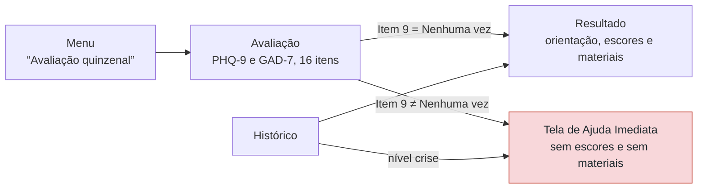

# Vocabulário da avaliação quinzenal

**Versão 1.0 – 16/11/2026** · Textos oficiais do PHQ-9 e do GAD-7 em português do Brasil e textos das telas da avaliação e do resultado.

!!! warning "Proposta em revisão"
    Este documento atende à issue [#52](https://github.com/FGA0138-MDS-Ajax/2026.2-T03-Lamport/issues/52) e complementa a [Visão do Produto e do Projeto](visao-produto-projeto.md), versão 2.7, e o [Documento de Arquitetura](arquitetura.md), versão 2.5. **Onde houver divergência, valem a Visão e a Arquitetura.** Os textos dos instrumentos foram conferidos com a fonte oficial (seção 2) e aguardam a validação do PO, assim como os pontos da [seção 9](#9-pendencias-para-decisao-do-po).

| | |
| :-- | :-- |
| **Projeto** | Sintoniza – Grupo Lamport, MDS 2026.2, Turma 03 (UnB) |
| **Issue** | [#52](https://github.com/FGA0138-MDS-Ajax/2026.2-T03-Lamport/issues/52) [Conteúdo/UX] Textos oficiais do PHQ-9 e do GAD-7 e protótipo da avaliação e do resultado (R08, R09) |
| **Base** | Visão do Produto e do Projeto v2.7 e Documento de Arquitetura v2.5, ambos de 15/11/2026; [Vocabulário do check-in](vocabulario-checkin.md) v1.1 |
| **Fonte dos instrumentos** | Versões oficiais em português do Brasil do PHQ-9 e do GAD-7 (PHQ SCREENERS, 2026), acessadas em 16/11/2026 |
| **Figma** | [Arquivo de design](https://www.figma.com/design/eY40HsGcHOBxnHPRMeB9gj) · [Protótipo navegável da avaliação (mobile)](https://www.figma.com/proto/eY40HsGcHOBxnHPRMeB9gj?node-id=125-1772&starting-point-node-id=125%3A1772&scaling=scale-down-width) |
| **Elaboração** | Vinícius Evangelista Borges Pinto (UX/UI, conteúdo e documentação) |
| **Revisão** | Martin Quadros de Melo (Product Owner) – pendente |

## Histórico de revisões

| Data | Versão | Descrição | Autor |
| :--: | :--: | :-- | :-- |
| 16/11/2026 | 1.0 | Transcrição dos textos oficiais do PHQ-9 e do GAD-7; identificadores, faixas e níveis; textos das telas da avaliação, do resultado e da Tela de Ajuda aberta pela avaliação; protótipo no Figma. | Vinícius E. B. Pinto |

---

## 1 Objetivo e escopo

Este documento define o vocabulário da avaliação quinzenal do Sintoniza (C03/R08 e C03/R09): os enunciados, os itens e as opções do PHQ-9 e do GAD-7, transcritos da fonte oficial; os identificadores usados na API e no frontend; os rótulos das faixas e dos níveis; e os textos das telas da avaliação e do resultado. Ele serve de referência para as issues #53 (cliente e tipos), #54 (`POST /api/avaliacoes`), #57 (tela da avaliação), #58 (tela de resultado) e #59 (avaliações no histórico) e para o caso de teste TSI-03.

Ficam fora do escopo, porque já estão definidos na Visão: a pontuação e as faixas (Quadro 17); os níveis, as orientações e os motivos das recomendações (Quadro 18); o conteúdo da Tela de Ajuda Imediata (seção 4.5.5); e os títulos e resumos dos materiais (seção 4.5.4). Quando aparecem aqui, esses textos estão copiados sem alteração, para reunir num só lugar o que cada tela mostra.

!!! note "Resumo"
    - A avaliação tem 16 itens obrigatórios: 9 do PHQ-9 e 7 do GAD-7, cada um com 4 opções, de 0 a 3. Os textos são os das versões oficiais em português do Brasil.
    - Uma tela com duas partes, uma por instrumento, cada uma com o seu enunciado oficial, e o aviso de que o recomendado é responder a cada duas semanas.
    - Uma tela de resultado com o aviso de que ele não é diagnóstico, a orientação do nível, os escores com as faixas e até 3 materiais (2 no nível N2), cada um com “Por que estou vendo isto?”.
    - Qualquer resposta diferente de “Nenhuma vez” no item 9 do PHQ-9 leva à Tela de Ajuda Imediata, sem escores e sem materiais (R-A1).
    - A fonte difere em três pontos da frase que a Visão usa para resumir o enunciado. A proposta segue a fonte, e a decisão é do PO (seções 4 e 9).

**Quadro 1 – Tarefas e critérios de aceite da issue #52**

| Tarefa ou critério da issue | Como foi atendido | Seção |
| :-- | :-- | :--: |
| Transcrever da fonte oficial o enunciado, os 9 itens do PHQ-9, os 7 do GAD-7 e as 4 opções, com o link e a data de acesso | Transcrição literal dos PDFs oficiais, com link, data de acesso e resumo SHA-256 de cada arquivo. | 2, 3 |
| Publicar os textos em `docs/vocabulario-avaliacao.md`, sem contradizer a Visão | Esta página. As diferenças de redação entre a fonte e a Visão ficaram registradas para decisão do PO, sem alterar a Visão. | 4, 9 |
| Protótipo da tela da avaliação: 16 itens e aviso de que o recomendado é responder a cada duas semanas | Telas M-07a, M-08a a M-08f e D-08a. | 6.2, 8 |
| Protótipo da tela de resultado: escores, faixas, orientação do nível, até 3 materiais com “Por que estou vendo isto?” e aviso “não é diagnóstico” | Telas M-09a a M-09d e D-09a. | 6.3, 6.4, 8 |
| Item 9 do PHQ-9 ≥ 1: ida à Tela de Ajuda Imediata, sem materiais (R-A1) | Telas M-08f, M-10a e M-10b. | 6.5, 8 |
| Textos conferidos com a fonte oficial e validados pelo PO | Conferência feita; validação do PO pendente. | 2, 9 |
| Protótipo linkado na issue e revisado pelo PO | Links do Figma no início deste documento e na seção 8, para comentar na issue; revisão do PO pendente. | 8 |
| Página publicada por PR na branch `docs` | Pendente. | – |

## 2 Fonte oficial

A Visão determina o uso das versões oficiais em português do Brasil disponibilizadas pelos autores (seção 4.5.2; PHQ SCREENERS, 2026). O site PHQ Screeners, mantido pela Pfizer, distribui essas versões em PDF na página *Select a Screener*: depois de aceitar os termos de uso do site, escolhe-se o instrumento, “PHQ-9” ou “GAD-7”, e o idioma “Portugese for Brazil”, grafado assim no site.

**Quadro 2 – Arquivos oficiais consultados**

| Instrumento | Arquivo | Link | Acesso |
| :-- | :-- | :-- | :--: |
| PHQ-9 | `PHQ9_Portuguese for Brazil.pdf`: 1 página, gerado em 15/06/2010 | [PDF do PHQ-9 em phqscreeners.com](https://www.phqscreeners.com/images/sites/g/files/g10060481/f/201412/PHQ9_Portuguese%20for%20Brazil.pdf) | 16/11/2026 |
| GAD-7 | `GAD7_Portuguese for Brazil.pdf`: 1 página, gerado em 26/05/2010 | [PDF do GAD-7 em phqscreeners.com](https://www.phqscreeners.com/images/sites/g/files/g10060481/f/201412/GAD7_Portuguese%20for%20Brazil.pdf) | 16/11/2026 |

Os dois arquivos trazem no rodapé: *“Desenvolvido pelos Drs. Robert L. Spitzer, Janet B.W. Williams, Kurt Kroenke e colegas, com um subsídio educacional da Pfizer Inc. Não é necessária permissão para reproduzir, traduzir, exibir ou distribuir.”* O rodapé confirma o que a Visão afirma sobre a reprodução dos textos.

**Conferência.** O texto foi extraído da camada de texto dos PDFs e comparado, item por item, com a página impressa, incluindo acentos, aspas, travessões e pontuação. Para verificar se os arquivos do site mudaram, estes são os resumos SHA-256 das cópias baixadas em 16/11/2026:

- PHQ-9: `57ac04e8800702b26cdc8f210b85bd1e0291d548af14f45617a1807b05967fbd`
- GAD-7: `e57d3c0d6224b3fd2c21ff6621b536be42ab90c9cf695561756816d1d2951b3b`

## 3 Textos oficiais

Os Quadros 3 a 6 reproduzem a fonte literalmente, inclusive a ortografia. O texto exibido na interface está na seção 6 e difere deste apenas nos pontos do Quadro 7.

### 3.1 PHQ-9

**Quadro 3 – PHQ-9: enunciado e itens na fonte oficial**

| Item | Texto |
| :--: | :-- |
| Enunciado | Durante as últimas 2 semanas, com que freqüência você foi incomodado/a por qualquer um dos problemas abaixo? |
| 1 | Pouco interesse ou pouco prazer em fazer as coisas |
| 2 | Se sentir “para baixo”, deprimido/a ou sem perspectiva |
| 3 | Dificuldade para pegar no sono ou permanecer dormindo, ou dormir mais do que de costume |
| 4 | Se sentir cansado/a ou com pouca energia |
| 5 | Falta de apetite ou comendo demais |
| 6 | Se sentir mal consigo mesmo/a — ou achar que você é um fracasso ou que decepcionou sua família ou você mesmo/a |
| 7 | Dificuldade para se concentrar nas coisas, como ler o jornal ou ver televisão |
| 8 | Lentidão para se movimentar ou falar, a ponto das outras pessoas perceberem? Ou o oposto – estar tão agitado/a ou irrequieto/a que você fica andando de um lado para o outro muito mais do que de costume |
| 9 | Pensar em se ferir de alguma maneira ou que seria melhor estar morto/a |

Detalhes que a transcrição preserva: as aspas curvas do item 2; o travessão (—, U+2014) do item 6 e o meia-risca (–, U+2013) do item 8; o ponto de interrogação no meio do item 8; e a ausência de ponto final nos itens.

### 3.2 GAD-7

**Quadro 4 – GAD-7: enunciado e itens na fonte oficial**

| Item | Texto |
| :--: | :-- |
| Enunciado | Durante as últimas 2 semanas, com que freqüência você foi incomodado/a pelos problemas abaixo? |
| 1 | Sentir-se nervoso/a, ansioso/a ou muito tenso/a |
| 2 | Não ser capaz de impedir ou de controlar as preocupações |
| 3 | Preocupar-se muito com diversas coisas |
| 4 | Dificuldade para relaxar |
| 5 | Ficar tão agitado/a que se torna difícil permanecer sentado/a |
| 6 | Ficar facilmente aborrecido/a ou irritado/a |
| 7 | Sentir medo como se algo horrível fosse acontecer |

### 3.3 Opções de resposta

Os dois instrumentos usam as mesmas quatro opções, impressas como cabeçalho das colunas, com o valor de cada uma repetido em todas as linhas. Valores e rótulos coincidem com os da Visão (seção 4.5.2).

**Quadro 5 – Opções de resposta na fonte oficial**

| Valor | Rótulo |
| :--: | :-- |
| 0 | Nenhuma vez |
| 1 | Vários dias |
| 2 | Mais da metade dos dias |
| 3 | Quase todos os dias |

### 3.4 Elementos da fonte que não entram na interface

**Quadro 6 – Elementos dos formulários impressos que não entram na interface**

| Elemento | Texto na fonte | Por que fica fora |
| :-- | :-- | :-- |
| Título do PHQ-9 | QUESTIONÁRIO SOBRE A SAÚDE DO/A PACIENTE- (PHQ-9) | A interface identifica cada instrumento pela sigla, como a Visão (Quadros 17 e 18). O título do GAD-7 já é a sigla. |
| Instrução | (Marque sua resposta com “✔”) | Instrução para o papel. Na tela, as opções são botões de rádio. |
| Campos de soma | “FOR OFFICE CODING … =Total Score” (PHQ-9) e “For office coding: Total Score T…” (GAD-7) | Campos para o profissional somar à mão. O escore é calculado pelo sistema. |
| Pergunta de dificuldade do PHQ-9 | Se você assinalou qualquer um dos problemas, indique o grau de dificuldade que os mesmos lhe causaram para realizar seu trabalho, tomar conta das coisas em casa ou para se relacionar com as pessoas? (Nenhuma dificuldade · Alguma dificuldade · Muita dificuldade · Extrema dificuldade) | Não entra no escore, e a Visão define o PHQ-9 com 9 itens e a avaliação com 16 respostas (R08). |

## 4 Diferenças entre a fonte e a Visão

A seção 4.5.2 da Visão resume o enunciado numa frase, que a issue #52 repete: “Nas últimas 2 semanas, com que frequência você foi incomodado(a) por…”. A fonte tem um enunciado para cada instrumento, e os dois diferem dessa frase nos pontos do Quadro 7. Como a própria Visão manda usar o texto oficial (seção 4.5.2) e o R08 exige “texto oficial em português do Brasil”, esta proposta segue a fonte, com uma única atualização ortográfica (ponto 2). Os três pontos dependem de decisão do PO (seção 9).

**Quadro 7 – Diferenças entre a fonte oficial e a Visão v2.7**

| # | Ponto | Visão v2.7, seção 4.5.2 | Fonte oficial | Proposta |
| :--: | :-- | :-- | :-- | :-- |
| 1 | Enunciado | Um só, para os dois instrumentos: “Nas últimas 2 semanas, com que frequência você foi incomodado(a) por…” | Um para cada instrumento: “Durante as últimas 2 semanas, com que freqüência você foi incomodado/a por qualquer um dos problemas abaixo?” (PHQ-9) e “Durante as últimas 2 semanas, com que freqüência você foi incomodado/a pelos problemas abaixo?” (GAD-7) | Exibir cada enunciado oficial na parte do seu instrumento. Na próxima versão da Visão, citar os dois enunciados na seção 4.5.2. |
| 2 | Trema | frequência | freqüência | Exibir “frequência”. O trema foi abolido pelo Acordo Ortográfico de 1990, obrigatório no Brasil desde 1º/1/2016 (BRASIL, 2008; 2012); nenhuma palavra muda. |
| 3 | Marca de gênero | incomodado(a) | incomodado/a, e “/a” também nos itens | Manter “/a”, como na fonte, no enunciado e nos itens. |

O número de itens, as opções (Quadro 5) e a escala de 0 a 3 são iguais na fonte e na Visão.

## 5 Identificadores, faixas e níveis

As respostas trafegam na API como duas listas de inteiros, `phq9` e `gad7` (Arquitetura, Quadro 6). A posição na lista identifica o item: a posição 0 é o item 1. As tags, as faixas e os níveis trafegam como slugs em letras minúsculas, os mesmos que o código da `main` já usa (`app/domain/checkin.py` e `app/domain/avaliacao.py`).

**Quadro 8 – Respostas na API**

| Instrumento | Campo | Itens | Posições | Valores | Observação |
| :-- | :-- | :--: | :--: | :-- | :-- |
| PHQ-9 | `phq9` | 1 a 9 | 0 a 8 | Inteiros de 0 a 3 (Quadro 5), todos obrigatórios | `phq9[8]` é o item 9, usado pela regra R-A1. |
| GAD-7 | `gad7` | 1 a 7 | 0 a 6 | Inteiros de 0 a 3 (Quadro 5), todos obrigatórios | – |

Não há valor nulo nem “Prefiro não responder”: o escore só existe com todos os itens respondidos (decisão D2).

**Quadro 9 – Faixas de gravidade (Visão, Quadro 17)**

| Constante | Slug | Rótulo na interface | PHQ-9 | GAD-7 |
| :-- | :-- | :-- | :--: | :--: |
| `MINIMA` | `minima` | Mínima | 0–4 | 0–4 |
| `LEVE` | `leve` | Leve | 5–9 | 5–9 |
| `MODERADA` | `moderada` | Moderada | 10–14 | 10–14 |
| `MODERADAMENTE_GRAVE` | `moderadamente_grave` | Moderadamente grave | 15–19 | – |
| `GRAVE` | `grave` | Grave | 20–27 | 15–21 |

**Quadro 10 – Níveis e orientações (Visão, seção 1.1 e Quadro 18)**

| Constante | Slug | Código | Regra | Rótulo na interface | Orientação exibida (Quadro 18, sem alteração) |
| :-- | :-- | :--: | :--: | :-- | :-- |
| `CRISE` | `crise` | N3 | R-A1 | Ajuda imediata | Nenhuma: abre a Tela de Ajuda Imediata (seção 6.5). |
| `PRIORITARIO` | `prioritario` | N2 | R-A2 | Procurar atendimento nos próximos dias | Suas respostas indicam sintomas intensos. Recomendamos procurar atendimento em saúde nos próximos dias, na sua UBS de referência ou em um CAPS. Se piorar, use a Ajuda Imediata. |
| `ATENCAO` | `atencao` | N1 | R-A3 | Procurar a UBS | Recomendamos conversar com um profissional de saúde. No SUS, a porta de entrada é a Unidade Básica de Saúde (UBS). |
| `AUTOCUIDADO` | `autocuidado` | N0 | R-A4 | Autocuidado | Continue acompanhando como você está. Seguem materiais de autocuidado. |

Os rótulos dos níveis repetem a seção 1.1 da Visão (“N0 autocuidado, N1 procurar a UBS, N2 procurar atendimento nos próximos dias ou N3 ajuda imediata”), porque o R09 e o R12 exigem que o nível apareça na interface (decisão D4). Os códigos N0 a N3, as regras e as palavras “crise”, “atenção” e “prioritário” não aparecem. A orientação vem pronta da API (Arquitetura, Quadro 6), e o frontend não a reescreve.

As tags são as do vocabulário do check-in (Quadro 5 daquele documento). A avaliação gera apenas `ajuda_profissional`, `ansiedade`, `humor` e `bem_estar` (Quadro 18 da Visão). Cada recomendação chega com `titulo`, `fonte`, `resumo`, `url`, `regra` e `motivo`, sem a tag (Arquitetura, seção 2.5.2). Por isso, o cartão do material não mostra o tema: quem explica a escolha é o motivo (decisão D6).

## 6 Textos da interface

Nos quadros desta seção, a coluna “Texto” traz o texto exato a implementar e a coluna “Observação” orienta o uso. As reticências são o caractere único U+2026, como no vocabulário do check-in. Valem os princípios de redação do vocabulário do check-in (seção 3 daquele documento), com três diferenças próprias da avaliação:

1. Os itens e as opções do PHQ-9 e do GAD-7 são exibidos exatamente como na seção 3, com as mudanças do Quadro 7 aprovadas pelo PO. A equipe não reescreve nem simplifica os itens, porque a validação dos instrumentos vale para o texto oficial.
2. Os termos que o vocabulário do check-in evita (Quadro 2 daquele documento) aparecem aqui apenas onde a Visão os usa: nos itens oficiais, nas faixas (Quadro 17), nas orientações e nos motivos (Quadro 18) e na descrição dos instrumentos no resultado (“sintomas de depressão” e “sintomas de ansiedade”, como em “PHQ-9 (depressão)” e “GAD-7 (ansiedade)” no Quadro 17).
3. O resultado sempre mostra o aviso de que não é diagnóstico, antes dos escores (risco R2).

**Figura 1 – Fluxo da avaliação**



### 6.1 Acesso

A avaliação é aberta pelo item “Avaliação quinzenal” do menu do usuário, entre “Início” e “Histórico”, no menu do desktop e no ☰ do mobile (issue #57). O Sintoniza não exibe lembretes nem convites para a avaliação (Visão, seção 4.5.2).

### 6.2 Tela da avaliação

**Quadro 11 – Textos da tela da avaliação**

| Elemento | Texto | Observação |
| :-- | :-- | :-- |
| Título | Avaliação quinzenal | `h1`; recebe o foco ao abrir a tela. |
| Texto de apoio | São 16 perguntas sobre as últimas duas semanas. Todas são obrigatórias. | – |
| Aviso | Você pode responder quando quiser, mas o recomendado é responder a cada duas semanas, o período a que as perguntas se referem. | Exigido pela Visão (seção 4.5.2). |
| Indicador da parte 1 | Parte 1 de 2 · 9 perguntas | Acima do título da parte. |
| Título da parte 1 | PHQ-9 | `h2`. |
| Enunciado da parte 1 | Durante as últimas 2 semanas, com que frequência você foi incomodado/a por qualquer um dos problemas abaixo? | Quadro 3, com as mudanças do Quadro 7. Fica logo abaixo do título, antes do item 1. |
| Itens da parte 1 | Itens 1 a 9 do Quadro 3 | Cada item é um `fieldset`; o `legend` traz o número e o texto, como “1. Pouco interesse ou pouco prazer em fazer as coisas”. |
| Indicador da parte 2 | Parte 2 de 2 · 7 perguntas | – |
| Título da parte 2 | GAD-7 | `h2`. |
| Enunciado da parte 2 | Durante as últimas 2 semanas, com que frequência você foi incomodado/a pelos problemas abaixo? | Quadro 4, com as mudanças do Quadro 7. |
| Itens da parte 2 | Itens 1 a 7 do Quadro 4 | Numeração própria do GAD-7, de 1 a 7, como na fonte. |
| Opções de cada item | Nenhuma vez · Vários dias · Mais da metade dos dias · Quase todos os dias | Quadro 5, nessa ordem, sem pré-seleção e sem os números. |
| Aviso antes do envio | O Sintoniza não acompanha suas respostas em tempo real e não avisa ninguém. | Mesma frase da Tela de Ajuda (Visão, seção 4.5.5) e da etapa 2 do check-in. |
| Botão principal | Concluir avaliação | Sempre habilitado. |
| Link secundário | Cancelar | Volta ao início sem gravar nada. |

**Quadro 12 – Validação, envio e erros da avaliação**

| Situação | Texto | Observação |
| :-- | :-- | :-- |
| Pergunta sem resposta, ao concluir | Responda esta pergunta. | Abaixo das opções do item, com o ícone ⚠ decorativo, ligado ao grupo por `aria-describedby`, com `aria-invalid`. |
| Resumo dos erros | Responda a todas as perguntas para concluir a avaliação. Faltam: | Acima do botão, com `role="alert"`, seguido da lista de pendências. |
| Item da lista de pendências | PHQ-9, pergunta 4 | Um por pergunta sem resposta, na ordem da tela; cada um é um link para o item. |
| Enviando | Enviando… | No botão principal, desabilitado durante o envio. |
| Sem conexão | Não foi possível enviar sua avaliação. Suas respostas foram mantidas: verifique sua conexão e tente novamente. | As respostas continuam marcadas. |
| Sessão expirada (401) | Sua sessão expirou. Entre novamente para responder à avaliação. | Levar ao login. |
| Dados inválidos (422) | Não foi possível registrar suas respostas. Revise-as e tente novamente. | Não deve ocorrer com o frontend correto. |
| Serviço indisponível (5xx) | O serviço está indisponível no momento. Tente novamente em instantes. | Texto já usado em `describeError`. |
| Qualquer erro com o item 9 diferente de “Nenhuma vez” | Ver o Quadro 16 | A Tela de Ajuda é exibida mesmo assim (decisão D3). |

### 6.3 Resultado (R-A2 a R-A4)

A mesma tela serve logo depois do envio e a partir do histórico (issue #58); só a confirmação muda.

**Quadro 13 – Textos da tela de resultado**

| Elemento | Texto | Observação |
| :-- | :-- | :-- |
| Confirmação | Avaliação registrada. | Só logo depois do envio, com `role="status"`. |
| Título | Resultado da avaliação | `h1`; recebe o foco ao abrir a tela. |
| Data | Respondida em 16 de novembro de 2026 | De `criado_em`, por extenso, no fuso `America/Sao_Paulo`. |
| Aviso | Este resultado não é um diagnóstico. Ele resume suas respostas sobre as últimas duas semanas e não substitui a avaliação de um profissional de saúde. | R09 e risco R2. Antes da orientação e dos escores (decisão D7). |
| Rótulo da orientação | Orientação | Acima do nível. |
| Nível | Rótulo do Quadro 10, como “Procurar a UBS” | `h2`. |
| Texto da orientação | Recebido da API | Coluna “Orientação exibida” do Quadro 10. |
| Título dos escores | Seus escores | `h2`; conteúdo na seção 6.4. |
| Título dos materiais | Materiais recomendados | `h2`. |
| Texto de apoio | Separamos materiais de fontes oficiais com base no seu resultado. | – |
| Cartão de material | Título, fonte e resumo do material | Recebidos da API, sem alteração e sem o tema (decisão D6). Até 3 materiais; no máximo 2 no nível N2 (R-S4). |
| Fonte | Fonte: Ministério da Saúde | “Fonte:” seguido do valor de `fonte`. |
| Link do material | Abrir no site oficial | Abre em nova aba; o nome acessível inclui o título do material. |
| Explicação | Por que estou vendo isto? | Mostra o motivo recebido da API (Quadro 14). |
| Sem materiais (R-S6) | – | A seção de materiais não aparece, e fica só a orientação. Situação evitada pelo teste TU-07. |
| Navegação | Ver histórico · Voltar ao início | – |
| Carregando | Carregando… | Ao abrir pelo histórico (`GET /api/avaliacoes/{id}`). |
| Avaliação não encontrada (404) | Não encontramos esta avaliação. | Com o botão “Voltar ao histórico” (issue #58). |
| Outros erros ao carregar | Textos de `describeError` | Como nas demais telas. |

**Quadro 14 – Motivos exibidos em “Por que estou vendo isto?” (Visão, Quadro 18)**

| Regra | Tag | Motivo |
| :--: | :-- | :-- |
| R-A2 | AJUDA_PROFISSIONAL | Suas respostas indicam sintomas intensos. Este material explica onde buscar atendimento. |
| R-A3 | AJUDA_PROFISSIONAL | Suas respostas indicam que conversar com um profissional de saúde pode ajudar. |
| R-A3 | HUMOR | Seu resultado no PHQ-9 ficou na faixa moderada ou acima. |
| R-A3 | ANSIEDADE | Seu resultado no GAD-7 ficou na faixa moderada ou acima. |
| R-A4 | HUMOR | Seu resultado no PHQ-9 ficou na faixa leve. |
| R-A4 | ANSIEDADE | Seu resultado no GAD-7 ficou na faixa leve. |
| R-A4 | BEM_ESTAR | Suas respostas não indicaram sintomas marcantes nas últimas duas semanas. |

### 6.4 Escores e faixas

Para cada instrumento, o resultado mostra a sigla, o que o instrumento mede, o escore com o máximo possível e a faixa, seguidos da lista de faixas com a do usuário marcada. A lista atende à “explicação das faixas” que a Visão prevê para o resultado (Quadro 3) e mostra que as faixas são valores publicados, e não criados pela equipe (objetivo secundário 2).

**Quadro 15 – Textos dos escores e das faixas**

| Elemento | Texto | Observação |
| :-- | :-- | :-- |
| Instrumento | PHQ-9 · GAD-7 | – |
| O que mede | Sintomas de depressão · Sintomas de ansiedade | Abaixo da sigla. |
| Escore | 10 de 27 · 5 de 21 | Escore recebido da API e o máximo do instrumento. |
| Faixa | Faixa: Moderada | Rótulo do Quadro 9. |
| Lista de faixas | Mínima 0–4 · Leve 5–9 · Moderada 10–14 · Moderadamente grave 15–19 · Grave 20–27 | Do PHQ-9; a do GAD-7 tem quatro faixas, até 21. A faixa do usuário aparece em negrito, com fundo e o texto “Sua faixa”, e não só pela cor. |
| Explicação | O escore é a soma das respostas, de 0 a 3 por pergunta. As faixas são as publicadas pelos autores dos questionários. | Abaixo das listas. |
| Leitura por leitor de tela | PHQ-9, sintomas de depressão: 10 de 27, faixa moderada. | Exemplo do perfil B (Visão, Quadro 19). |

### 6.5 Tela de Ajuda Imediata aberta pela avaliação (R-A1)

O conteúdo da Tela de Ajuda é fixo (Visão, seção 4.5.5) e não muda aqui. Quando a tela é aberta pela avaliação, entram apenas os textos do Quadro 16, os mesmos do check-in com “avaliação” no lugar de “check-in”. A tela não mostra escores, faixas, nível nem materiais (Quadro 18 da Visão, R-A1).

**Quadro 16 – Textos da Tela de Ajuda aberta pela avaliação**

| Elemento | Texto | Observação |
| :-- | :-- | :-- |
| Acolhimento, no topo | Obrigado por responder. Você não precisa enfrentar isso sem apoio: fale agora com alguém. | Igual ao do check-in (vocabulário do check-in, Quadro 12). |
| Registro, no rodapé | Sua avaliação foi registrada. | Discreto; aparece depois da confirmação da API. |
| Falha no envio | Não foi possível salvar sua avaliação agora, mas os contatos acima funcionam normalmente. | A tela continua visível (decisão D3). |

Aberta a partir do histórico, uma avaliação com nível crise mostra a Tela de Ajuda sem o acolhimento e sem o registro, como o botão “Preciso de ajuda agora”.

### 6.6 Avaliações no histórico (R12)

Textos para a issue #59, com os rótulos dos Quadros 9 e 10. O protótipo desta issue não inclui o histórico.

**Quadro 17 – Textos das avaliações no histórico**

| Elemento | Texto | Observação |
| :-- | :-- | :-- |
| Título da seção | Avaliações | `h2` na página Histórico, separado dos check-ins. |
| Data | Hoje; Ontem; 16 de nov. | Mesmo formato dos check-ins. |
| Escores e faixas | PHQ-9: 10 (Moderada) · GAD-7: 5 (Leve) | R12. |
| Nível | Orientação: Procurar a UBS | Rótulo do Quadro 10. |
| Leitura por leitor de tela | 16 de novembro: PHQ-9 10, faixa moderada; GAD-7 5, faixa leve; orientação: procurar a UBS. | Exemplo de texto acessível de um item. |
| Ação do item | – | Abre o resultado (seção 6.3); no nível crise, a Tela de Ajuda (seção 6.5). |
| Lista vazia | Você ainda não respondeu à avaliação quinzenal. | Com o botão “Responder à avaliação”. |

### 6.7 Acessibilidade

- Cada item é um `fieldset` com `legend`; cada opção é um botão de rádio com rótulo visível e área de toque de pelo menos 44 px, como no check-in.
- O enunciado de cada parte fica entre o título da parte e o primeiro item, para ser lido antes dos itens.
- Ao concluir com pendências, o resumo é anunciado (`role="alert"`) e cada pendência leva ao item sem resposta, marcado com `aria-invalid` e com a mensagem ligada por `aria-describedby`.
- Ao abrir o resultado, o foco vai para o título; a confirmação “Avaliação registrada.” usa `role="status"`.
- “Por que estou vendo isto?” usa um elemento que abre e fecha pelo teclado, como `details` e `summary`.
- A faixa do usuário é indicada por texto (“Sua faixa”) e pelo peso da fonte, não só pela cor.
- O navegador pode quebrar a linha depois da barra de “incomodado/a”. Para evitar a sobra de “a” no início da linha, essas palavras podem ficar num `span` com `white-space: nowrap`.

## 7 Decisões

As decisões abaixo completam a Visão onde ela não detalha as telas. Todas dependem da revisão do PO.

**D1 – Uma tela, com uma parte por instrumento.**
A issue #57 pede uma tela com os 16 itens. Dividir a tela em duas partes mantém o enunciado oficial de cada instrumento junto dos seus itens e a numeração da fonte (o “item 9 do PHQ-9” da R-A1), e acompanha a API, que recebe `phq9` e `gad7` separados.

**D2 – Todos os itens são obrigatórios e não há “Prefiro não responder”.**
O R08 exige 16 respostas, e o escore só pode ser calculado com todos os itens. É o contrário do check-in, em que P1 a P4 são opcionais (decisão D3 do vocabulário do check-in). O botão “Concluir avaliação” fica sempre habilitado e, se faltar resposta, a tela lista as pendências (Quadro 12), o que ajuda a encontrar um item esquecido numa tela longa.

**D3 – Com o item 9 diferente de “Nenhuma vez”, a Tela de Ajuda não depende da API.**
Segue a decisão D9 do vocabulário do check-in, ainda pendente com o PO, e o que o frontend já faz no check-in: se o envio falhar, a Tela de Ajuda abre mesmo assim. Depois de “Concluir avaliação”, o frontend abre a Tela de Ajuda quando a API devolve o nível crise ou, se o envio falhar, quando o próprio item 9 tem resposta diferente de “Nenhuma vez”. Marcar a opção do item 9 não abre a tela: a avaliação só é registrada com as 16 respostas.

**D4 – O nível aparece com os rótulos da seção 1.1 da Visão.**
O R09 e o R12 exigem que o nível apareça, mas os nomes das constantes (“crise”, “atenção”, “prioritário”) soam como rótulos sobre a pessoa. A seção 1.1 da Visão já descreve os níveis pelo que o usuário deve fazer, e o Quadro 10 usa essas palavras.

**D5 – Na avaliação, os instrumentos aparecem só pela sigla; o que medem é dito no resultado.**
Os formulários oficiais não dizem o que cada instrumento mede: o título do PHQ-9 é “Questionário sobre a saúde do/a paciente”, e o do GAD-7 é a sigla. A tela da avaliação faz o mesmo, para não induzir respostas. No resultado, a descrição explica os escores e os motivos que citam o PHQ-9 e o GAD-7 (Quadro 14).

**D6 – O cartão do material não mostra o tema.**
As recomendações chegam sem a tag (Arquitetura, seção 2.5.2), e o motivo já diz por que o material foi escolhido. O protótipo do check-in (issue #2) mostra o tema, mas foi feito antes da Arquitetura v2.5.

**D7 – O aviso “não é diagnóstico” vem antes da orientação e dos escores.**
O risco R2 da Visão é o resultado ser lido como diagnóstico. Com o aviso no topo, o usuário o lê antes dos números.

## 8 Protótipo

O protótipo está no mesmo arquivo do Figma do check-in (issue #2), para reaproveitar os componentes e ligar as telas novas à Tela de Ajuda e ao início. As telas mobile ficam na página “01 · Mobile (prioritário)”, nas seções 5 e 6, e as de desktop na página “02 · Desktop”, na seção 5. Como no check-in, o mobile de 390 px é a referência e o único com navegação; o desktop, em 1280 px, é estático. O histórico de versões do arquivo registra o estado antes e depois desta issue (“Antes da issue #52” e “Issue #52 – avaliação e resultado”, ambas de 16/11/2026).

!!! note "Como navegar no protótipo"
    O [protótipo navegável](https://www.figma.com/proto/eY40HsGcHOBxnHPRMeB9gj?node-id=125-1772&starting-point-node-id=125%3A1772&scaling=scale-down-width) abre no fluxo “Avaliação quinzenal (mobile)”, na tela M-07a, ajustado à largura; role a tela para ver todas as perguntas. Na M-08a, “Concluir avaliação” mostra as pendências (M-08c), e um clique em qualquer pergunta preenche a avaliação com o perfil B (M-08b). Os fluxos “Avaliação: item 9 do PHQ-9 marcado”, “Resultado da avaliação: N2” e “Resultado da avaliação: N0, aberto pelo histórico” começam na M-08f, na M-09b e na M-09c.

As respostas seguem os perfis do Quadro 19 da Visão, para que as telas sirvam de referência ao TSI-03 e ao TI-06. Os materiais são do catálogo atual (`catalog/materiais.yaml`), escolhidos como as regras R-S1 a R-S4 escolheriam para um usuário sem recomendações anteriores.

**Quadro 18 – Telas do protótipo**

| Tela | Conteúdo | Perfil (Visão, Quadro 19) |
| :-- | :-- | :-- |
| [M-07a](https://www.figma.com/design/eY40HsGcHOBxnHPRMeB9gj?node-id=125-1772) | Menu aberto com o item “Avaliação quinzenal”. | – |
| [M-08a](https://www.figma.com/design/eY40HsGcHOBxnHPRMeB9gj?node-id=125-2) | Avaliação vazia, sem opção marcada. | – |
| [M-08b](https://www.figma.com/design/eY40HsGcHOBxnHPRMeB9gj?node-id=125-281) | Avaliação respondida. | B |
| [M-08c](https://www.figma.com/design/eY40HsGcHOBxnHPRMeB9gj?node-id=125-576) | Erro ao concluir com perguntas sem resposta (PHQ-9, pergunta 4, e GAD-7, pergunta 2). | B, incompleto |
| [M-08d](https://www.figma.com/design/eY40HsGcHOBxnHPRMeB9gj?node-id=125-879) | Envio em andamento, com o botão desabilitado. | B |
| [M-08e](https://www.figma.com/design/eY40HsGcHOBxnHPRMeB9gj?node-id=125-1177) | Erro de conexão, com as respostas mantidas. | B |
| [M-08f](https://www.figma.com/design/eY40HsGcHOBxnHPRMeB9gj?node-id=125-1477) | Item 9 do PHQ-9 marcado com “Vários dias”; ao concluir, abre a M-10a. | D |
| [M-09a](https://www.figma.com/design/eY40HsGcHOBxnHPRMeB9gj?node-id=125-1799) | Resultado N1: 10 de 27 (Moderada) e 5 de 21 (Leve), “Procurar a UBS” e 2 materiais. É o resultado esperado do TSI-03. | B |
| [M-09b](https://www.figma.com/design/eY40HsGcHOBxnHPRMeB9gj?node-id=125-1928) | Resultado N2: 18 de 27 (Moderadamente grave) e 15 de 21 (Grave), “Procurar atendimento nos próximos dias” e 2 materiais de ajuda profissional. | C |
| [M-09c](https://www.figma.com/design/eY40HsGcHOBxnHPRMeB9gj?node-id=125-2056) | Resultado N0 aberto pelo histórico, sem a confirmação: 5 de 27 (Leve) e 6 de 21 (Leve), “Autocuidado” e 2 materiais. | E |
| [M-09d](https://www.figma.com/design/eY40HsGcHOBxnHPRMeB9gj?node-id=125-2179) | Avaliação não encontrada (404). | – |
| [M-10a](https://www.figma.com/design/eY40HsGcHOBxnHPRMeB9gj?node-id=125-2201) | Tela de Ajuda aberta pela avaliação, com o acolhimento e o registro. | D |
| [M-10b](https://www.figma.com/design/eY40HsGcHOBxnHPRMeB9gj?node-id=125-2234) | Tela de Ajuda com falha ao salvar a avaliação. | D |
| [D-08a](https://www.figma.com/design/eY40HsGcHOBxnHPRMeB9gj?node-id=125-2273) | Avaliação no desktop. | – |
| [D-09a](https://www.figma.com/design/eY40HsGcHOBxnHPRMeB9gj?node-id=125-2556) | Resultado N1 no desktop. | B |

## 9 Pendências para decisão do PO

Os três primeiros pontos são as diferenças do Quadro 7. O quarto é um caso de segurança que os documentos não tratam, e o quinto cobre os textos novos desta página.

**Quadro 19 – Pontos que dependem de decisão do PO**

| # | Ponto | Opções | Proposta |
| :--: | :-- | :-- | :-- |
| 1 | Enunciado (Quadro 7, ponto 1) | Os dois enunciados oficiais, um por instrumento; ou a frase da seção 4.5.2 da Visão para os dois. | Enunciados oficiais, com a citação da seção 4.5.2 atualizada na próxima versão da Visão. |
| 2 | Trema (Quadro 7, ponto 2) | “frequência”, pela ortografia vigente; ou “freqüência”, como na fonte. | “frequência”. |
| 3 | Marca de gênero (Quadro 7, ponto 3) | “/a”, como na fonte; ou “(a)”, como na Visão e no check-in. | “/a”. |
| 4 | Item 9 marcado e avaliação incompleta | Mostrar as pendências (Quadro 12) e só abrir a Tela de Ajuda depois das 16 respostas, como na Figura 4 da Arquitetura, com o botão “Preciso de ajuda agora” sempre visível; ou abrir a Tela de Ajuda sem registrar a avaliação. | Seguir a Figura 4. |
| 5 | Textos da seção 6 e decisões D1 a D7 | Aprovar ou ajustar. | Aprovar. |

## Apêndice A – Constantes sugeridas para o frontend

Sugestão não normativa para as issues #53, #57 e #58, com os textos da seção 6 e as propostas 1 a 3 da seção 9. A organização do código fica a critério do frontend; os textos, depois de validados pelo PO, não devem ser alterados.

```ts
// frontend/src/constants/avaliacao.ts
// Textos oficiais do PHQ-9 e do GAD-7 (PHQ SCREENERS, 2026); seção 3 do vocabulário da avaliação.
export type Faixa = 'minima' | 'leve' | 'moderada' | 'moderadamente_grave' | 'grave'
export type Nivel = 'autocuidado' | 'atencao' | 'prioritario' | 'crise'

export const FREQUENCY_OPTIONS = [
  { value: 0, label: 'Nenhuma vez' },
  { value: 1, label: 'Vários dias' },
  { value: 2, label: 'Mais da metade dos dias' },
  { value: 3, label: 'Quase todos os dias' },
] as const

export const PHQ9 = {
  title: 'PHQ-9',
  description: 'Sintomas de depressão',
  maxScore: 27,
  stem: 'Durante as últimas 2 semanas, com que frequência você foi incomodado/a por qualquer um dos problemas abaixo?',
  items: [
    'Pouco interesse ou pouco prazer em fazer as coisas',
    'Se sentir “para baixo”, deprimido/a ou sem perspectiva',
    'Dificuldade para pegar no sono ou permanecer dormindo, ou dormir mais do que de costume',
    'Se sentir cansado/a ou com pouca energia',
    'Falta de apetite ou comendo demais',
    'Se sentir mal consigo mesmo/a — ou achar que você é um fracasso ou que decepcionou sua família ou você mesmo/a',
    'Dificuldade para se concentrar nas coisas, como ler o jornal ou ver televisão',
    'Lentidão para se movimentar ou falar, a ponto das outras pessoas perceberem? Ou o oposto – estar tão agitado/a ou irrequieto/a que você fica andando de um lado para o outro muito mais do que de costume',
    'Pensar em se ferir de alguma maneira ou que seria melhor estar morto/a',
  ],
} as const

export const GAD7 = {
  title: 'GAD-7',
  description: 'Sintomas de ansiedade',
  maxScore: 21,
  stem: 'Durante as últimas 2 semanas, com que frequência você foi incomodado/a pelos problemas abaixo?',
  items: [
    'Sentir-se nervoso/a, ansioso/a ou muito tenso/a',
    'Não ser capaz de impedir ou de controlar as preocupações',
    'Preocupar-se muito com diversas coisas',
    'Dificuldade para relaxar',
    'Ficar tão agitado/a que se torna difícil permanecer sentado/a',
    'Ficar facilmente aborrecido/a ou irritado/a',
    'Sentir medo como se algo horrível fosse acontecer',
  ],
} as const

// Faixas do Quadro 17 da Visão, em ordem crescente.
export const FAIXA_LABELS: Record<Faixa, string> = {
  minima: 'Mínima',
  leve: 'Leve',
  moderada: 'Moderada',
  moderadamente_grave: 'Moderadamente grave',
  grave: 'Grave',
}

export const PHQ9_RANGES: ReadonlyArray<{ faixa: Faixa; min: number; max: number }> = [
  { faixa: 'minima', min: 0, max: 4 },
  { faixa: 'leve', min: 5, max: 9 },
  { faixa: 'moderada', min: 10, max: 14 },
  { faixa: 'moderadamente_grave', min: 15, max: 19 },
  { faixa: 'grave', min: 20, max: 27 },
]

export const GAD7_RANGES: ReadonlyArray<{ faixa: Faixa; min: number; max: number }> = [
  { faixa: 'minima', min: 0, max: 4 },
  { faixa: 'leve', min: 5, max: 9 },
  { faixa: 'moderada', min: 10, max: 14 },
  { faixa: 'grave', min: 15, max: 21 },
]

// Rótulos dos níveis (Visão, seção 1.1). O código N0 a N3 não aparece na interface.
export const NIVEL_LABELS: Record<Nivel, string> = {
  autocuidado: 'Autocuidado',
  atencao: 'Procurar a UBS',
  prioritario: 'Procurar atendimento nos próximos dias',
  crise: 'Ajuda imediata',
}
```

As faixas servem só para a lista exibida no resultado. A faixa de cada escore vem da API (`faixa_phq9` e `faixa_gad7`, Arquitetura, Figura 6), e o frontend não a recalcula.

## Referências

BRASIL. Decreto nº 6.583, de 29 de setembro de 2008. Promulga o Acordo Ortográfico da Língua Portuguesa, assinado em Lisboa, em 16 de dezembro de 1990. **Diário Oficial da União**: seção 1, Brasília, DF, 30 set. 2008.

BRASIL. Decreto nº 7.875, de 27 de dezembro de 2012. Altera o Decreto nº 6.583, de 29 de setembro de 2008, que promulga o Acordo Ortográfico da Língua Portuguesa. **Diário Oficial da União**: seção 1, Brasília, DF, 28 dez. 2012.

GRUPO LAMPORT. **Documento de Arquitetura – Sintoniza**. Versão 2.5. Brasília, DF: Universidade de Brasília, 2026.

GRUPO LAMPORT. **Visão do Produto e do Projeto – Sintoniza**: aplicação web de apoio à saúde mental. Versão 2.7. Brasília, DF: Universidade de Brasília, 2026.

GRUPO LAMPORT. **Vocabulário do check-in diário – Sintoniza**. Versão 1.1. Brasília, DF: Universidade de Brasília, 2026.

KROENKE, K.; SPITZER, R. L.; WILLIAMS, J. B. W. The PHQ-9: validity of a brief depression severity measure. **Journal of General Internal Medicine**, v. 16, n. 9, p. 606-613, 2001.

MELO, M. Q. **[Conteúdo/UX] Textos oficiais do PHQ-9 e do GAD-7 e protótipo da avaliação e do resultado (R08, R09)**. Issue #52 do repositório FGA0138-MDS-Ajax/2026.2-T03-Lamport. GitHub, 15 nov. 2026. Disponível em: <https://github.com/FGA0138-MDS-Ajax/2026.2-T03-Lamport/issues/52>. Acesso em: 16 nov. 2026.

PHQ SCREENERS. **Patient Health Questionnaire (PHQ) screeners**: instructions and translations. [S. l.], 2026. Disponível em: <https://www.phqscreeners.com>. Acesso em: 16 nov. 2026.

SPITZER, R. L.; WILLIAMS, J. B. W.; KROENKE, K. **GAD-7**: Portuguese for Brazil. [S. l.]: Pfizer, [2010]. 1 p. Disponível em: <https://www.phqscreeners.com/images/sites/g/files/g10060481/f/201412/GAD7_Portuguese%20for%20Brazil.pdf>. Acesso em: 16 nov. 2026.

SPITZER, R. L.; WILLIAMS, J. B. W.; KROENKE, K. **Questionário sobre a saúde do/a paciente (PHQ-9)**: Portuguese for Brazil. [S. l.]: Pfizer, [2010]. 1 p. Disponível em: <https://www.phqscreeners.com/images/sites/g/files/g10060481/f/201412/PHQ9_Portuguese%20for%20Brazil.pdf>. Acesso em: 16 nov. 2026.

SPITZER, R. L. et al. A brief measure for assessing generalized anxiety disorder: the GAD-7. **Archives of Internal Medicine**, v. 166, n. 10, p. 1092-1097, 2006.
