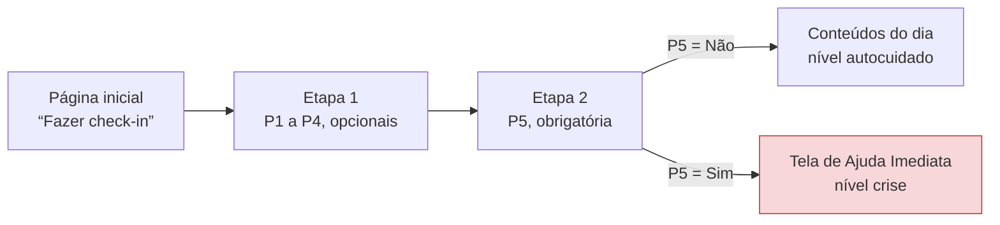

# Vocabulário do check-in diário

**Versão 1.0 – 28/10/2026** · Perguntas, escalas, identificadores e textos da interface do check-in diário.

!!! warning "Proposta em revisão"
    Este documento atende à issue [#3](https://github.com/FGA0138-MDS-Ajax/2026.2-T03-Lamport/issues/3) e aguarda a revisão do Product Owner e a confirmação de backend e frontend. Ele se baseia na [Visão do Produto e do Projeto](visao-produto-projeto.md) e no [Documento de Arquitetura](arquitetura.md), ambos na versão 2.1. Os pontos que dependem de decisão do PO estão na [seção 10](#10-pendencias-para-decisao-do-po).

| | |
| :-- | :-- |
| **Projeto** | Sintoniza – Grupo Lamport, MDS 2026.2, Turma 03 (UnB) |
| **Issue** | [#3](https://github.com/FGA0138-MDS-Ajax/2026.2-T03-Lamport/issues/3) [PO/UX] Definir vocabulário do check-in: categorias de humor, escala e fatores de contexto |
| **Base** | Visão do Produto e do Projeto v2.1 e Documento de Arquitetura v2.1, ambos de 18/10/2026 |
| **Elaboração** | Vinícius Evangelista Borges Pinto (UX/UI, conteúdo e documentação) |
| **Revisão** | Martin Quadros de Melo (Product Owner) – pendente |

## Histórico de revisões

| Data | Versão | Descrição | Autor |
| :--: | :--: | :-- | :-- |
| 28/10/2026 | 1.0 | Proposta inicial do vocabulário do check-in, alinhada à Visão v2.1. | Vinícius E. B. Pinto |

---

## 1 Objetivo e escopo

Este documento define o vocabulário do check-in diário do Sintoniza: as perguntas e as opções de resposta, os identificadores usados na API, no banco de dados e no frontend, os rótulos exibidos ao usuário e os textos de cada etapa. Ele atende à issue #3 e serve de referência para as issues de modelo de dados (#4), API (#5 e #6), frontend (#7 a #9) e testes (#10).

Ficam fora do escopo: os textos do PHQ-9 e do GAD-7, que seguem as versões oficiais em português (Visão, seção 4.5.2); o conteúdo da Tela de Ajuda Imediata, já fixado na Visão (seção 4.5.5); e os títulos e resumos dos materiais, que seguem as regras do catálogo (Visão, seção 4.5.4).

!!! note "Resumo"
    - O check-in tem cinco perguntas fechadas (P1 a P5) e nenhum campo de texto livre.
    - P1 a P4 são opcionais e servem apenas para escolher conteúdos de autocuidado. P5 é obrigatória e, se a resposta for “Sim”, leva direto à Tela de Ajuda Imediata.
    - São duas etapas de perguntas e uma tela de resultado, com no máximo um check-in por dia.
    - Campos: `humor`, `ansiedade`, `sono`, `sobrecarga` e `pensamento_risco`. As respostas são gravadas como números (P1 a P4) ou verdadeiro/falso (P5); tags e níveis, como slugs em letras minúsculas.

## 2 A issue e a Visão v2.1

A issue #3 foi aberta em 14/10/2026 com um modelo baseado em categorias de humor, escala de intensidade de 1 a 5 e fatores de contexto. No dia seguinte, a versão 2.0 da Visão do Produto e do Projeto definiu o check-in como cinco perguntas fechadas (P1 a P5), ligadas a regras de recomendação com valores-limite (R-D1 a R-D7), e a versão 2.1, de 18/10/2026 e vigente, manteve essa definição. Como a documentação do projeto estabelece que vale a versão mais recente de cada documento, este vocabulário segue a Visão v2.1 (seção 4.5.1, Quadros 15 e 16) e a Arquitetura v2.1 (Figura 6 e Quadros 5 e 6).

Os dois modelos não são compatíveis. As regras da v2.1 comparam respostas em escalas ordenadas com limites (por exemplo, P1 ≤ 2 gera a tag `humor`), e uma categoria de escolha única não registra estados que ocorrem juntos, como cansaço e preocupação no mesmo dia. O Quadro 1 mostra como cada tarefa e cada critério de aceite da issue foram atendidos.

A issue também cita requisitos pela numeração anterior (C02/R03 e C02/R04). Na Visão v2.1, o check-in corresponde a C02/R05 (responder o check-in), C02/R06 (receber conteúdos do dia) e C02/R07 (convite para a avaliação); R03 e R04 passaram a ser os requisitos de termos de uso e de exclusão de conta.

**Quadro 1 – Correspondência entre a issue #3 e este documento**

| Tarefa ou critério da issue | Como foi atendido | Seção |
| :-- | :-- | :--: |
| Lista fechada de categorias de humor | Substituída pela escala de humor da P1, com cinco pontos de “Muito ruim” a “Muito bom”, já definida na Visão v2.1. | 4 |
| Escala de intensidade e rótulo de cada ponto | Duas escalas: qualidade, de 1 a 5 (P1 e P3), e intensidade, de 0 a 3 (P2 e P4), com rótulo para cada ponto. | 4 |
| Lista fechada de fatores de contexto | Sono virou a P3; estresse e estudo/trabalho viraram a P4 (sobrecarga), que gera a tag `estresse`. Relações, saúde física e alimentação ficaram de fora (decisão D2). | 4, 7 |
| Pergunta e microcopy de cada etapa, em linguagem simples e não diagnóstica | Textos de todas as etapas, estados e mensagens, com princípios de redação e lista de termos evitados. | 3, 6 |
| Sem campo de texto livre no MVP | Decisão D1, justificada pela LGPD e pela segurança do usuário. | 7 |
| Identificadores (slugs) estáveis para a API | Nomes de campo, valores das respostas, tags e níveis. | 4, 5 |
| Textos revisados pelo PO, sem termos clínicos | Revisão do PO pendente; há ajustes de redação opcionais para ele decidir. | 3, 9 |
| Publicar no repositório e confirmar com backend e frontend | Depois da revisão do PO. O que muda em cada issue relacionada está resumido para facilitar a confirmação. | 8 |

## 3 Princípios de redação

Valem para todos os textos que a equipe escreve para o check-in:

1. Linguagem simples, na segunda pessoa (“você”), com frases curtas e uma ideia por frase.
2. Perguntar sobre o dia, nunca classificar a pessoa: o check-in não atribui rótulos de saúde a ninguém.
3. Nenhum termo clínico (Quadro 2). Títulos de materiais oficiais aparecem como a fonte os publica.
4. Nenhuma resposta é certa ou errada: sem julgamento e sem promessa de resultado.
5. Evitar a marcação de gênero com “(a)”, reescrevendo a frase quando possível. As perguntas P2, P4 e P5 e os motivos das regras R-D3 e R-D5 mantêm a forma da Visão v2.1; há versões neutras para o PO avaliar na seção 9.
6. Cor, ícone ou emoji nunca são a única forma de informação: toda opção tem rótulo em texto.
7. Nomes internos (tags em maiúsculas, níveis e códigos de regra) não aparecem na interface. O usuário vê rótulos e motivos em linguagem simples.

**Quadro 2 – Termos evitados nos textos do check-in**

| Evitar | Usar no lugar |
| :-- | :-- |
| depressão, depressivo | humor ruim, dia difícil |
| crise de ansiedade, ansiedade generalizada | nervosismo, preocupação; “ansiedade” só no sentido do dia a dia, como na P2 |
| transtorno, distúrbio, doença, patologia | descrever o que a pessoa sentiu, sem nomear condições |
| diagnóstico, avaliação clínica | “o check-in não é um teste de saúde” (decisão D8) |
| sintoma, paciente, tratamento | o que você sentiu; você; cuidado, apoio |
| crise, surto, risco | momento difícil; ajuda imediata |
| suicídio, suicida | descrever pensamentos, como faz a P5, sem rótulos |
| normal, anormal, grave | nenhum juízo sobre as respostas |

A lista vale para os textos do check-in. Os termos de uso e a avaliação quinzenal continuam usando “não é diagnóstico”, como a Visão prevê para o risco R2.

## 4 Perguntas e escalas

As cinco perguntas e os valores gravados são os do Quadro 15 da Visão. P1 a P4 são perguntas próprias da equipe, não validadas, e servem apenas para escolher conteúdos de autocuidado; P5 adapta para o dia o item 9 do PHQ-9 e serve exclusivamente para identificar risco (Visão, seção 4.5.1). Este documento acrescenta o nome de cada campo, a obrigatoriedade e o tratamento das perguntas sem resposta.

**Quadro 3 – Perguntas do check-in diário**

| ID | Campo | Pergunta (texto exibido) | Escala | Obrigatória | Regra |
| :--: | :-- | :-- | :-- | :--: | :--: |
| P1 | `humor` | Como você avalia seu humor hoje? | Qualidade | Não | R-D2 |
| P2 | `ansiedade` | Hoje, o quanto você se sentiu nervoso(a), ansioso(a) ou preocupado(a)? | Intensidade | Não | R-D3 |
| P3 | `sono` | Como foi seu sono na última noite? | Qualidade | Não | R-D4 |
| P4 | `sobrecarga` | Hoje, o quanto você se sentiu sobrecarregado(a) com estudos, trabalho ou outras demandas? | Intensidade | Não | R-D5 |
| P5 | `pensamento_risco` | Hoje você teve pensamentos de se machucar ou de que seria melhor estar morto(a)? | Sim ou não | Sim | R-D1 |

**Quadro 4 – Escalas de resposta**

| Escala | Usada em | Valor gravado | Rótulo exibido |
| :-- | :-- | :--: | :-- |
| Qualidade | P1 e P3 | `1` | Muito ruim |
| | | `2` | Ruim |
| | | `3` | Regular |
| | | `4` | Bom |
| | | `5` | Muito bom |
| Intensidade | P2 e P4 | `0` | Nada |
| | | `1` | Um pouco |
| | | `2` | Bastante |
| | | `3` | Extremamente |
| Sim ou não | P5 | `false` | Não |
| | | `true` | Sim |
| Sem resposta | P1 a P4 | `null` | Prefiro não responder (ou nenhuma opção marcada) |

- **O valor é o identificador.** O número gravado identifica a opção de forma estável. O rótulo pode ser revisado sem migração de dados, desde que cada posição mantenha o mesmo sentido.
- **Exibição.** As opções aparecem na ordem do Quadro 4, sem nenhuma pré-selecionada, e os números não aparecem na interface.
- **Início das escalas.** A escala de qualidade começa em 1 e a de intensidade em 0, como na Visão; por isso, o frontend deve usar o valor de cada opção, e não a posição dela na lista. Na qualidade, valor maior é melhor; na intensidade, valor maior indica mais dificuldade.
- **Perguntas sem resposta.** P1 a P4 sem resposta, ou com “Prefiro não responder”, são enviadas e gravadas como `null` e não acionam a regra correspondente. Se nenhuma das regras R-D2 a R-D5 for acionada, inclusive quando P1 a P4 ficam todas sem resposta, vale a R-D6 (tag `bem_estar`).
- **P5.** Não aceita `null`: sem resposta, o check-in não é enviado.
- **Um por dia.** Cada usuário faz no máximo um check-in por data, calculada no fuso `America/Sao_Paulo` (Arquitetura, seção 2.5.3). O contrato da API não prevê edição depois do envio (Arquitetura, Quadro 6).

## 5 Tags e níveis

As respostas geram *tags*, que indicam o tema dos conteúdos sugeridos, e um *nível*, que define o que o usuário vê depois do check-in. O slug é o valor que trafega na API e fica gravado no banco e no catálogo (`materiais.yaml`); o nome em maiúsculas é a constante no código e a forma usada nos documentos do projeto.

**Quadro 5 – Tags (temas dos conteúdos)**

| Constante | Slug | Rótulo na interface | Origem no check-in |
| :-- | :-- | :-- | :-- |
| `HUMOR` | `humor` | Humor | R-D2: P1 ≤ 2 |
| `ANSIEDADE` | `ansiedade` | Ansiedade | R-D3: P2 ≥ 2 |
| `SONO` | `sono` | Sono | R-D4: P3 ≤ 2 |
| `ESTRESSE` | `estresse` | Estresse | R-D5: P4 ≥ 2 |
| `BEM_ESTAR` | `bem_estar` | Bem-estar | R-D6: nenhuma das regras anteriores |
| `AJUDA_PROFISSIONAL` | `ajuda_profissional` | Ajuda profissional | Não é gerada pelo check-in, só pela avaliação quinzenal |

Na interface, as tags aparecem como “temas”. Listas de temas seguem a ordem de prioridade da regra R-S1: `ajuda_profissional`, `ansiedade`, `humor`, `estresse`, `sono` e `bem_estar`.

**Quadro 6 – Níveis**

| Constante | Slug | Código | No check-in | O que o usuário vê |
| :-- | :-- | :--: | :-- | :-- |
| `AUTOCUIDADO` | `autocuidado` | N0 | P5 = Não | Conteúdos do dia (seção 6.4) |
| `ATENCAO` | `atencao` | N1 | Nunca | Só na avaliação quinzenal |
| `PRIORITARIO` | `prioritario` | N2 | Nunca | Só na avaliação quinzenal |
| `CRISE` | `crise` | N3 | P5 = Sim | Tela de Ajuda Imediata, sem conteúdos |

O check-in só produz `autocuidado` ou `crise`, porque suas perguntas não são instrumento de rastreio (Visão, seção 4.5.1). O nome do nível nunca aparece na interface.

## 6 Textos da interface

Nos quadros desta seção, a coluna “Texto” traz o texto exato a implementar e a coluna “Observação” orienta o uso. As reticências são o caractere único U+2026, como o código atual já usa em “Criando conta…”. O fluxo tem duas etapas de perguntas e uma tela de resultado (Figura 1), dentro do limite de três telas da issue #2.

**Figura 1 – Fluxo do check-in diário**



### 6.1 Entrada na página inicial

**Quadro 7 – Textos da entrada no check-in**

| Elemento | Texto | Observação |
| :-- | :-- | :-- |
| Título do cartão | Check-in de hoje | – |
| Texto, sem check-in no dia | Conte como você está hoje. Leva menos de um minuto e ajuda a escolher conteúdos de autocuidado para você. | – |
| Botão | Fazer check-in | Abre a etapa 1. |
| Texto, com check-in no dia | Você já fez o check-in de hoje. Um novo check-in fica disponível amanhã. | Consulta `GET /api/checkins/hoje`. |
| Botão, com check-in no dia | Ver check-in de hoje | Mostra o resultado já registrado; se o nível do dia for `crise`, mostra a Tela de Ajuda. |

### 6.2 Etapa 1: como você está hoje (P1 a P4)

**Quadro 8 – Textos da etapa 1**

| Elemento | Texto | Observação |
| :-- | :-- | :-- |
| Indicador de etapa | Etapa 1 de 2 | – |
| Título | Como você está hoje? | Recebe o foco ao abrir a etapa. |
| Texto de apoio | Escolha a opção que mais combina com o seu dia. As perguntas desta etapa não são obrigatórias. | – |
| Perguntas | P1 a P4, com as opções do Quadro 4 | Cada pergunta é um `fieldset`, com o texto da pergunta no `legend`. |
| Opção extra | Prefiro não responder | Última opção de P1 a P4; grava `null` e permite desfazer uma escolha (decisão D3). |
| Botão principal | Continuar | Sempre habilitado. |
| Link secundário | Cancelar | Volta à página inicial sem gravar nada. |

### 6.3 Etapa 2: pergunta de segurança (P5)

**Quadro 9 – Textos da etapa 2**

| Elemento | Texto | Observação |
| :-- | :-- | :-- |
| Indicador de etapa | Etapa 2 de 2 | – |
| Título | Uma última pergunta | Recebe o foco ao abrir a etapa. |
| Texto de apoio | Fazemos esta pergunta em todo check-in. Se a resposta for “Sim”, mostramos na hora contatos de ajuda gratuitos, que funcionam 24 horas. | – |
| Pergunta | P5, com as opções Não e Sim | Sem pré-seleção e sem “Prefiro não responder”. Não pedir confirmação ao marcar “Sim”. |
| Obrigatoriedade | Resposta obrigatória. | Texto visível, ligado ao grupo por `aria-describedby`. |
| Aviso | O Sintoniza não acompanha suas respostas em tempo real e não avisa ninguém. | Mesma frase da Tela de Ajuda (Visão, seção 4.5.5). |
| Erro de validação | Responda esta pergunta para concluir o check-in. | Ao tentar concluir sem resposta. |
| Botão principal | Concluir check-in | Durante o envio: “Enviando…”, com o botão desabilitado. Com P5 = Sim, a Tela de Ajuda abre na hora (decisão D9). |
| Botão secundário | Voltar | Volta à etapa 1 mantendo as respostas. |

### 6.4 Resultado: conteúdos do dia (P5 = Não)

**Quadro 10 – Textos do resultado**

| Elemento | Texto | Observação |
| :-- | :-- | :-- |
| Confirmação | Check-in de hoje registrado. | Componente `Alert` de sucesso. |
| Título | Conteúdos para hoje | – |
| Texto de apoio | Separamos materiais de fontes oficiais com base nas suas respostas. | – |
| Cartão de material | Título, fonte e resumo do material | Vêm do `materiais.yaml`, sem alteração. |
| Link do material | Abrir no site oficial | Abre em nova aba; o nome acessível inclui o título do material. |
| Explicação | Por que estou vendo isto? | Mostra o motivo da regra (Quadro 11). |
| Aviso | O check-in não é um teste de saúde: ele serve apenas para sugerir conteúdos de autocuidado. | Decisão D8. |
| Sem materiais (R-S6) | Não encontramos materiais para hoje. Continue acompanhando como você está. | Situação evitada pelo teste TU-07. |
| Convite (R-D7) | Notamos dificuldades em dias seguidos. Que tal responder a avaliação? | Botão “Fazer a avaliação”. Requisito Should (R07); ver a seção 9. |
| Navegação | Ver histórico · Voltar ao início | – |

**Quadro 11 – Motivos exibidos em “Por que estou vendo isto?” (Visão, Quadro 16)**

| Regra | Motivo |
| :--: | :-- |
| R-D2 | Você indicou humor ruim ou muito ruim hoje. |
| R-D3 | Você indicou ter se sentido bastante ou extremamente ansioso(a) hoje. |
| R-D4 | Você indicou que dormiu mal na última noite. |
| R-D5 | Você indicou ter se sentido bastante ou extremamente sobrecarregado(a). |
| R-D6 | Você não indicou dificuldades marcantes hoje. |

### 6.5 Resultado: Tela de Ajuda Imediata (P5 = Sim)

O conteúdo da Tela de Ajuda é fixo (Visão, seção 4.5.5) e não muda aqui. Quando a tela é aberta pelo check-in, entram apenas os textos do Quadro 12, e nenhum conteúdo é sugerido.

**Quadro 12 – Textos da Tela de Ajuda aberta pelo check-in**

| Elemento | Texto | Observação |
| :-- | :-- | :-- |
| Acolhimento, no topo | Obrigado por responder. Você não precisa enfrentar isso sem apoio: fale agora com alguém. | Só quando a tela vem do check-in. |
| Registro, no rodapé | Seu check-in de hoje foi registrado. | Discreto; aparece depois da confirmação da API. |
| Falha no envio | Não foi possível salvar seu check-in agora, mas os contatos acima funcionam normalmente. | A tela continua visível (decisão D9). |

### 6.6 Estados e erros

**Quadro 13 – Estados e mensagens de erro**

| Situação | Texto | Observação |
| :-- | :-- | :-- |
| Carregando | Carregando… | Componente `LoadingState`. |
| Check-in já feito (409) | Você já fez o check-in de hoje. | Mostrar o resultado do dia. |
| Sessão expirada (401) | Sua sessão expirou. Entre novamente para fazer o check-in. | Levar ao login. |
| Sem conexão | Não foi possível enviar seu check-in. Suas respostas foram mantidas: verifique sua conexão e tente novamente. | Manter as respostas no formulário. |
| Dados inválidos (422) | Não foi possível registrar suas respostas. Revise-as e tente novamente. | Não deve ocorrer com o frontend correto. |
| Serviço indisponível (5xx) | O serviço está indisponível no momento. Tente novamente em instantes. | Texto já usado em `describeError`. |
| Qualquer erro com P5 = Sim | Ver o Quadro 12 | A Tela de Ajuda é exibida mesmo assim. |

### 6.7 Histórico (R12)

**Quadro 14 – Textos do histórico de check-ins**

| Elemento | Texto | Observação |
| :-- | :-- | :-- |
| Título | Histórico | – |
| Texto de apoio | Seus últimos 30 check-ins. | Limite do requisito R12. |
| Data | Hoje; Ontem; 15 de out. | Formato curto em português. |
| Humor | Humor: Bom | Rótulo do Quadro 4; sem resposta, “Humor: não informado”. |
| Temas | Temas: Ansiedade, Sono | Rótulos do Quadro 5, na ordem da R-S1; a linha some quando não há tags. |
| Leitura por leitor de tela | 15 de outubro: humor bom; temas: ansiedade e sono. | Exemplo de texto acessível de um item. |
| Lista vazia | Você ainda não fez nenhum check-in. | Botão “Fazer o primeiro check-in”. |

O histórico não mostra a resposta da P5 nem o nível do check-in (decisão D6).

### 6.8 Acessibilidade

- Cada pergunta é um `fieldset` com `legend`; cada opção é um botão de rádio com rótulo visível e área de toque de pelo menos 44 px (issue #2).
- Ao mudar de etapa, o foco vai para o título da nova etapa.
- Erros ficam ligados à pergunta por `aria-describedby` e marcados com `aria-invalid`, como já acontece no cadastro.
- Confirmações são anunciadas com `role="status"` e erros com `role="alert"`, como no componente `Alert`.
- Nenhuma informação depende só de cor ou de ícone (decisão D7).

## 7 Decisões

As decisões abaixo completam a Visão v2.1 onde ela não detalha o check-in. Todas dependem da revisão do PO e da confirmação de backend e frontend na issue #3.

**D1 – Sem campo de texto livre no MVP.**
As respostas sobre o estado emocional são dados pessoais sensíveis, por se referirem à saúde (LGPD, art. 5º, II), e a coleta deve se limitar ao mínimo necessário para a finalidade (art. 6º, III). Um texto livre também poderia receber relatos de risco que ninguém vai ler, já que o Sintoniza não acompanha as respostas, o que criaria uma falsa expectativa de acolhimento. Além disso, ele não pode ser usado pelas regras determinísticas da Visão.

**D2 – Relações, saúde física e alimentação ficam fora do check-in.**
Nenhuma regra da Visão v2.1 usa esses dados, e coletá-los sem finalidade contraria o princípio da necessidade; “relações” ainda tende a envolver dados de terceiros. Os outros fatores sugeridos na issue continuam cobertos: sono pela P3; estresse e estudo/trabalho pela P4.

**D3 – P1 a P4 são opcionais; P5 é obrigatória.**
A Visão torna obrigatória apenas a P5 (requisito R05 e Quadro 15; Arquitetura, Figura 3). Perguntas opcionais diminuem o esforço do check-in e tratam o risco de baixa adesão citado na issue #2. A opção “Prefiro não responder” deixa a escolha explícita e permite desfazer uma resposta, o que um grupo de botões de rádio não permite sozinho. Consequência para o backend: P1 a P4 aceitam `null`, e a função `avaliar_checkin` (Arquitetura, Quadro 5) passa a receber valores ausentes nessas perguntas, que não acionam suas regras.

**D4 – Mesmos nomes de campo na API, no banco e no frontend.**
A Arquitetura define campos de domínio em português sem acento (seção 2.4, item 6), e a Figura 6 já usa `humor`, `ansiedade`, `sono`, `sobrecarga` e `pensamento_risco`. Usar esses nomes também no corpo da API, no lugar de `p1` a `p5` (forma abreviada do Quadro 6 da Arquitetura), evita uma tradução entre camadas e deixa as requisições legíveis. P1 a P5 continuam identificando as perguntas nos documentos e nos testes.

**D5 – Números para respostas; slugs em minúsculas para tags e níveis.**
As regras comparam valores (por exemplo, P1 ≤ 2), então o número é o identificador estável da resposta, e o rótulo pode mudar sem migração. Tags e níveis usam letras minúsculas sem acento, com sublinhado entre palavras, como o código já faz com o papel do usuário (constante `Role.USER`, valor `user`); os nomes em maiúsculas dos documentos são as constantes correspondentes.

**D6 – Nomes internos não aparecem; o histórico não mostra a P5 nem o nível.**
Palavras como “crise”, “HUMOR” ou “R-D3” são termos do sistema e podem soar como rótulos sobre a pessoa. Por isso, as tags aparecem como temas, com os rótulos do Quadro 5. Omitir a P5 e o nível no histórico protege o usuário quando outra pessoa vê a tela, cuidado que o frontend já tem ao guardar a sessão em `sessionStorage`.

**D7 – Sem ícones nem emoji nas opções do MVP.**
Emoji variam entre sistemas e são lidos de forma imprevisível por leitores de tela. Por isso, as constantes do frontend não terão campo de ícone por enquanto (issue #7). Se o protótipo adotar ícones, eles serão decorativos (`aria-hidden`) e nunca substituirão o rótulo.

**D8 – O check-in não usa a palavra “diagnóstico”.**
A issue proíbe termos clínicos nos textos do check-in, e a Visão pede que nenhum resultado pareça um diagnóstico (risco R2). A frase “O check-in não é um teste de saúde: ele serve apenas para sugerir conteúdos de autocuidado” atende às duas exigências em linguagem simples.

**D9 – Com P5 = Sim, a Tela de Ajuda não depende da API.**
A Tela de Ajuda é estática justamente para funcionar com a API fora do ar (Arquitetura, seção 2.4, item 3). Ao concluir com P5 = Sim, o frontend abre a tela na hora e envia o check-in em paralelo; uma falha no envio não impede que os contatos apareçam.

## 8 Impacto nas demais issues

As issues #2 e #4 a #10 foram abertas junto com a #3, antes da Visão v2.0, e ainda descrevem o modelo de categorias, intensidade e fatores. Elas também situam o check-in na Sprint 3, que na v2.1 passou a ser a sprint de regras e catálogo; o check-in agora é da Sprint 4 (29/10 a 11/11/2026). O Quadro 15 resume o que muda em cada uma.

**Quadro 15 – O que muda nas demais issues**

| Issue | O que muda |
| :-- | :-- |
| #2 Protótipo | Fluxo da Figura 1 (etapa 1 com P1 a P4, etapa 2 com P5 e depois conteúdos ou Tela de Ajuda) no lugar de categoria, intensidade e fatores; textos da seção 6. |
| #4 Modelo de dados | Entidade `CheckinDiario` (Arquitetura, Figura 6) com `data`; `humor`, `ansiedade`, `sono` e `sobrecarga` (inteiros que aceitam nulo); `pensamento_risco` (booleano obrigatório); `tags` e `nivel`. Um check-in por usuário e data. Saem `mood_category`, `intensity` e a tabela de fatores. |
| #5 `POST /checkins` | Corpo com os cinco campos da seção 4 (Apêndice A); 422 para valor fora da faixa ou `pensamento_risco` ausente; 409 para um segundo check-in no mesmo dia (TI-04). Sai a validação de fatores duplicados ou desconhecidos. Continuam valendo: usuário obtido só do token e conteúdo do check-in fora dos logs. |
| #6 `GET /checkins` | Itens com os campos da seção 4, `tags` e `nivel`. A Arquitetura prevê também `GET /api/checkins/hoje`, e a v2.1 limita a lista aos últimos 30 check-ins (R12). |
| #7 Cliente e tipos | Tipos e constantes das seções 4 e 5 (sugestão no Apêndice B); saem `MoodCategory`, `ContextFactor` e os ícones. |
| #8 Tela de check-in | Etapas e textos da seção 6. “Concluir sem fatores” passa a ser “concluir respondendo só à P5”. Tela de Ajuda independente da API (decisão D9). |
| #9 Histórico | Itens com data, humor e temas (seção 6.7), sem a P5 nem o nível. Exemplo de leitura: “15 de outubro: humor bom; temas: ansiedade e sono”. |
| #10 Testes | Valores inválidos: `humor` ou `sono` iguais a 0 ou 6; `ansiedade` ou `sobrecarga` iguais a −1 ou 4; `pensamento_risco` ausente. Saem “categoria inexistente” e “fator duplicado”. Na v2.1, o check-in é coberto por TU-05, TI-03 a TI-05, TS-03, TSI-01 e TSI-02. |
| Termos de uso (R03) | A página atual promete que novas categorias de dados só serão coletadas depois de o usuário ser informado. Antes de liberar o check-in, incluir os dados dele nos termos (texto sugerido no Apêndice C), atualizar `TERMS_VERSION` e definir com o PO como colher o aceite de quem já tem conta. |

## 9 Ajustes de redação para o PO

Os textos abaixo vêm da Visão v2.1 e foram mantidos sem alteração nas seções anteriores. As versões sugeridas não mudam valores, regras nem testes; se aprovadas, passam a valer na interface e entram na próxima revisão da Visão. A P5 não está na lista porque sua redação acompanha o item 9 do PHQ-9 e deve continuar próxima dele.

**Quadro 16 – Ajustes opcionais de redação**

| Texto | Visão v2.1 | Sugestão | Motivo |
| :--: | :-- | :-- | :-- |
| P2 | Hoje, o quanto você se sentiu nervoso(a), ansioso(a) ou preocupado(a)? | Hoje, o quanto você sentiu nervosismo, ansiedade ou preocupação? | Sem “(a)”: leitura mais fluida, inclusive por leitores de tela. |
| P4 | Hoje, o quanto você se sentiu sobrecarregado(a) com estudos, trabalho ou outras demandas? | Hoje, o quanto você sentiu sobrecarga com estudos, trabalho ou outras demandas? | Mesmo motivo da P2. |
| R-D3 | Você indicou ter se sentido bastante ou extremamente ansioso(a) hoje. | Você indicou muito nervosismo, ansiedade ou preocupação hoje. | Sem “(a)”; repete as palavras da P2. |
| R-D5 | Você indicou ter se sentido bastante ou extremamente sobrecarregado(a). | Você indicou muita sobrecarga com estudos, trabalho ou outras demandas hoje. | Sem “(a)”; inclui “hoje”, como os demais motivos. |
| R-D7 | Notamos dificuldades em dias seguidos. Que tal responder a avaliação? | Seus últimos três check-ins indicaram dias difíceis. Que tal fazer a avaliação quinzenal? | “Notamos” sugere acompanhamento contínuo, o que contradiz o aviso de que o Sintoniza não acompanha as respostas; “fazer” repete o verbo do botão. |

## 10 Pendências para decisão do PO

A revisão deste vocabulário contra a Visão v2.1 e a Arquitetura v2.1 encontrou os pontos abaixo. Os três primeiros são decisões deste documento que alteram a Arquitetura; os demais são divergências entre os próprios documentos v2.1.

**Quadro 17 – Pontos que dependem de decisão do PO**

| # | Ponto | O que dizem os documentos | Decisão necessária |
| :--: | :-- | :-- | :-- |
| 1 | P1 a P4 opcionais (D3) | A Visão diz apenas “P5 obrigatória” (R05). A Arquitetura tipa os campos sem nulo (Figura 6: `humor: int 1..5`) e o Quadro 5 diz que `avaliar_checkin` recebe “inteiros nas faixas”. | Aprovar P1 a P4 opcionais e atualizar a Figura 6 e o Quadro 5 da Arquitetura, ou torná-las obrigatórias e retirar “Prefiro não responder”. |
| 2 | Check-in sem respostas vira “bem-estar” | Pela R-D6, se P1 a P4 ficarem em branco, a tag é `bem_estar` e o motivo é “Você não indicou dificuldades marcantes hoje”, o que pode soar como se a pessoa estivesse bem. | Manter, usar outro motivo quando tudo estiver em branco, ou não sugerir conteúdo nesse caso. Depende do ponto 1. |
| 3 | Nomes dos campos na API (D4) | O Quadro 6 da Arquitetura usa `p1` a `p5` no corpo de `POST /api/checkins`. | Aprovar `humor`, `ansiedade`, `sono`, `sobrecarga` e `pensamento_risco` e atualizar o Quadro 6, ou manter `p1` a `p5`. |
| 4 | Momento em que a Tela de Ajuda abre (D9) | A Figura 3 da Arquitetura mostra a Tela de Ajuda depois que a API valida e salva o check-in. A seção 2.4, item 3, da mesma Arquitetura exige que ela não dependa do backend. | Aprovar a D9 e ajustar a Figura 3. |
| 5 | Convite para avaliação (R-D7) | O Quadro 16 da Visão fala nos “3 últimos check-ins registrados”, que podem estar espalhados no tempo; a Figura 3 da Arquitetura, o teste TU-08 e a mensagem falam em “seguidos” e “dias seguidos”. Um check-in com P5 = Sim não gera tags e interrompe a sequência, caso que nenhum documento trata. | Definir se vale “3 últimos registros” ou “3 dias consecutivos” e como contar um check-in com P5 = Sim. |
| 6 | Escalas em sentidos opostos | P1 e P3 vão de 1 a 5 e valor maior é melhor; P2 e P4 vão de 0 a 3 e valor maior é pior (Visão, Quadro 15). Na tela, a opção “boa” fica num extremo em uma pergunta e no outro na seguinte. | Manter como está (mudar exige rever regras e testes) ou ajustar só a ordem de exibição, sem mudar os valores gravados. |
| 7 | Tema diferente da pergunta | A P4 pergunta sobre “sobrecarga”, mas gera a tag `ESTRESSE`, exibida como “Estresse”. | Manter ou exibir a tag como “Sobrecarga” na interface, sem mudar o slug. |
| 8 | Prefixo das rotas | A Figura 3 da Arquitetura usa `GET /checkins/hoje` e `POST /checkins`; o Quadro 6 e a seção 2.4, item 4, usam o prefixo `/api`. | Corrigir a Figura 3 na próxima revisão da Arquitetura. |

## Apêndice A – Exemplos de requisição e resposta

O exemplo 1 usa as respostas do caso TI-03 da Visão (P1 = 4, P2 = 3, P3 = 1, P4 = 0 e P5 = Não). As recomendações (requisito R06) foram omitidas, porque a estrutura delas fica a cargo do backend.

**Exemplo 1 – check-in sem risco**

```http
POST /api/checkins
Authorization: Bearer <token>

{
  "humor": 4,
  "ansiedade": 3,
  "sono": 1,
  "sobrecarga": 0,
  "pensamento_risco": false
}

201 Created

{
  "id": "3f6c2a54-9b1e-4d7a-8c2f-5e0a1b2c3d4e",
  "data": "2026-10-29",
  "humor": 4,
  "ansiedade": 3,
  "sono": 1,
  "sobrecarga": 0,
  "pensamento_risco": false,
  "nivel": "autocuidado",
  "tags": ["ansiedade", "sono"]
}
```

No exemplo 2, P2 a P4 ficam sem resposta e P5 = Sim. A regra R-D1 tem precedência, então nenhuma tag é gerada, embora P1 = 2.

**Exemplo 2 – perguntas sem resposta e P5 = Sim**

```http
POST /api/checkins

{
  "humor": 2,
  "ansiedade": null,
  "sono": null,
  "sobrecarga": null,
  "pensamento_risco": true
}

201 Created (trecho)

{
  "nivel": "crise",
  "tags": []
}
```

## Apêndice B – Sugestão de constantes

Sugestão não normativa para as issues #4, #5 e #7. Os nomes de campo, os valores e os rótulos são os das seções 4 e 5; a organização do código fica a critério de cada equipe.

**Backend (Python)**

```python
# backend/app/domain/checkins.py
from enum import StrEnum


class Tag(StrEnum):
    HUMOR = "humor"
    ANSIEDADE = "ansiedade"
    SONO = "sono"
    ESTRESSE = "estresse"
    BEM_ESTAR = "bem_estar"
    AJUDA_PROFISSIONAL = "ajuda_profissional"


class Nivel(StrEnum):
    AUTOCUIDADO = "autocuidado"
    ATENCAO = "atencao"
    PRIORITARIO = "prioritario"
    CRISE = "crise"
```

```python
# backend/app/api/schemas.py
class CheckinCreate(BaseModel):
    # P1-P4 are optional: a missing answer is stored as null and triggers no rule.
    humor: int | None = Field(default=None, ge=1, le=5)
    ansiedade: int | None = Field(default=None, ge=0, le=3)
    sono: int | None = Field(default=None, ge=1, le=5)
    sobrecarga: int | None = Field(default=None, ge=0, le=3)
    pensamento_risco: bool
```

**Frontend (TypeScript)**

```ts
// frontend/src/checkins/vocabulary.ts
export type Tag = 'humor' | 'ansiedade' | 'sono' | 'estresse' | 'bem_estar' | 'ajuda_profissional'
export type Nivel = 'autocuidado' | 'atencao' | 'prioritario' | 'crise'

export interface CheckinAnswers {
  humor: number | null
  ansiedade: number | null
  sono: number | null
  sobrecarga: number | null
  pensamento_risco: boolean
}

export interface Option {
  value: number
  label: string
}

// The stored value identifies the option; labels may change without a data migration.
const QUALITY_SCALE: Option[] = [
  { value: 1, label: 'Muito ruim' },
  { value: 2, label: 'Ruim' },
  { value: 3, label: 'Regular' },
  { value: 4, label: 'Bom' },
  { value: 5, label: 'Muito bom' },
]

const INTENSITY_SCALE: Option[] = [
  { value: 0, label: 'Nada' },
  { value: 1, label: 'Um pouco' },
  { value: 2, label: 'Bastante' },
  { value: 3, label: 'Extremamente' },
]

export const SKIP_LABEL = 'Prefiro não responder'

export const OPTIONAL_QUESTIONS = [
  { id: 'P1', field: 'humor', text: 'Como você avalia seu humor hoje?', options: QUALITY_SCALE },
  {
    id: 'P2',
    field: 'ansiedade',
    text: 'Hoje, o quanto você se sentiu nervoso(a), ansioso(a) ou preocupado(a)?',
    options: INTENSITY_SCALE,
  },
  { id: 'P3', field: 'sono', text: 'Como foi seu sono na última noite?', options: QUALITY_SCALE },
  {
    id: 'P4',
    field: 'sobrecarga',
    text: 'Hoje, o quanto você se sentiu sobrecarregado(a) com estudos, trabalho ou outras demandas?',
    options: INTENSITY_SCALE,
  },
] as const

export const SAFETY_QUESTION = {
  id: 'P5',
  field: 'pensamento_risco',
  text: 'Hoje você teve pensamentos de se machucar ou de que seria melhor estar morto(a)?',
  options: [
    { value: false, label: 'Não' },
    { value: true, label: 'Sim' },
  ],
} as const

export const TAG_LABELS: Record<Tag, string> = {
  humor: 'Humor',
  ansiedade: 'Ansiedade',
  sono: 'Sono',
  estresse: 'Estresse',
  bem_estar: 'Bem-estar',
  ajuda_profissional: 'Ajuda profissional',
}

// Priority order of rule R-S1, also used to list themes in the interface.
export const TAG_ORDER: Tag[] = [
  'ajuda_profissional',
  'ansiedade',
  'humor',
  'estresse',
  'sono',
  'bem_estar',
]
```

## Apêndice C – Texto sugerido para os termos de uso

Seção a acrescentar à página “Termos de uso e privacidade” antes de liberar o check-in, junto com a atualização de `TERMS_VERSION`:

!!! quote "Check-in diário"
    - Guardamos suas respostas ao check-in (humor, nervosismo ou preocupação, sono, sobrecarga e a pergunta sobre pensamentos de se machucar), a data, os temas e os conteúdos sugeridos a partir delas.
    - Usamos essas respostas apenas para sugerir conteúdos de autocuidado de fontes oficiais e, se você indicar pensamentos de se machucar, para mostrar na hora contatos de ajuda.
    - O check-in não tem campo de texto livre: você escolhe entre opções, e só a pergunta sobre pensamentos de se machucar é obrigatória.
    - Essas respostas são dados sobre a sua saúde. O acesso a elas é restrito a você, e você pode pedir a exclusão delas a qualquer momento.
    - O Sintoniza não acompanha suas respostas em tempo real e não avisa ninguém.

## Referências

BRASIL. Lei nº 13.709, de 14 de agosto de 2018. Lei Geral de Proteção de Dados Pessoais (LGPD). **Diário Oficial da União**: seção 1, Brasília, DF, 15 ago. 2018.

GRUPO LAMPORT. **Documento de Arquitetura – Sintoniza**. Versão 2.1. Brasília, DF: Universidade de Brasília, 2026.

GRUPO LAMPORT. **Visão do Produto e do Projeto – Sintoniza**: aplicação web de apoio à saúde mental. Versão 2.1. Brasília, DF: Universidade de Brasília, 2026.

KROENKE, K.; SPITZER, R. L.; WILLIAMS, J. B. W. The PHQ-9: validity of a brief depression severity measure. **Journal of General Internal Medicine**, v. 16, n. 9, p. 606-613, 2001.

MELO, M. Q. **[PO/UX] Definir vocabulário do check-in**: categorias de humor, escala e fatores de contexto. Issue #3 do repositório FGA0138-MDS-Ajax/2026.2-T03-Lamport. GitHub, 14 out. 2026. Disponível em: <https://github.com/FGA0138-MDS-Ajax/2026.2-T03-Lamport/issues/3>. Acesso em: 28 out. 2026.
